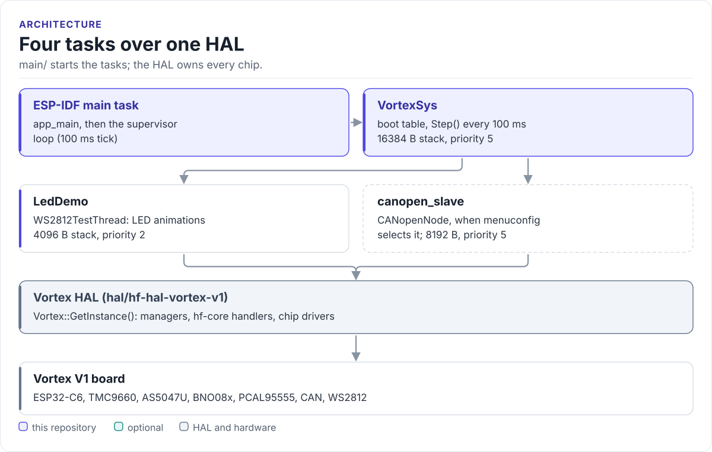

# Vortex V1 firmware

ESP-IDF firmware for the HardFOC Vortex V1 single-axis motor controller (ESP32-C6, TMC9660): table-driven boot
through the Vortex HAL, a health supervisor, and a CANopen device built from one object dictionary.

[](https://github.com/hardfoc/hardfoc-vortex-v1/actions/workflows/host.yml)
[](https://hardfoc.github.io/hardfoc-vortex-v1/latest/)
[](LICENSE)

**Documentation: [hardfoc.github.io/hardfoc-vortex-v1](https://hardfoc.github.io/hardfoc-vortex-v1/latest/)**

<!-- figure: firmware-tasks -->
<picture>
  <source media="(prefers-color-scheme: dark)" srcset="docs/diagrams/firmware-tasks.dark.svg">
  
</picture>
<!-- /figure -->

## Build and flash

```bash
git clone https://github.com/hardfoc/hardfoc-vortex-v1.git && cd hardfoc-vortex-v1
git submodule update --init hal/hf-hal-vortex-v1
git -C hal/hf-hal-vortex-v1 submodule init
git -C hal/hf-hal-vortex-v1 config submodule.docs/hf-development-handbook.update none
git submodule update --init --recursive
idf.py build                      # ESP-IDF v5.5, target esp32c6 (committed sdkconfig)
idf.py -p PORT flash monitor
```

## What it does

- `app_main` starts one orchestrator task, `VortexSys`, which runs an ordered boot table: HAL, LED demo, CAN worker.
- A non-recoverable boot failure tears down the completed steps and reboots after 2 s.
- The supervisor checks HAL health every 5 s, logs status every 10 s and runs read-only HAL demos; it never moves the
  motor on a timer.
- An optional CANopenNode CiA 301 slave runs on the CAN port (menuconfig; a bring-up shim today).
- `od/vortex_od.yaml` generates the CANopenNode dictionary, the EDS, C++ and Python identifiers and the reference
  page; CI fails on drift.
- `contracts/` holds the CiA 402, fault, routing and parameter-store rules, tested on the host with sanitizers.

## Documentation

| Page | What it covers |
| --- | --- |
| [Getting started](https://hardfoc.github.io/hardfoc-vortex-v1/latest/getting-started/) | Toolchain, build, flash, the boot log |
| [Architecture](https://hardfoc.github.io/hardfoc-vortex-v1/latest/architecture/) | Layers, boot table, state machine, supervisor |
| [Threads](https://hardfoc.github.io/hardfoc-vortex-v1/latest/threads/) | Every task with its stack, priority and period |
| [Safety](https://hardfoc.github.io/hardfoc-vortex-v1/latest/safety/) | What protects the drive today and what is designed |
| [CANopen](https://hardfoc.github.io/hardfoc-vortex-v1/latest/canopen/) | Slave runtime, object dictionary, host tools |
| [Design notes](https://hardfoc.github.io/hardfoc-vortex-v1/latest/design/) | CANopen node and drive observability designs |

The board itself (pins, buses, managers) is documented with the
[Vortex V1 HAL](https://hardfoc.github.io/hf-hal-vortex-v1/latest/).

## Tests

```bash
cd tests/host && cmake --preset host-debug && cmake --build --preset host-debug && ctest --preset host-debug
```

## License

GPL-3.0; see [LICENSE](LICENSE).
