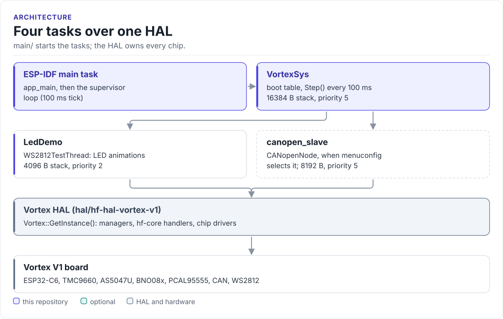
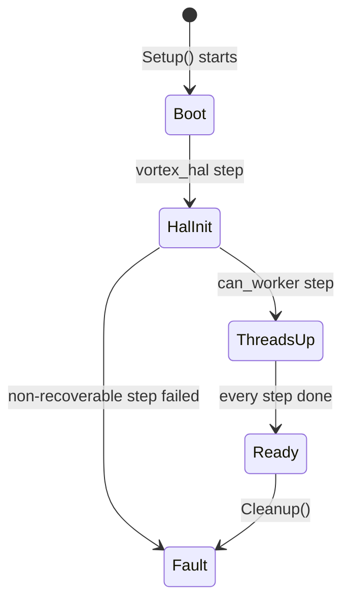

# Architecture

How the firmware is put together: the layers, the boot table, the system state machine and the supervisor loop.

<!-- figure: firmware-tasks -->
<picture>
  <source media="(prefers-color-scheme: dark)" srcset="diagrams/firmware-tasks.dark.svg">
  
</picture>
<!-- /figure -->

## Layers

| Layer | Where | What it owns |
| --- | --- | --- |
| Application | [`main/`](../main/) | `app_main`, the orchestrator, the supervisor, worker threads |
| Contracts | [`contracts/`](../contracts/) | Header-only rules (CiA 402, fault policy, routing, store codec, OD ids); no RTOS, no HAL; host-tested, not yet linked into the firmware |
| Object dictionary | [`od/`](../od/) | `vortex_od.yaml` and everything `tools/odgen` generates from it |
| HAL | `hal/hf-hal-vortex-v1` (submodule) | The `Vortex` singleton, managers, hf-core handlers, chip drivers, CANopenNode ([HAL docs](https://hardfoc.github.io/hf-hal-vortex-v1/latest/architecture/)) |
| Platform | ESP-IDF v5.5 | FreeRTOS, drivers, the build system |

The application is the ESP-IDF `main` component. The root `CMakeLists.txt` adds only the HAL to
`EXTRA_COMPONENT_DIRS`; the HAL builds hf-core and the drivers itself. There is no middleware layer: anything shared
lives in the HAL.

## Source map

| Path | Role |
| --- | --- |
| `main/app_main.cpp` | IDF entry: logger, start the orchestrator, wait for boot, run the supervisor |
| `main/apps/system/sub_threads/VortexSystemThread.{h,cpp}` | `vortex_app::VortexSystemThread`: the boot table and `Step()` |
| `main/apps/system/api/VortexSystemStateMachine.{h,cpp}` | `vortex_app::VortexSystemStateMachine`: the coarse lifecycle state |
| `main/apps/supervisor/VortexSupervisor.{h,cpp}` | `RunVortexSupervisorLoop()`: health checks, status logs, HAL demos |
| `main/apps/node/sub_threads/ws2812/` | `WS2812TestThread` (task `LedDemo`) |
| `main/apps/node/canopen/` | The CANopen device: `CoNode`, `FrameRouter`, the `co_svc` task and `CanopenDevice`, built only when menuconfig selects it ([CANopen](canopen.md)) |
| `main/utils/vortex_demos.h` | Declarations of older demo functions; nothing implements them |
| `main/Kconfig.projbuild` | The **HardFOC Vortex main (app)** menu |

## Boot table

`VortexSystemThread::Setup()` walks `kInitSequence` in order. A failed step marked recoverable is logged and boot
continues; a failed non-recoverable step moves the state machine to `Fault`, tears down the steps that completed,
in reverse order, and makes `Setup()` return false.

| Step | Recoverable | Setup | Teardown |
| --- | --- | --- | --- |
| `vortex_hal` | no | `Vortex::GetInstance().EnsureInitialized()` | `Vortex::Shutdown()` |
| `ws2812` | yes | `EnsureInitialized()` and `Start()` of the `LedDemo` thread | `Stop()` |
| `can_worker` | yes | With menuconfig **None**: nothing. With **CANopen device**: `StartCanopenDevice()` on `CommChannelsManager::GetEspCan()` | `StopCanopenDevice()` |

Adding a step means adding a `Setup*` / `Teardown*` pair and a row to `kInitSequence[]` in
`VortexSystemThread.cpp`. [Boot and updates](boot-and-ota.md) follows the whole sequence from reset.

## System state machine

`VortexSystemStateMachine` holds one atomic `VortexSystemState` and the reason of the last change.
`TryTransition()` stores the new state without a guard table; the states mark milestones for logs.

## Supervisor loop

After boot, `RunVortexSupervisorLoop()` runs on the ESP-IDF main task and does not return. It prints a banner, the
ESP-IDF version, chip information and `Vortex::GetSystemDiagnostics()`, then loops every 100 ms:

| Period | Counter condition | Work |
| --- | --- | --- |
| 2 s | `count % 20 == 0` | Toggle the status LED between `STATUS_OK` and `STATUS_BOOT` |
| 5 s | `count % 50 == 0` | `Vortex::PerformHealthCheck()`; LED `STATUS_WARN` on failure, `STATUS_OK` otherwise |
| 10 s | `count % 100 == 0` | Log uptime and free heap; log whether `LedDemo` runs |
| 20 s | `count % 200 == 0` | GPIO (pulses `GPIO_EXT_GPIO_CS_1` high for 200 ms, reads PCAL GPIO17/18), ADC and temperature reads, LED (four status animations, 0.5 s each) |
| 20 s, offset 10 s | `count % 200 == 100` | Motor controller, IMU and encoder demos: handler lookups, device counts, encoder angle and velocity (reads only) |

The demos address pins and channels by their HAL names (`GPIO_EXT_GPIO_CS_1`, `ADC_TMC9660_AIN3`); the names are
in the [HAL pin map](https://hardfoc.github.io/hf-hal-vortex-v1/latest/hardware/pin-map/).

## Design choices

- **A thin `app_main`.** Boot order and teardown live in one table that can be read top to bottom.
- **Static stacks.** `VortexSystemThread` and `WS2812TestThread` pass member arrays to `CreateBaseThread()`; only
  CANopenNode allocates (`CO_new()` and an 8192-byte task stack).
- **One owner per bus direction.** Only one task may drain `BaseCan::ReceiveMessage()` on the CANopen bus, which is
  why the CAN worker is a menuconfig choice with one option at a time.
- **Rules before integration.** The CiA 402 and fault tables are written and host-tested in `contracts/` before the
  firmware uses them ([design notes](design/canopen-node.md)).

Next: [Threads](threads.md).
