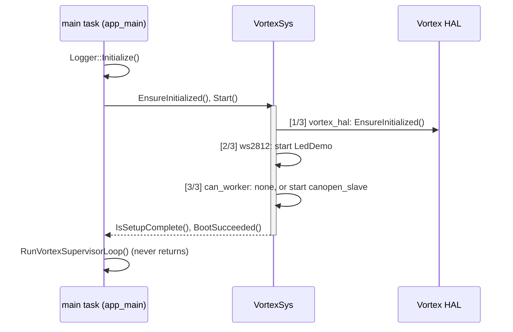

# Boot and updates

What happens from reset to the supervisor loop, what makes the board reboot, and how firmware gets onto it.

## From reset to the supervisor

1. `app_main` initialises the logger, so every later step can log.
2. It creates the `VortexSys` task (`EnsureInitialized()`) and starts it (`Start()`). `Setup()` runs on that task,
   not on the main task.
3. The main task waits until `IsSetupComplete()` is true, for at most `ComputeVortexBootTimeoutMs()` = 120 000 ms.
4. It checks `BootSucceeded()`, which `Setup()` sets only after the last step.
5. It enters `RunVortexSupervisorLoop()`. By then the HAL is initialised and the workers run.

The [architecture page](architecture.md#boot-table) lists the boot steps and what each one tears down.

## When the board reboots

`app_main` calls `ResetWithDiagnostic()`, which logs `FATAL: <reason> — rebooting in 2000 ms` with tag `MAIN`, waits
2 s and calls `esp_restart()`, in four cases:

| Reason in the log | Cause |
| --- | --- |
| `VortexSystemThread EnsureInitialized failed` | The orchestrator task could not be created |
| `VortexSystemThread Start failed` | The task could not be started |
| `VortexSystemThread Setup did not complete in time` | `Setup()` took more than 120 s |
| `VortexSystemThread boot sequence failed` | `vortex_hal` failed: the HAL did not initialise |

The `ws2812` and `can_worker` steps never cause a reboot; their failures are logged as warnings and boot goes on.
The task watchdog (5 s, idle task) can also reset the chip; see [Threads](threads.md#watchdog).

## Flash layout

| Setting | Value (`sdkconfig`) |
| --- | --- |
| Flash size | 2 MB (`CONFIG_ESPTOOLPY_FLASHSIZE_2MB`), DIO |
| Partition table | ESP-IDF single app, `partitions_singleapp.csv` (`CONFIG_PARTITION_TABLE_SINGLE_APP`), offset `0x8000` |
| App rollback | off (`CONFIG_BOOTLOADER_APP_ROLLBACK_ENABLE` not set) |

## Firmware updates

There is no over-the-air update today: the single-app partition table has no second app slot, and nothing in
`main/` calls the OTA API. Update the firmware over USB with `idf.py -p PORT flash`, or flash the `build/*.bin`
files from the `fw-release-v5.5-*` artifacts CI keeps for 14 days.

The [CANopen node design](design/canopen-node.md#101-keep--change--delete) moves to a two-OTA partition table to
prepare firmware download over CANopen (CiA 302-3, objects `0x1F50` / `0x1F51`); the protocol itself is out of
scope for that design.

Next: [Safety](safety.md).
