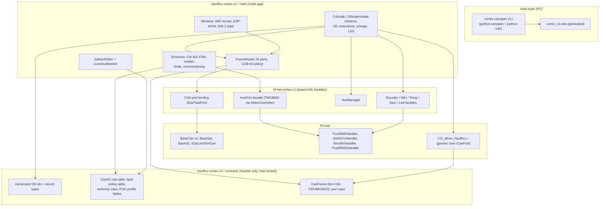
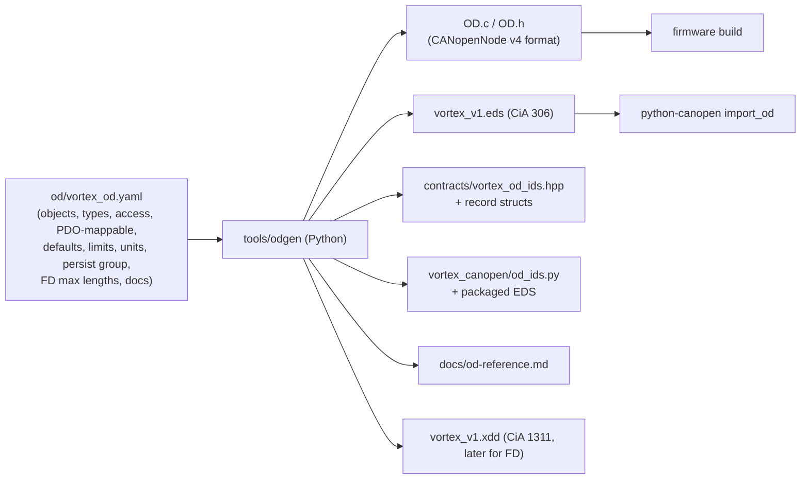
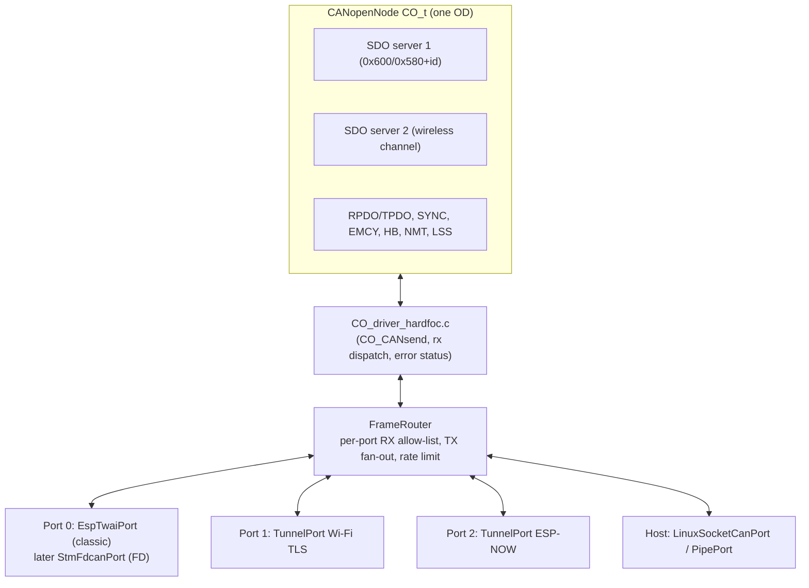
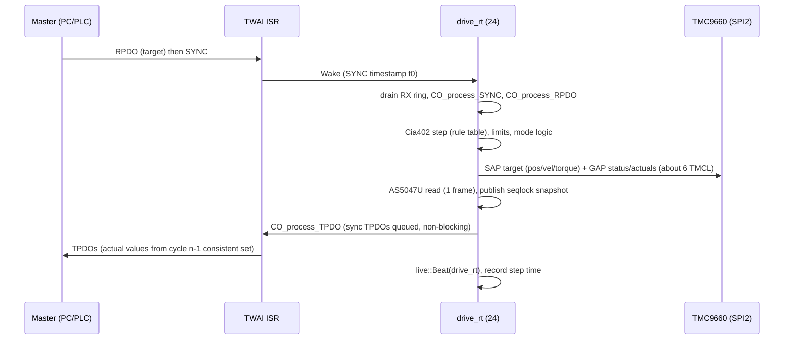
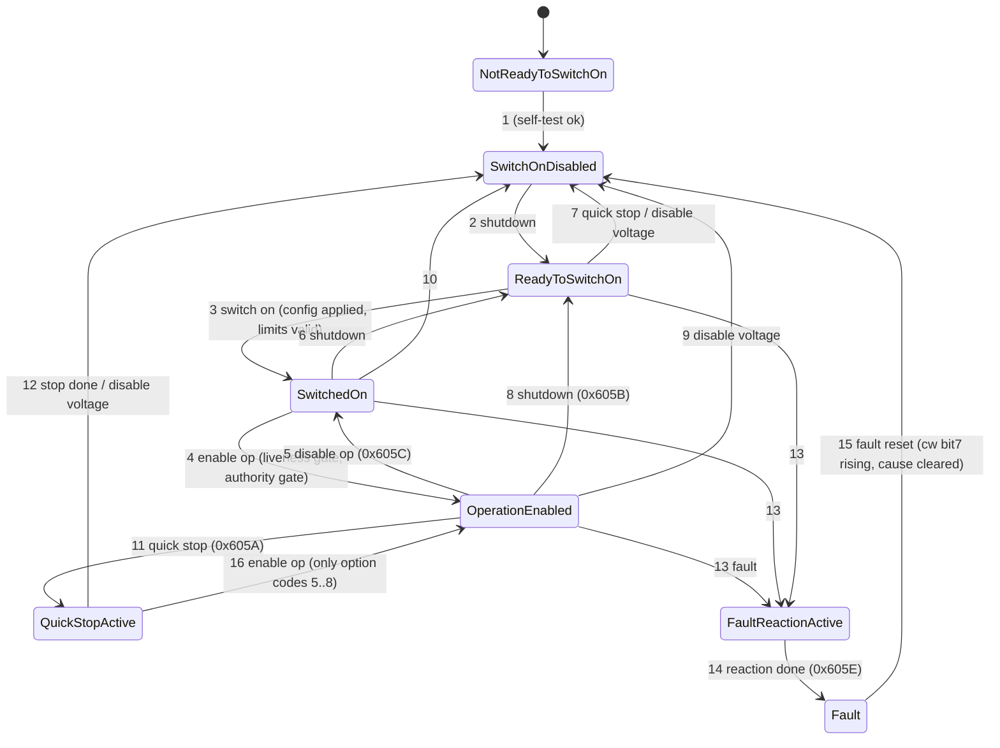
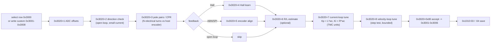
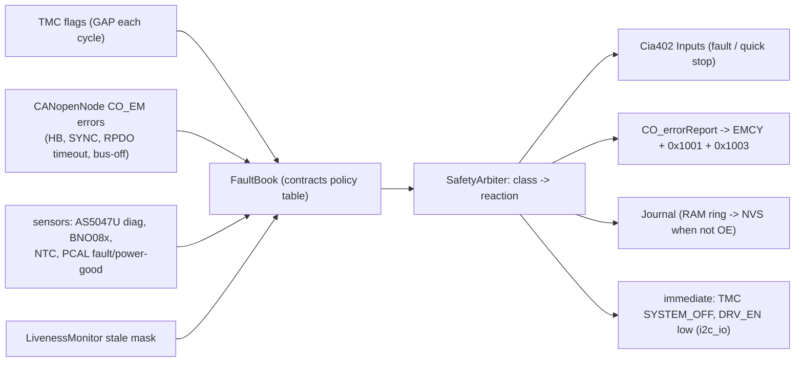
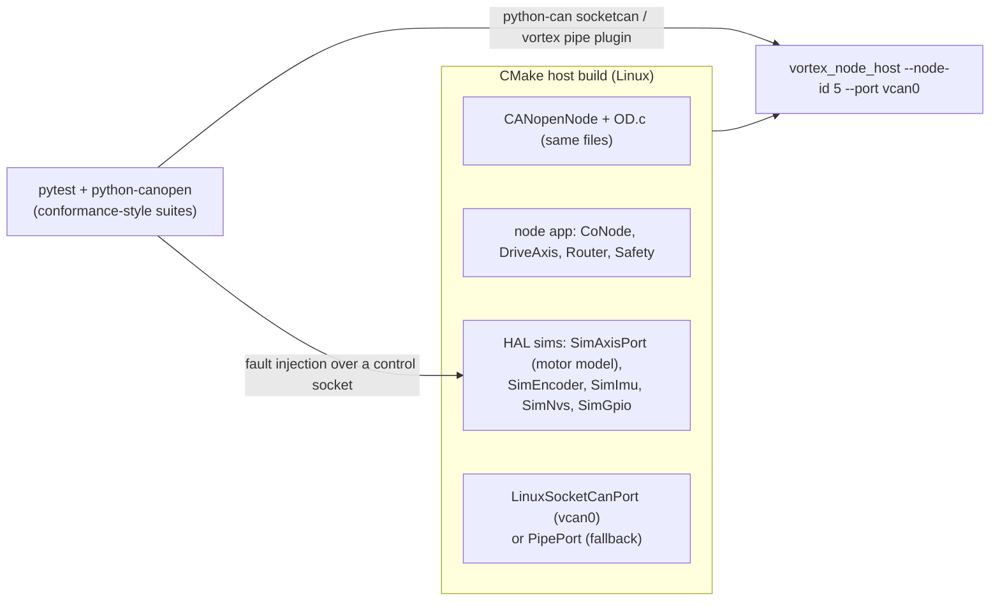

# Vortex V1 CANopen Device: Design

| | |
|---|---|
| Status | Draft for owner review |
| Date | 2026-11-01 |
| Scope | Firmware, tooling and verification for a CiA 301 / 305 / 402 CANopen device on the HardFOC Vortex V1 board, with wireless access paths and a CAN FD migration route |
| Code base read | `hf-hal-vortex-v1@28f1a63` (branch `ci/fix-workflows`), `hardfoc-vortex-v1@0d98cde` (branch `ci/fix-workflows`), `hf-core@54cbb5e` (main; submodules `hf-core-utils@2f7e1da`, `hf-utils-canopen@242a88e`, `hf-internal-interface-wrap@ba7f5ca`), `hf-vortex-driver@68cd06d`, `hf-tmc9660-driver@bc3cfcc`, `hf-as5047u-driver@8b4f7a9`, `hf-bno08x-driver@9936d27`, `hf-pincfg@6b8354d`, CANopenNode `ac21407` (v4, 2025-11-22) |
| Reference architecture | `pw-controller-sw` (layering, `BaseThread` run control, rule-table state machines in contracts, safety arbiter, liveness-gated watchdog, host tests) |

Paths below are relative to the repository named in each section. Mermaid diagrams render on GitHub.

---

## 1. Summary

Vortex V1 should become a **CiA 402 servo drive node** on its CAN port. It should keep one object dictionary (OD), described in a single YAML source. That source generates the CANopenNode `OD.c/OD.h`, the CiA 306 EDS file, C++ index constants and the Python constants. Every transport carries the same CANopen services against that OD: the TWAI port today, a CAN FD port on a future STM32, ESP-NOW and Wi-Fi. Motion is driven by the TMC9660's own current, velocity, position and ramp loops. The ESP32-C6 runs the CiA 402 state machine, mode logic, limits, the fault arbiter and the communication stack. The repository already has the pieces (CANopenNode v4 as a submodule, a `CO_driver` shim, managers for every chip), but the current CAN path does not work on hardware (§3). The plan therefore rebuilds the integration rather than extending it.

Key decisions:

1. **Stack:** CANopenNode v4 (Apache-2.0, already vendored) behind a narrow `CoStack` seam, so a CiA 1301 stack can replace it later without touching application code.
2. **Single source of truth:** `od/vortex_od.yaml` generates firmware, EDS, documentation and Python. CI fails on drift.
3. **Transport router:** one `CO_CANmodule` that fans out to N `ICanPort` bindings, with per-port COB-ID policy. Wireless gets its own SDO server channel and read-only mirrors. It never gets motion authority by default.
4. **Threads:** one SYNC-driven real-time owner thread for SPI2 (TMC9660 + AS5047U). It runs as a short burst at the highest priority. A separate service thread handles SDO, storage and NMT. An I2C owner thread handles the PCAL95555 and BNO08x. A safety monitor gates the task watchdog. The TMC9660's own SPI heartbeat is the independent last-resort stop.
5. **Wireless:** Wi-Fi with a TLS tunnel that python-can can use as a bus, so the same tools work over Wi-Fi as over USB-CAN. CiA 309-3 ASCII is an optional extra. ESP-NOW is for a USB dongle that bridges to a PC (slcan). It also serves board-to-board links.
6. **Verification:** the same node application and OD build for Linux and run against `vcan0`, or against a pipe bus where `vcan` is unavailable. They are exercised by pytest and python-canopen against a simulated motor.

---

## 2. Goals, non-goals and requirements

### 2.1 Goals

- G1: A complete, conformant-in-spirit CANopen device on the board's CAN port: CiA 301 NMT, heartbeat, SYNC, TIME, EMCY, SDO (expedited, segmented, block), PDO with runtime mapping, 0x1010/0x1011 store/restore, identity, and CiA 305 LSS.
- G2: Easy to exercise with a USB-CAN adapter on Windows, Linux or macOS, using a single `pip install` tool.
- G3: Motor-agnostic. BLDC/PMSM, stepper and brushed DC, with Hall, ABN, SPI-encoder or open-loop feedback, are selected and commissioned through OD objects. No rebuild is needed.
- G4: Expose the IMU (BNO08x), the absolute encoder (AS5047U), temperatures, power rails, spare GPIO, expansion slots and the LED.
- G5: Extra access paths over Wi-Fi and ESP-NOW that use the same OD semantics and never weaken safety.
- G6: CAN FD on a future STM32 should be a port-binding and stack-configuration change, not an application rewrite.

### 2.2 Non-goals (this design)

- CiA 402-4 functional safety (STO/SS1 certification). The design is safety-aware, but nothing in it is safety-rated.
- Firmware update over CANopen (CiA 302-3, 0x1F50/0x1F51). The partition layout is prepared for it (§10, step 12). The protocol is deferred.
- Acting as an NMT master or CiA 402 master for other drives. This is what the current `CANOpenBLDCThread` does, and it is removed (§10).
- CANopen safety (SRDO, CiA 304), CiA 302 network management, and Thread/Zigbee on 802.15.4.
- CiA conformance certification. Conformance-*style* tests are in scope. Certification needs a CiA vendor ID and a test house (open question Q1).

### 2.3 Requirements

| ID | Requirement | Owner ask | Verified by |
|---|---|---|---|
| R1 | Node implements CiA 301 services in §2.1 G1 with CANopenNode v4 | complete CANopen node | host CI conformance suite (§9.4) |
| R2 | CiA 305 LSS: node-ID and bit-rate configuration, fastscan, persistent store | complete node, USB-CAN | `test_lss.py`, bench |
| R3 | CiA 402 state machine (0x6040/0x6041), modes pp, pv, tq, hm, csp, csv, cst; ip reported unsupported in 0x6502 | many motors | `test_402_fsm.py`, bench demos |
| R4 | OD generated from one source. EDS shipped and identical to firmware OD (CI drift check) | USB-CAN usability | CI `od-drift` job |
| R5 | `vortex-canopen` Python CLI over any python-can interface and over the Wi-Fi tunnel | USB-CAN usability, wireless | CLI smoke tests in CI |
| R6 | Motor/feedback catalog rows and commissioning procedures in the OD | many motors and feedbacks | sim tests + bench matrix |
| R7 | IMU, encoder, temperatures, rails, GPIO, LED in manufacturer area with PDO-mappable packed variants | expose IMU and expansions | `test_manufacturer_area.py` |
| R8 | Every detected fault maps to one EMCY code, error-register bits and a CiA 402 reaction from one table | safety | table-driven host test |
| R9 | Heartbeat-consumer loss, RPDO timeout and SYNC loss trigger the 0x6007 abort-connection reaction | safety | fault-injection tests |
| R10 | 0x1010/0x1011 persist to NVS with records keyed by OD address and survive OD layout changes | persistence | `test_storage.py`, migration fixtures |
| R11 | Wireless transports reach the same OD. Enabling the drive over wireless is refused unless policy allows it | wireless, safety | `test_authority.py` |
| R12 | Frame type, port capabilities and PDO length checks are FD-ready. No 8-byte assumptions above the port binding | CAN FD on STM32 | static check + host FD build (`CO_PDO_MAX_SIZE` test, §8) |
| R13 | 1 kHz SYNC with one node at 1 Mbit/s and an RT step ≤ 300 µs WCET on the C6 | performance | on-target timing histogram object 0x4201 |

---

## 3. What exists today (verified)

| Area | Fact | Evidence |
|---|---|---|
| CANopenNode | v4 submodule at `third_party/CANopenNode` (commit `ac21407`). Compiled only when `CONFIG_HARDFOC_HAL_CANOPENNODE_SLAVE` is set | `hf-hal-vortex-v1/Kconfig`, `CMakeLists.txt:57-75`, `hf-core/cmake/hf_core_build_settings.cmake:460-494` |
| OD | The build compiles the **upstream example** `example/OD.c` (DS301 profile, 1 SDO server, 4 RPDO, 4 TPDO). It has no CiA 402 or manufacturer objects | `hf_core_build_settings.cmake:492`, `third_party/CANopenNode/example/OD.h:45-48` |
| Storage | `example/CO_storageBlank.c` is compiled, so 0x1010/0x1011 do nothing | same file, line 479 |
| Missing stack modules | `CO_fifo.c`, `crc16-ccitt.c` and `CO_gateway_ascii.c` are not compiled, and `CO_CONFIG_FIFO`/`CO_CONFIG_CRC16` default to 0. So there is no SDO block transfer and no gateway | `301/CO_config.h:706,739` |
| Driver shim | `hf-core/handlers/common/canopen/CO_driver_vortex.c`. Software RX dispatch. `CO_CANsend` calls the registered TX hook **inside** `portENTER_CRITICAL`. The hook ends in `EspCan::SendMessage` → `twai_node_transmit(timeout)` + `vTaskDelay`. That is a blocking call inside a critical section. `CO_CANmodule_process` is empty, so `bufferFull` frames are never retried and error-state bits are never reported to the stack | `CO_driver_vortex.c:16-18,145-178,200`; `CO_driver_target.h` lock macros |
| RX path | `CanopenSlaveRuntime` polls `BaseCan::ReceiveMessage(m, 0)`. `EspCan::ReceiveMessage` unconditionally returns `CAN_ERR_UNSUPPORTED_OPERATION`. **The slave never receives a frame.** The same applies to `CANOpenBLDCThread` (via `CanOpenBaseCanLink::Read`) | `hardfoc-vortex-v1/main/apps/node/canopen/CanopenSlaveRuntime.cpp:75`; `hf-internal-interface-wrap/src/mcu/esp32/EspCan.cpp:282-294`; `CANOpenBLDCThread.cpp:114` |
| EspCan RX | The RX callback runs in ISR context (`twai_node_receive_from_isr`) and calls the user callback from the ISR. Its conversion error path calls `ESP_LOGE` in ISR context | `EspCan.cpp:766-800,952-963` |
| EspCan TX | Adds `vTaskDelay(pdMS_TO_TICKS(1))` after **every** successful transmit ("prevent driver overload") | `EspCan.cpp:262-266` |
| Tick rate | `CONFIG_FREERTOS_HZ=100`, so `pdMS_TO_TICKS(1) == 0`. The slave task loop (`vTaskDelay(pdMS_TO_TICKS(1))`, priority 5) is a busy yield that starves the idle task. `CONFIG_ESP_TASK_WDT_CHECK_IDLE_TASK_CPU0=y` with a 5 s timeout, so a TWDT trip is likely. (Inferred from config, not bench-verified.) | `hardfoc-vortex-v1/sdkconfig:1077,1120`; `CanopenSlaveRuntime.cpp:98` |
| Bit rate | 500 kbit/s hard-coded in two places | `CommChannelsManager.cpp:282`; `CanopenSlaveRuntime.cpp:117` |
| Build break | `VortexSystemThread.cpp` includes `VortexCanHostThread.h` unconditionally, and that file does not exist in any repository | `apps/system/sub_threads/VortexSystemThread.cpp:2`; `find` over all clones |
| `BaseCan` FD | `hf_can_message_t` has FD flags (`is_canfd`, `is_brs`, `is_esi`, `canfd_dlc`) but `data[8]`. `SetDLC()` accepts 64 for FD frames. That is a latent buffer overrun, because the struct only *pretends* to model FD | `hf-internal-interface-wrap/inc/base/BaseCan.h:165-235` |
| STM32 | `StmCan` wraps bxCAN or FDCAN. The FD data phase is "requires HAL extensions" | `inc/mcu/stm32/StmCan.h:3-8` |
| TWAI hardware | ESP-IDF documents **two** TWAI controllers on the C6, classic only. FD frames are treated as errors. There is one mask filter (or a dual 16-bit split). The RX callback runs in ISR context. Vortex routes one controller (TX GPIO14, RX GPIO15) | [IDF TWAI (C6)](https://docs.espressif.com/projects/esp-idf/en/stable/esp32c6/api-reference/peripherals/twai.html); `hf_functional_pin_config_vortex_v1.hpp:95-96` |
| Transceiver standby | `PCAL_CAN_HS_STB_OP` (PCAL95555 P10) is defined, but no code in the HAL or examples drives it. If the transceiver's STB defaults to standby, the bus is silent. Verify against the schematic | `grep` over `hf-hal-vortex-v1/lib`, `examples` |
| Host client | `hf-vortex-driver` is NMT plus expedited SDO download only. `VortexProtocol.hpp` names 0x1021 as "Error behavior". In CiA 301 that object is 0x1029 (0x1021 is Store EDS) | `inc/vortex/VortexProtocol.hpp:21` |
| Helpers | `docs/helpers/usb_can/*.py` hand-builds frames with python-can (no python-canopen). A `__pycache__` directory is committed | `hardfoc-vortex-v1/docs/helpers/usb_can/` |
| TMC9660 | Parameter-mode driver with motor types NONE/DC/STEPPER/BLDC, commutation modes (open-loop V/I, ABN, Hall, SPI encoder), velocity/position sensor selection, ramp, reference search, brake, I²t, protection, stop events and an **SPI/UART heartbeat monitor** (`HEARTBEAT_MONITORING_CONFIG/TIMEOUT`). Erratum 4: target updates are serviced in a ~1 kHz internal loop | `hf-tmc9660-driver/inc/tmc9660.hpp:465-5044`, `parameter_mode/tmc9660_param_mode_tmcl.hpp:460,1569,1752,2898,5028,5106`; `examples/esp32/main/common/vortex_bench_safety.hpp:169-173` |
| Feedback wiring | The AS5047U is on the **host** SPI2 (CS GPIO20), not on the TMC SPI-encoder port. Hall/ABN need a bootloader `BootloaderConfig` mux. Closed loop on AS5047U is "static unless wired through SPI-enc on the TMC" | `examples/esp32/docs/BENCH_MATRIX.md:28-34,63`; `BLDC_BRINGUP.md:19` |
| Expansion | `EXT_GPIO_CS_1` (GPIO19) and `EXT_GPIO_CS_2` (GPIO8) are external SPI2 chip selects. `MotorController` reserves device slots 2 and 3 for external TMC9660s. `EncoderManager`/`ImuManager` have external slots. There is a UART (GPIO4/5), and PCAL95555 bits 0, 7, 8, 9 are unassigned | pin map lines 88-131; `MotorController.h` (`MAX_TMC9660_DEVICES=4`, indices 2/3) |
| Persistence | `NvsManager` exposes namespaces `vortex`, `vortex_cal`, `vortex_cfg`. The partition table is single-app (no OTA) | `lib/managers/NvsManager.cpp:26-28`; `sdkconfig:597` |
| Version info | HAL CMake already generates `HF_HAL_GIT_SHA_*` macros per submodule | `hf-hal-vortex-v1/CMakeLists.txt:353-380` |

Conclusion: keep the CANopenNode submodule, the CMake gate idea, the managers and the TMC9660/AS5047U/BNO08x handlers. Rewrite the driver binding, runtime, OD, storage and tooling.

---

## 4. Architecture

### 4.1 Layers

The layout follows `pw-controller-sw/firmware/README.md`. A header-only contracts package holds the shared types and pure rule tables. The HAL owns hardware, the app owns threads, and host tests link only contracts and the app logic.



Rules (adapted from `pw-hal/README.md` "Design rules"):

1. The node app never includes `twai.h`, `EspCan.h` or chip drivers. It uses HAL facades (`AxisPort`, `ImuFacade`, …) and the `ICanPort` interface.
2. Contracts contain no `.cpp`, no RTOS and no HAL. They hold the CiA 402 transition table, fault policy table, authority rules, PDO profile tables and generated OD identifiers. Host tests use them directly.
3. One bus has one owner thread (see `pw-controller-sw/docs/software/threading-model.md` §4): SPI2 belongs to `drive_rt`, and I2C belongs to `i2c_io`.
4. Hot paths bind once at init. They do no string lookups (`GpioManager::Get(std::string_view)`) per cycle.

### 4.2 Object dictionary as the single source of truth



- The YAML schema mirrors the CiA 306 attributes: `ParameterName`, `ObjectType`, `DataType`, `AccessType`, `PDOMapping`, `DefaultValue`, `LowLimit`/`HighLimit`. It adds: `persist: comm|app|cal|none`, `od_extension: <C++ handler>` (dynamic objects served from snapshots), `fd_only: bool` and `units`.
- `odgen` writes `OD.c/OD.h` in the exact CANopenNode v4 layout. A CI job cross-checks the output by importing the generated EDS with the pinned [CANopenEditor](https://github.com/CANopenNode/CANopenEditor) EDSSharp CLI, exporting "CANopenNode V4", and diffing the structural content (entries, sub-counts, attributes). The in-house emitter is primary because it runs anywhere without .NET. CANopenEditor is the independent oracle. (CANopenEditor lists EDS, XDD v1.0/1.1, CANopenNode V4 and Markdown exporters. Confirm the CLI flag names against the pinned release.)
- The drift gate is `odgen --check` in CI. It regenerates every artefact and fails if any checked-in file differs, or if `0x1018:03` revision / OD hash (0x5FFE) was not bumped when the dictionary changed.

### 4.3 Transport abstraction

All CANopen semantics live in one CANopenNode instance. Transports are *ports* under one `CO_CANmodule`.



`contracts/can_frame.hpp`:

```cpp
struct CanFrame {             // transport-neutral; FD-sized from day one
  uint32_t id;                // 11- or 29-bit
  uint8_t  len;               // 0..8 classic, 0..64 FD (bytes, not DLC code)
  uint8_t  flags;             // EXT | RTR | FDF | BRS | ESI
  uint8_t  data[64];
  uint32_t ts_us;             // RX timestamp (ISR-captured)
};
struct PortCaps { bool fd; uint8_t max_len; uint32_t nominal_bps, data_bps; uint8_t hw_filters; };
class ICanPort {              // implemented per binding; Send is non-blocking
 public:
  virtual PortCaps Caps() const = 0;
  virtual TxResult Send(const CanFrame&) = 0;            // Ok | QueueFull | BusOff | NotAllowed
  virtual void SetRxSink(void (*sink)(void*, const CanFrame&), void* ctx) = 0; // ISR-safe sink
  virtual PortStatus Status() const = 0;                 // TEC/REC, state, overruns
  virtual bool Recover() = 0;                            // bus-off recovery request
};
```

Router policy, as a table in contracts:

| Port | RX accepted | TX sent | Notes |
|---|---|---|---|
| CAN (0) | everything except SDO-server-2 COB-IDs (dropped, so a CAN node cannot pose as the wireless client) | everything except SDO-server-2 responses | normal CANopen |
| Wi-Fi / ESP-NOW tunnel | SDO-server-2 requests. NMT and RPDO only if `0x2701 authority policy` allows | SDO-server-2 responses, plus subscribed mirrors of HB, EMCY and selected TPDOs (rate-limited per port, default ≤ 100 Hz each) | read-mostly by default |
| Host sim (P3) | as CAN | as CAN | CI |

SDO server 2 (0x1201) is predefined with *virtual* COB-IDs (client→server 0x6C0+id, server→client 0x5C0+id, documented as tunnel-only). These IDs never appear on the physical bus. For human or script access, the CiA 309-3 gateway (`CO_gateway_ascii.c`) uses CANopenNode's local SDO client (`CO_CONFIG_SDO_CLI_LOCAL`, `301/CO_config.h:401`), so ASCII commands for the node's own ID access the OD without bus traffic. Together this gives identical SDO semantics everywhere: the same abort codes, the same OD extension handlers and the same access checks.

The C++ side has no 8-byte assumptions. `CO_CANrxMsg_t` and `CO_CANtx_t` in the new `CO_driver_target.h` carry `data[CO_CAN_MAX_LEN]`, which is 8 on classic builds and 64 on FD builds. The router rejects any frame longer than the destination port's `Caps().max_len`, and the PDO layer checks mapped length against `CO_PDO_MAX_SIZE` (§8).

### 4.4 Threads, priorities and timing on the single-core C6

Platform facts: ESP32-C6, one HP RISC-V core at 160 MHz (`CONFIG_ESP_DEFAULT_CPU_FREQ_MHZ=160`). ESP-IDF built-in priorities are Wi-Fi 23, esp_timer 22, event loop 20 and lwIP 18. Espressif reserves 24 for very short timing-critical bursts and advises that network-using tasks run below 18 ([IDF speed guide](https://docs.espressif.com/projects/esp-idf/en/stable/esp32c6/api-guides/performance/speed.html)). Prerequisite: set `CONFIG_FREERTOS_HZ=1000`.

| Thread / context | Prio | Trigger / period | Owns | Budget | Liveness |
|---|---|---|---|---|---|
| TWAI ISR | ISR | RX/TX/error | none (copies to lock-free ring, timestamps, `Wake(drive_rt)` on SYNC/RPDO COB-IDs, `Wake(co_svc)` on others) | < 5 µs/frame | n/a |
| gptimer ISR | ISR | free-run tick when no SYNC is configured (default 1 ms) | none | < 2 µs | n/a |
| `drive_rt` | 24 | SYNC (or gptimer) event; 2 ms backstop | **SPI2** (TMC9660, AS5047U), CiA 402 FSM, RPDO/TPDO processing | WCET ≤ 300 µs at 1 kHz (step aborted to safe stop if > 1 ms) | critical, 5 ms |
| `safety` | 21 | 5 ms fixed rate | `LivenessMonitor`, `SafetyArbiter`, task-WDT feed | ≤ 50 µs | n/a (it *is* the monitor; TWDT watches it) |
| `i2c_io` | 19 | PCAL INT (GPIO23) events + 10 ms backstop | **I2C** (PCAL95555: DRV_EN, faults, CAN STB; BNO08x) | blocking I/O, preemptible | critical, 100 ms |
| `co_svc` | 17 | CAN RX wake + 1 ms timer-next (CANopenNode `timerNext_us`) | `CO_process` (NMT, HB producer/consumer, EMCY, SDO servers incl. block, LSS, TIME), OD extensions, storage requests | ≤ 200 µs typical | critical, 50 ms |
| `wl_gw` | 15 | socket / ESP-NOW queue | TLS tunnel, ESP-NOW peer table, optional 309-3 | — | non-critical |
| `housekeep` | 6 | 100 ms | fault-journal flush (only when motion is not enabled), LED, diagnostics, NVS writes | — | non-critical, 1 s |
| `app_main` supervisor | 1 | 1 s | boot orchestration (`VortexSystemThread` init table) | — | — |

Notes:

- `drive_rt` at 24 is short by construction. The TMC9660 runs the fast loops (PWM-rate current loop and internal velocity/position loops), so each cycle is about six TMCL SPI exchanges plus one AS5047U read. Commissioning and bulk configuration (hundreds of TMCL writes) go through a **bounded service slot** in the same thread: at most N transactions per cycle, default 2. The bus therefore keeps a single owner, and RT jitter stays bounded. This is the `RunInBackground` lesson from the pw threading model, applied to a single core.
- Blocking chip bring-up (TMC bootloader, BNO08x reset) runs at boot before `drive_rt` starts, or in the service slot. It never runs inline at priority 24.
- `safety` sits below Wi-Fi and esp_timer. Its 5 ms deadline tolerates Wi-Fi bursts. The *fast* reactions do not depend on it: `drive_rt` enforces limits and stops on TMC fault flags in the same cycle, and the TMC9660 SPI heartbeat (§5.5) stops the motor if `drive_rt` itself stalls.
- Flash writes (NVS) stall cache-resident code on the C6. Storage is therefore **refused while the drive is in Operation Enabled**: 0x1010 returns SDO abort `0x08000022`, and journal writes are buffered in RAM (§6).

`drive_rt` cycle (cyclic synchronous modes):



### 4.5 Timing budget at 1 Mbit/s

Classic base-format data frame with *n* data bytes: 47 + 8*n* bits nominal (including 3-bit IFS). Worst-case bit stuffing adds ⌊(34 + 8*n* − 1)/4⌋ bits. At 1 Mbit/s an 8-byte frame takes 111 µs nominal and 135 µs worst case. SYNC (0 bytes) takes 47–55 µs.

Default CSP traffic per node per cycle: RPDO2 (controlword + target position, 6 B, ≤ 115 µs), TPDO2 (statusword + position actual, 6 B, ≤ 115 µs) and TPDO3 (statusword + velocity actual, 6 B, ≤ 115 µs). About 345 µs per node, plus a shared SYNC of 55 µs.

| SYNC rate | Nodes | Worst-case bus time / cycle | Bus load @ 1 Mbit/s | @ 500 kbit/s | Verdict |
|---|---|---|---|---|---|
| 1 kHz | 1 | 400 µs | 40 % | 80 % | OK at 1 M only |
| 1 kHz | 2 | 745 µs | 75 % | >100 % | marginal (avoid) |
| 500 Hz | 2 | 745 µs | 37 % | 75 % | OK |
| 500 Hz | 4 | 1435 µs | 72 % | >100 % | marginal |
| 250 Hz | 4 | 1435 µs | 36 % | 72 % | OK |
| 250 Hz | 8 | 2815 µs | 70 % | >100 % | marginal |

Planning rule: keep the worst case at or below 60 % of the cycle, leaving room for SDO, EMCY and HB. CPU estimate per 1 kHz cycle on the C6: RX drain about 20 µs, SYNC/RPDO/TPDO processing about 40 µs, FSM and limits about 10 µs, six TMCL exchanges at 10 MHz SPI about 150 µs (to be measured, about 25 µs each in polling mode), AS5047U about 15 µs. That is roughly 235 µs, or 24 % CPU. The TMC9660 samples targets in a ~1 kHz internal loop that is not phase-locked to SYNC (Erratum 4 note, `vortex_bench_safety.hpp:169`), so expect up to 1 ms of extra transport delay. **1 kHz is the ceiling. 250–500 Hz is the recommended default for csp/csv/cst.** 0x60C2 (interpolation time period) mirrors 0x1006, and `drive_rt` linearly interpolates targets when the SYNC period exceeds 1 ms.

---

## 5. Object dictionary plan

Data types use CiA 301 names (U8/U16/U32/I16/I32/R32/VS/DOM). Access: `ro`, `rw`, `wo`, `const`. "Map" means PDO-mappable. Persist groups: C (communication, 0x1010:02), A (application, 0x1010:03), K (calibration, 0x1010:04, manufacturer-specific). The full sub-index tables live in the YAML. This section fixes the layout.

### 5.1 Communication profile area (0x1000–0x1FFF)

| Index | Name | Notes | Persist |
|---|---|---|---|
| 0x1000 | Device type | `0x00020192`: profile 402 (0x0192), additional info = servo drive type 0x0002 (verify against CiA 402-2 §device type) | const |
| 0x1001 | Error register | bit0 generic, 1 current, 2 voltage, 3 temperature, 4 communication, 5 profile, 7 manufacturer | ro, map |
| 0x1003 | Pre-defined error field | 16 entries. Sub 0 write 0 clears | — |
| 0x1005 | COB-ID SYNC | 0x80; consumer | C |
| 0x1006 | Communication cycle period | µs. Used for SYNC timeout (1.5×) and interpolation | C |
| 0x1007 | Synchronous window length | TPDOs not sent after window | C |
| 0x1008 / 0x1009 / 0x100A | Device name / HW version / SW version | "HardFOC Vortex V1" / board rev / semver+git | const |
| 0x1010 | Store parameters | sub1 all, 2 comm, 3 app, 4 calibration. Signature `0x65766173` ("save"). Refused in Operation Enabled | — |
| 0x1011 | Restore default parameters | same subs, signature `0x64616F6C` ("load"). Takes effect after reset | — |
| 0x1012 | COB-ID TIME | 0x100; consumer. Sets the fault-journal wall clock | C |
| 0x1014 / 0x1015 | COB-ID EMCY / inhibit time EMCY | 0x80+id / default 10 (×100 µs) | C |
| 0x1016 | Consumer heartbeat time | 4 entries (node-ID, ms). Required for motion unless an RPDO timeout is set (§5.5) | C |
| 0x1017 | Producer heartbeat time | default 100 ms | C |
| 0x1018 | Identity | vendor ID (Q1), product code `0x00560001`, revision `(major<<16)|minor` (bumped on OD change), serial = low 32 bits of the eFuse MAC (LSS address) | const |
| 0x1019 | SYNC counter overflow | 0 (no counter) default | C |
| 0x1029 | Error behaviour | sub1 communication error → 0 = pre-operational (default); sub2 profile error → 1 = no change | C |
| 0x1200 | SDO server 1 | predefined 0x600+id / 0x580+id | — |
| 0x1201 | SDO server 2 | tunnel-only virtual COB-IDs (§4.3) | C |
| 0x1280 | SDO client 1 | local only (309-3 gateway). Absent if the gateway is disabled | — |
| 0x1400–0x1403 | RPDO1–4 communication | COB-ID, transmission type, event timer (= RPDO timeout monitor) | C |
| 0x1600–0x1603 | RPDO1–4 mapping | ≤ 8 entries (≤ 64 on FD build) | C |
| 0x1800–0x1807 | TPDO1–8 communication | COB-ID, type, inhibit, event timer, SYNC start | C |
| 0x1A00–0x1A07 | TPDO1–8 mapping | | C |
| 0x1F80 | NMT startup | bit2 = 0: wait for NMT start (default). Option to self-start for stand-alone demos | C |

LSS (CiA 305) has no OD objects. The node-ID and bit-rate are stored in their own NVS record (§6.3).

### 5.2 CiA 402 axis objects (axis 1 at 0x6000; axis *n* at 0x6000 + 0x800·(*n*−1))

Supported modes (0x6502): bit0 pp, bit2 pv, bit3 tq, bit5 hm, bit7 csp, bit8 csv, bit9 cst → `0x000003AD`. Velocity mode vl (bit1) and ip (bit6) are not supported. ip is covered by csp with interpolation.

| Index | Name | pp | pv | tq | hm | csp | csv | cst | Map | Implementation (TMC9660 / host) |
|---|---|---|---|---|---|---|---|---|---|---|
| 0x603F | Error code | ✓ | ✓ | ✓ | ✓ | ✓ | ✓ | ✓ | T | last EMCY code of this axis |
| 0x6040 / 0x6041 | Controlword / Statusword | ✓ | ✓ | ✓ | ✓ | ✓ | ✓ | ✓ | R/T | contracts rule table (§5.6) |
| 0x605A | Quick stop option code | ✓ | ✓ | ✓ | ✓ | ✓ | ✓ | ✓ | | default 2 (quick-stop ramp → Switch On Disabled) |
| 0x605B / 0x605C | Shutdown / disable operation option code | ✓ | ✓ | ✓ | ✓ | ✓ | ✓ | ✓ | | default 0 / 1 |
| 0x605D | Halt option code | ✓ | ✓ | ✓ | ✓ | ✓ | ✓ | ✓ | | default 1 (slow-down ramp) |
| 0x605E | Fault reaction option code | ✓ | ✓ | ✓ | ✓ | ✓ | ✓ | ✓ | | default 0 (disable drive, coast). 2 = quick-stop ramp only for faults where the bridge is healthy |
| 0x6007 | Abort connection option code | ✓ | ✓ | ✓ | ✓ | ✓ | ✓ | ✓ | | default 1 (fault). 3 = quick stop |
| 0x6060 / 0x6061 | Modes of operation / display | ✓ | ✓ | ✓ | ✓ | ✓ | ✓ | ✓ | R/T | mode switch only in Switched On, or in OE with velocity ≈ 0 |
| 0x6062 / 0x6064 | Position demand / actual | ✓ | | | ✓ | ✓ | | | T | TMC `ACTUAL_POSITION` (selected position sensor) |
| 0x6065 / 0x6066 | Following error window / timeout | ✓ | | | ✓ | ✓ | | | | host-side check → EMCY 0x8611 |
| 0x6067 / 0x6068 | Position window / time | ✓ | | | ✓ | | | | | target-reached bit 10 |
| 0x606B / 0x606C | Velocity demand / actual | | ✓ | | | | ✓ | | T | TMC velocity, converted to inc/s |
| 0x606D / 0x606E | Velocity window / time | | ✓ | | | | | | | |
| 0x6071 | Target torque | | | ✓ | | | | ✓ | R | ‰ of 0x6076 → TMC target torque mA via Kt and rated current |
| 0x6072 / 0x6073 | Max torque / max current | ✓ | ✓ | ✓ | ✓ | ✓ | ✓ | ✓ | | ‰. Clamped against the catalog row and the board limit (§6.2) |
| 0x6075 / 0x6076 | Motor rated current / torque | | | | | | | | | mA / mNm, from the catalog row |
| 0x6077 / 0x6078 | Torque / current actual | ✓ | ✓ | ✓ | ✓ | ✓ | ✓ | ✓ | T | ‰ |
| 0x6079 | DC link voltage | ✓ | ✓ | ✓ | ✓ | ✓ | ✓ | ✓ | T | mV (TMC supply ADC) |
| 0x607A | Target position | ✓ | | | | ✓ | | | R | |
| 0x607C | Home offset | | | | ✓ | | | | | |
| 0x607D | Software position limit | ✓ | | | | ✓ | | | | violation → 0x8612 |
| 0x607E | Polarity | ✓ | ✓ | ✓ | ✓ | ✓ | ✓ | ✓ | | maps to `MotorMechanics::invert_output` |
| 0x607F / 0x6080 | Max profile velocity / max motor speed | ✓ | ✓ | | ✓ | ✓ | ✓ | | | |
| 0x6081 / 0x6083 / 0x6084 | Profile velocity / acceleration / deceleration | ✓ | ✓ | | | | | | | TMC ramp generator |
| 0x6085 | Quick stop deceleration | ✓ | ✓ | ✓ | ✓ | ✓ | ✓ | ✓ | | TMC ramp with this deceleration on quick stop |
| 0x6086 | Motion profile type | ✓ | ✓ | | | | | | | 0 linear (TMC 8-point ramp parameters derived) |
| 0x6087 | Torque slope | | | ✓ | | | | | | host-side slew |
| 0x608F / 0x6091 / 0x6092 | Position encoder resolution / gear ratio / feed constant | ✓ | ✓ | | ✓ | ✓ | ✓ | | | user-unit scaling |
| 0x6098 / 0x6099 / 0x609A | Homing method / speeds / acceleration | | | | ✓ | | | | | methods 17–30 (switches via TMC REF inputs), 33/34 (index), 35/37 (current position). Others abort `0x06090030` |
| 0x60B0 / 0x60B1 / 0x60B2 | Position / velocity / torque offset | | | | | ✓ | ✓ | ✓ | R | feed-forward |
| 0x60C2 | Interpolation time period | | | | | ✓ | ✓ | ✓ | | mirrors 0x1006 |
| 0x60E0 / 0x60E1 | Positive / negative torque limit | ✓ | ✓ | ✓ | ✓ | ✓ | ✓ | ✓ | | |
| 0x60E4 | Additional position actual value | ✓ | ✓ | ✓ | ✓ | ✓ | ✓ | ✓ | T | sub1 = AS5047U multi-turn counts (host encoder) |
| 0x60F4 | Following error actual value | ✓ | | | | ✓ | | | T | |
| 0x60FD / 0x60FE | Digital inputs / outputs | ✓ | ✓ | ✓ | ✓ | ✓ | ✓ | ✓ | T/R | bit0 neg. limit, bit1 pos. limit, bit2 home (TMC REF), bits 16+ = board spare inputs |
| 0x60FF | Target velocity | | ✓ | | | | ✓ | | R | inc/s → TMC velocity units |
| 0x6402 / 0x6403 / 0x6404 | Motor type / catalog number / manufacturer | | | | | | | | | from catalog row (0x6402 values per CiA 402-2, e.g. 10 = sinusoidal PM brushless, 11 = trapezoidal, 9 = micro-step stepper; verify table) |
| 0x6502 | Supported drive modes | | | | | | | | | `0x000003AD` |

Multi-axis: a second or third TMC9660 on `EXT_GPIO_CS_1/2` (`MotorController` slots 2/3) appears as CiA 402 axis 2 at 0x6800 and axis 3 at 0x7000. Each axis has its own device type at 0x67FF / 0x6FFF and its own manufacturer block (§5.3). One `drive_rt` serves all axes. The SPI budget grows by about 150 µs per extra axis, so 3 axes are realistic only at 500 Hz or slower.

CiA 406 (encoder profile) uses the same 0x6000–0x67FF window as CiA 402 axis 1, so a combined device would need an extra logical device. The host AS5047U is therefore exposed through 0x60E4 plus a manufacturer block that follows the CiA 406 *naming* (position value, speed value, singleturn resolution, alarms, warnings). This keeps masters that understand 406 semantics easy to configure without consuming a logical device. CiA 410 (inclinometer) covers slope angles only, not quaternions, angular rate or magnetic field, so the IMU goes in the manufacturer area.

### 5.3 Manufacturer area (0x2000–0x5FFF)

Board-level objects are at 0x2000–0x2FFF. Axis-level objects are at 0x3000 + 0x400·(axis−1). The journal and service objects are at 0x4000–0x4FFF. Meta objects are at 0x5F00–0x5FFF.

| Index | Name | Content (sub-indices abbreviated) | Map | Persist |
|---|---|---|---|---|
| 0x2000 | Firmware build | VS app version, VS git SHAs (HAL, core, drivers, CANopenNode from `HF_HAL_GIT_SHA_*`), U32 build time, VS IDF version | | const |
| 0x2001 | Board info | U8 HW revision, 6-byte MAC, U32 reset reason, U32 uptime s, U32 free heap | | ro |
| 0x2002 | Component versions | TMC9660 FW/bootloader id, BNO08x SH-2 version, AS5047U id | | ro |
| 0x2100 | Encoder (AS5047U) control | U8 enable, U16 zero position, U8 direction, U8 ABI resolution bits, U8 DAEC enable | | K |
| 0x2101 | Encoder status | U16 angle raw, U16 angle compensated, I16 velocity raw, I32 multi-turn position, U8 AGC, U16 magnitude, U16 error flags, U32 comm errors | T | ro |
| 0x2200 | IMU control | U16 enabled-report mask, U16 rate per report (Hz): rotation vector, game RV, accel, gyro, mag, linear accel, gravity; U8 interrupt mode | | A |
| 0x2201–0x2207 | IMU values (R32 SI) | quaternion (i, j, k, real, accuracy rad), accel m/s², gyro rad/s, mag µT, linear accel, gravity, Euler deg | | ro |
| 0x2210 | IMU packed quaternion | 4×I16 Q14 (8 B, one TPDO) | T | ro |
| 0x2211 | IMU packed accel + seq | 3×I16 (1/256 m/s²) + U16 sample counter | T | ro |
| 0x2212 | IMU packed gyro + status | 3×I16 (1/1024 rad/s) + U8 calibration status + U8 accuracy | T | ro |
| 0x2220 | IMU calibration | U8 status per sensor (0–3), command: 1 save DCD, 2 tare, 3 reset | | — |
| 0x2300 | Temperatures | I16 0.1 °C: NTC (TMC AIN3), TMC chip, ESP32 die, motor (if fitted) | T | ro |
| 0x2301 | Power | U16 mV supply, U16 mV driver, BOOL power-good (PCAL P6) | T | ro |
| 0x2302 | Thermal limits | warning/fault thresholds per sensor | | A |
| 0x2400 | Spare GPIO config | per line: direction, pull, function (none, input, output, limit/home mirror) for PCAL P0/P7/P8/P9, TMC GPIO17/18 | | A |
| 0x2401 / 0x2402 | Spare GPIO inputs / outputs | bitfields | T/R | ro/rw |
| 0x2410 | Expansion slots | per `EXT_GPIO_CS_1/2`: U8 role (0 none, 1 external TMC9660 axis, 2 external AS5047U, 3 raw SPI), U32 SPI clock | | A (applied at boot) |
| 0x2411 | Expansion UART | U8 role (0 none, 1 TMCL bridge, 2 debug console), U32 baud | | A |
| 0x2500 | LED | U8 mode (0 CiA 303-3 status emulation, 1 manual, 2 off), U32 RGB, U8 brightness | | A |
| 0x2600 | Wireless config | enable mask (Wi-Fi, ESP-NOW, BLE), TLS port, ESP-NOW channel, peer MACs | | A |
| 0x2601 | Wireless secrets (wo) | Wi-Fi SSID/pass, TLS PSK identity/key, ESP-NOW PMK/LMK. Write-only, read returns abort `0x06010001` | | A (separate NVS key) |
| 0x2602 | Wireless status | link state, RSSI, peer count, frames in/out, auth failures | | ro |
| 0x2700 | Control authority | U8 current owner (0 none, 1 CAN, 2 Wi-Fi, 3 ESP-NOW), U8 request | | — |
| 0x2701 | Authority policy | U8 allowed enable transports (bitmask, default CAN only), U16 wireless deadman ms (default 200), BOOL require master liveness (default 1) | | A |
| 0x2800 | Parameter store meta | U32 store count, U32 last store result, schema/OD hash at last store | | ro |
| 0x3000 | Axis motor selection | U16 catalog row id (0 = none), VS row name | | A |
| 0x3001 | Motor parameters | type (TMC enum), pole pairs, rated/peak current mA, Rs mΩ, Ls µH, Kt mNm/A, max speed rpm, PWM Hz, PWM scheme, output voltage limit | | A |
| 0x3002 | Power-stage / gate driver | gate currents, dead time, shunt mΩ, CSA gain, OC thresholds (from `PowerStageProfile`) | | A |
| 0x3003 | Feedback selection | commutation mode (TMC enum), velocity sensor, position sensor, ABN CPR, ABN direction, Hall order/offset, SPI-encoder config, host-encoder role (none / alignment reference / output-shaft absolute) | | A/K |
| 0x3004 | Current loop | torque/flux Kp, Ki, normalisation | | A |
| 0x3005 | Velocity loop | Kp, Ki, filter, scaling | | A |
| 0x3006 | Position loop | Kp, Ki/scaling | | A |
| 0x3007 | Protection | OV, UV thresholds, I²t (two windows), OT warn/fault, stop-event config, retry behaviour | | A |
| 0x3008 | Brake | enable, release/hold timings, chopper | | A |
| 0x3009 | Mechanics | gear ratio (R32), invert | | A |
| 0x3010 | Motor catalog (ro) | sub *n*: VS name of built-in row *n* | | const |
| 0x3020 | Commissioning command | U8: 1 ADC offset cal, 2 direction/polarity check, 3 pole-pair/CPR check, 4 Hall learn, 5 encoder align, 6 R/L estimate, 7 current-loop tune, 8 velocity-loop tune, 0x80 accept results, 0xFF abort | | — |
| 0x3021 | Commissioning status | U8 state (idle/running/done/failed), U8 step, U8 progress %, U16 failure code | T | ro |
| 0x3022 | Commissioning results | measured values (offsets, R, L, pole pairs, CPR, Hall map, align offset, suggested gains) | | K after accept |
| 0x3030 | Axis diagnostics | TMC general error flags (U32), gate-driver flags (U32), ADC clip flags, TMC heartbeat status | T | ro |
| 0x4000 | Fault journal header | count, head, capacity (64), overflow count | | ro |
| 0x4001 | Fault journal | DOM, read by segmented/block SDO. Each entry is 32 B: {u32 uptime_ms, u64 TIME-synced ms, u16 EMCY code, u8 ER, u8 cause id, u32 raw flags, u8 NMT state, u8 402 state, u16 axis, i32 pos, i16 vel, i16 current, u8 temps[2]…} | | NVS ring |
| 0x4002 | Fault journal clear | write `0x726C6300` ("clr") | | — |
| 0x4003 | Active causes | U32 bitmask from `FaultBook`, U32 escalated | T | ro |
| 0x4100 | TMC parameter bridge | {U8 bank, U16 param id, I32 value, U8 op get/set, U8 status}. Service-only (§6.6) | | — |
| 0x4200 | Thread stats | per thread: last/max step µs, overruns, liveness stale mask | | ro |
| 0x4201 | Timing histogram | SYNC-to-step-start jitter buckets, RT step WCET buckets | | ro |
| 0x4202 | CAN stats | TEC, REC, state, bus-off count, RX overruns, TX queue full, router drops per port | | ro |
| 0x5FFE | OD layout hash | U32 CRC of the generated OD description | | const |
| 0x5FFF | Manufacturer OD version | U16 major.minor | | const |

### 5.4 Default PDO mappings

All PDOs are runtime-remappable in Pre-operational using the CiA 301 procedure: set COB-ID bit 31, set mapping sub0 = 0, write entries, set sub0 = *n*, clear bit 31. Mapping is limited to objects flagged mappable in the YAML, at most 8 entries, and the classic length limit of 8 bytes. The tool ships named profiles that apply a whole set in one command (§9.2).

| PDO | COB-ID | Mapping | Type | Use |
|---|---|---|---|---|
| RPDO1 | 0x200+id | 0x6040, 0x6060 (3 B) | 255 async | all modes; state and mode changes |
| RPDO2 | 0x300+id | 0x6040, 0x607A (6 B) | 1 (sync) | pp (async 255 allowed) / csp |
| RPDO3 | 0x400+id | 0x6040, 0x60FF (6 B) | 1 | pv / csv |
| RPDO4 | 0x500+id | 0x6040, 0x6071 (4 B) | 1 | tq / cst |
| TPDO1 | 0x180+id | 0x6041, 0x6061 (3 B) | 254, inhibit 10 ms, event 100 ms | state |
| TPDO2 | 0x280+id | 0x6041, 0x6064 (6 B) | 1 | position modes |
| TPDO3 | 0x380+id | 0x6041, 0x606C (6 B) | 1 | velocity modes |
| TPDO4 | 0x480+id | 0x6077, 0x603F, 0x2300:01, 0x2301:01 (8 B) | 254, event 100 ms | torque, error, temperature, supply |
| TPDO5 | disabled (0x80000000 \| 0x1C0+id) | 0x2210 (8 B) | 254, event 10 ms | IMU quaternion |
| TPDO6 | disabled | 0x2211 (8 B) | 254, event 10 ms | accel |
| TPDO7 | disabled | 0x2212 (8 B) | 254, event 10 ms | gyro |
| TPDO8 | disabled | 0x2101:01, 0x2101:03, 0x2101:07 (6 B) | 254, event 10 ms | host encoder |

TPDO5–8 have no predefined connection-set COB-IDs. The suggested IDs are documented, and enabling them is an explicit configuration step (the `imu-stream` profile). RPDO2–4 have an RPDO timeout (event timer sub5) of 0 by default. The tool profiles set it to 3× the cycle.

### 5.5 Liveness requirements for motion

The drive refuses transition 4 (Switched On → Operation Enabled) with status bit 7 (warning) and EMCY `0x8100` unless at least one of these holds:

- 0x1016 consumes a heartbeat (≤ 500 ms), or
- the active mode's RPDO has an event timer (RPDO timeout), or
- the mode is cyclic and 0x1006 is non-zero (SYNC timeout monitored).

This applies when 0x2701:03 "require master liveness" = 1 (the default). The deadman therefore always exists. Loss of any configured liveness source triggers the 0x6007 reaction: default 1 = Fault, which applies 0x605E. 0x1029:01 drives the NMT reaction. CANopenNode raises its own EMCYs (heartbeat consumer timeout, SYNC timeout, RPDO timeout) through `CO_EM`. The node translates them into `FaultBook` causes, so the 402 reaction and the journal entry come from the same table.

Additionally, the TMC9660 SPI heartbeat monitor is enabled (`HEARTBEAT_MONITORING_CONFIG = SPI`, timeout 20 ms; `tmc9660_param_mode_tmcl.hpp:460`). `drive_rt` exchanges with the chip at least every cycle, and at ≥ 100 Hz when idle. If the ESP32 hangs, crashes or is held in reset, the TMC9660 stops the bridge on its own (`HEARTBEAT_STOPPED` flag) with the configured stop behaviour. That is the independent hardware path.

### 5.6 CiA 402 state machine as a rule table



`contracts/cia402_rules.hpp` implements `constexpr Decision Decide(State, ControlwordCmd, Inputs)`. `Inputs` carries: fault active, authority ok, liveness ok, configuration valid, quick-stop done, velocity below threshold. It follows the pattern of `pw_shared/system/clinical_lifecycle.hpp:166`: a single documented table, pure and host-tested. Controlword decode uses CiA 402 masks (shutdown `xxxx x110`, switch on `0111`, enable `1111`, disable voltage `xx0x`, quick stop `x01x`, fault reset bit 7 edge). Statusword encode covers bits 0–6 per state, bit 7 warning, bit 9 remote (set when the controlword source holds authority), bit 10 target reached, bit 11 internal limit active and bits 12/13 per mode (pp: set-point ack / following error; hm: attained / error; csp/csv/cst: target ignored / following error). Transition 3 is where the OD application parameters are validated and pushed to the TMC9660, in the service slot. Transition 4 sets the commutation mode and asserts `DRV_EN`. Transitions out of Operation Enabled first set the TMC target to zero or ramp per the option code, and then switch commutation to `SYSTEM_OFF` or `SYSTEM_OFF_LOW_SIDE_FETS_ON` as the option code requires.

---

## 6. Motor-agnostic drive, faults and persistence

### 6.1 Motor and feedback catalog

The approach follows `pw-controller-sw/docs/software/bldc-motor-catalog.md`: numbers live in one header of catalog rows. A SKU swap means picking a row id or uploading a custom row, never hunting through code.

- `hal/.../config/VortexMotorCatalog.hpp` holds `constexpr` rows: id, slug, `tmcl::MotorType`, pole pairs, rated/peak mA, Rs, Ls, Kt, max rpm, PWM Hz, default commutation, Hall/ABN data, safe tuning seeds. Row 0 is `none`. Row 1 is `bench_24v_30w_bldc`, seeded from `vortex_bench_safety.hpp`: 7 pole pairs, 390 µH, 25 kHz, 2.5 A max phase, I²t 2.5 A/2 s and 2.0 A/5 s. Further rows: `generic_nema17_stepper`, `generic_brushed_dc`, `custom` (all values from 0x3001–0x3008).
- 0x3000 selects a row. Selecting copies the row into 0x3001–0x3008 (application group), and the user may then edit. The OD stays the truth: the TMC9660's own NVM (`NvmStorage`) is not used. The chip is re-programmed from the OD at every transition 3.
- Feedback choices map to the TMC enums. Commutation: open-loop voltage/current, ABN, Hall, SPI encoder. Velocity and position sensors: same-as-commutation, Hall, ABN1, ABN2, SPI. The host AS5047U can serve as (a) an alignment and verification reference during commissioning, (b) an output-shaft absolute position in 0x60E4 (with 0x3009 gear ratio) for homing method 35/37 seeding, and (c) a plausibility monitor (commutation encoder vs. host encoder divergence → EMCY 0x7300-class). It cannot close the TMC loop unless the board routes it to the TMC SPI-encoder or ABI pins (Q5).
- The Hall/ABN bootloader mux (`BootloaderConfig`) depends on the board. It is a build-time board fact, held in the catalog's board section, not an OD object. Changing 0x3003 to a feedback whose pins are not muxed is rejected with SDO abort `0x06090030` (value range) and a hint code in 0x3021.

### 6.2 Safe defaults and limit enforcement

- With factory defaults, row 0 (`none`) refuses transition 3 with EMCY 0x6320 ("parameter error") until a row is selected and stored.
- Limits clamp in three layers, and the effective value is the minimum: board limit (compile-time: shunt, MOSFET, connector rating) ≥ catalog row peak ≥ 0x6073/0x6072/0x60E0/0x60E1. Writes beyond the board limit abort with `0x06090031` (value too high).
- TMC protection (OV/UV, OT, OC, I²t) is always programmed from 0x3007 before `DRV_EN`.
- Torque mode (tq/cst) needs an explicit 0x6080 max motor speed. Exceeding it triggers quick stop with EMCY 0x8400-class ("velocity speed controller"), which prevents unloaded runaway (see the bench warning in `BLDC_BRINGUP.md:71`).

### 6.3 Commissioning flow



Procedures run only in Switched On, with authority held by the requesting transport. They obey reduced limits (≤ 30 % rated current, ≤ 10 % max speed, ≤ 2 s per step) and abort on any fault or controlword change. Each step is a small state machine in the `drive_rt` service slot. Results land in 0x3022 and are applied only on "accept".

### 6.4 Fault funnel and EMCY mapping



Policy table (`contracts/vortex_fault_policy.hpp`, one row per cause). EMCY bytes 3–7 carry {cause id, raw flags u32}.

| Cause | Source | EMCY code | ER bits | Class → reaction |
|---|---|---|---|---|
| Phase/low/high-side overcurrent, short | TMC gate-driver flags | 0x2320 short circuit / 0x2310 overcurrent | 0,1 | Disable now (bridge off), 402 Fault |
| I²t limit 1/2 exceeded | TMC general flags 16/17 | 0x2310 | 0,1 | Fault (0x605E) |
| Supply overvoltage | TMC OV / 0x2301 | 0x3210 DC-link overvoltage | 0,2 | Disable now |
| Supply undervoltage, power-good lost | TMC UV, PCAL P6 | 0x3220 DC-link undervoltage | 0,2 | Fault |
| UV/OV warning | TMC flags 19/20 | 0x3200-class warning | 2 | Warn (status bit 7) |
| Chip temperature exceeded / warning | TMC flags 14/24 | 0x4210 excess temperature device | 0,3 | Fault / Warn |
| NTC (power stage) exceeded | TemperatureManager | 0x4310 excess temperature drive | 0,3 | Fault |
| Hall invalid state | TMC flag 5 | 0x7305 incremental sensor fault (verify code) | 0,5 | Fault |
| Host encoder diag / plausibility | AS5047U | 0x7300-class sensor (manufacturer sub-code) | 0,5 | Fault if it is the position source, else Warn |
| IMU lost | BNO08x | 0xFF10 (manufacturer) | 7 | Warn |
| TMC comms (TMCL timeout/CRC) | `drive_rt` | 0x7510 internal serial interface | 0,7 | Disable now |
| TMC watchdog / heartbeat stopped | TMC flags 9/26 | 0x6010 software reset (watchdog) | 0,7 | Fault |
| Following error | host | 0x8611 | 0,5 | Fault (0x605E) |
| Software limit reached | host | 0x8612 reference limit | 5 | Quick stop |
| CAN RX overflow | port | 0x8110 | 4 | Warn |
| Error passive | port | 0x8120 | 4 | Warn |
| Heartbeat consumer loss | CO_HBconsumer | 0x8130 | 4 | 0x6007 reaction |
| Recovered from bus-off | port | 0x8140 | 4 | Warn (0x6007 reaction if it happened in OE) |
| PDO length error | CO_PDO | 0x8210 / 0x8220 | 4 | Warn |
| SYNC length / timeout | CO_SYNC | 0x8240 / 0x8100 | 4 | 0x6007 reaction in cyclic modes |
| RPDO timeout | CO_PDO | 0x8250 | 4 | 0x6007 reaction |
| Parameter invalid / store CRC mismatch | storage | 0x6320 | 0,7 | Refuse transition 3 |
| RT thread stall / overrun storm | LivenessMonitor | 0x6100 internal software | 0,7 | Reset (journal first, bridge off) |

Escalation follows `pw_shared/system/fault_state.hpp`: the same cause repeating `kEscalateCount` times inside a window becomes sticky and needs a fault reset *and* the cause's `Cleared` predicate. CiA 402 fault reset (transition 15) succeeds only when every sticky cause's predicate holds. Otherwise the state stays Fault and 0x603F keeps the code.

Quick stop: ramp using 0x6085 (TMC ramp deceleration) per 0x605A. Coasting (code 0) is the only option when the bridge itself is faulted, and the arbiter downgrades the reaction automatically when the class is "Disable now".

### 6.5 Safety arbiter and liveness-gated watchdog

- `LivenessMonitor` (the same design as `pw_shared/system/liveness_monitor.hpp`) has checkpoints for `drive_rt` (5 ms, critical), `co_svc` (50 ms, critical), `i2c_io` (100 ms, critical) and `housekeep` (1 s, non-critical).
- `safety` (every 5 ms) evaluates the verdict and raises `RtStall`/`SvcStall` causes. It feeds the ESP task watchdog **only** while the critical verdict is clean. Only `safety` subscribes to the TWDT, with the timeout reduced from 5 s to 500 ms. On a critical stall it commands, in order: TMC `SYSTEM_OFF` (if `drive_rt` is not the stalled thread), then `DRV_EN` low via `i2c_io`, then a journal entry, then it stops feeding the watchdog.
- Independent path: the TMC9660 SPI heartbeat (§5.5) and the hardware `DRV_EN` pull-down (verify on the schematic, Q6).

### 6.6 Service-only objects

0x4100 (raw TMCL bridge), the commissioning commands and 0x2601 secrets are gated twice. The writer must hold authority, and the node must be in Pre-operational or Switched On (never Operation Enabled).

### 6.7 Persistence

- Groups and keys: `od_comm` (0x1010:02), `od_app` (0x1010:03), `od_cal` (0x1010:04) in namespace `vortex_cfg`; `lss` (node-ID, bit-rate index) in `vortex_cfg`; secrets in `vortex` under a separate key; the fault journal ring in a new namespace `vortex_log`. The NVS partition should be encrypted (`nvs_flash_secure_init` + flash encryption) if secrets are stored (Q8).
- Record format, versioned by OD address rather than memory layout. Header {magic `VXOD`, u16 format, u32 OD hash, u32 count, u32 crc32}, followed by TLV records {u16 index, u8 sub, u8 type, u8 len, value}. On restore, every record whose (index, sub, type) exists in the current OD with `persist` = its group is range-checked and applied. Unknown or invalid records are dropped and counted (0x2800). Missing ones keep defaults. Changing the OD therefore never bricks a stored configuration. A YAML `migrations:` list can map renamed addresses.
- CANopenNode integration: `CO_storage_init` with custom `store`/`restore` callbacks that serialise the TLV list for each entry group. This replaces `CO_storageBlank.c`. 0x1011 writes a "restore pending" flag, and defaults apply after the next reset (CiA 301 semantics).
- Store is refused in Operation Enabled (flash cache stall, §4.4) with abort `0x08000022`, and it runs in `co_svc`.
- LSS: CANopenNode's LSS slave store callback (`CO_LSSslave_initCfgStoreCallback`) writes `lss`. At boot the order is LSS-stored node-ID → Kconfig default → 0xFF (unconfigured, LSS only). The bit-rate index follows the CiA 305 table (0 = 1 M, 1 = 800 k, 2 = 500 k, 3 = 250 k, 4 = 125 k, 6 = 50 k, 7 = 20 k, 8 = 10 k). The `CommChannelsManager` hard-coded 500 kbit/s becomes the value read from `lss`, applied before `EspCan` init. "Activate bit timing" re-initialises the TWAI node after the switch delay.

---

## 7. Wireless paths

### 7.1 Recommendation

| Path | Recommendation | Why |
|---|---|---|
| Wi-Fi STA + TLS tunnel (binary frame records) | **Primary wireless path** (Phase 2) | python-canopen works unchanged through a python-can bus plugin (`interface="vortex"`, `channel="tls://host:port"`), so the whole CLI and test suite runs over Wi-Fi. Throughput is high, and it is reachable from any PC on the LAN |
| CiA 309-3 ASCII over TLS-TCP | Optional (Phase 3) | Human- and script-friendly ("`[1] 5 r 0x6041 0 u16`"). CANopenNode ships `CO_gateway_ascii.c` and can address the whole CAN bus as a gateway. It is valuable for integrators and needs no special client |
| ESP-NOW | **Secondary** (Phase 3): a PC dongle (any ESP32-C6/S3 board running `vortex-espnow-bridge` firmware exposing **slcan** over USB-CDC), plus board-to-board links | No AP is needed and latency is low. slcan is supported by python-can on all OSes, so the dongle looks like a USB-CAN adapter. The same frame-record codec is used |
| BLE | Commissioning only, if wanted (Q4): IDF network provisioning (security 2, SRP6a) to set Wi-Fi credentials | Avoids typing secrets into SDO from a PC |

### 7.2 Frame-record tunnel (shared by Wi-Fi and ESP-NOW)

Datagram format: `{u8 ver=1, u8 flags, u16 seq, u32 ack/epoch, then records: {u32 id|EXT|RTR, u8 flags FDF/BRS/ESI, u8 len, data[len]}...}`. A record is the transport form of `CanFrame`, so FD lengths are already representable. Wi-Fi carries the stream over TLS 1.3 PSK (mbedTLS via esp-tls). ESP-NOW carries one datagram per action frame: ≤ 250 B for v1 compatibility, ≤ 1470 B with v2. That is up to 23 classic frames per v1 datagram. Records arrive at the router as from any other port (§4.3), with that port's policy.

### 7.3 Security

- **ESP-NOW:** unicast only, CCMP-encrypted with a per-peer LMK under a device PMK. Broadcast or multicast cannot be encrypted, so the node ignores broadcast data except a signed pairing beacon. At most 17 encrypted peers; the IDF default is 7 (`CONFIG_ESP_WIFI_ESPNOW_MAX_ENCRYPT_NUM`). Keys are set over CAN or USB (0x2601, write-only) or by a pairing button sequence. An application sequence number with a replay window is added on top of CCMP.
- **Wi-Fi:** credentials are provisioned via 0x2601 or BLE provisioning. The TLS-PSK identity and key are per device. There is no plaintext listener. Auth failures are rate-limited and counted in 0x2602. mDNS advertises `_vortex-co._tcp` for discovery.
- NVS encryption is required whenever secrets are present (Q8).

### 7.4 Safety rules (never bypass)

1. By default 0x2701 allows enable (transition 4) from CAN only. A wireless writer of 0x6040 is accepted only for transitions *towards* safety (disable operation, disable voltage, quick stop). Shutdown/switch-on/enable (transitions 2/3/4) and fault reset are rejected with abort `0x08000022`.
2. If a user sets 0x2701 to allow wireless enable, the wireless port must hold authority (0x2700 request/grant). It must send a deadman (tunnel keep-alive or HB mirror) at least every 0x2701:02 ms (default 200). On loss, the 0x6007 reaction applies.
3. Authority changes only in Switched On or below. A request from another transport while one holds authority is refused. The CAN master can always revoke authority, because CAN wins.
4. NMT from wireless is limited by default to Reset Node / Pre-operational (Stop and Start need policy).
5. Wireless never writes 0x1010, 0x4100 or 0x2601 unless policy bit "wireless service" is set.

### 7.5 Expectations (to be measured on the bench)

| Path | One-way latency (typ.) | Jitter | Practical throughput | Use |
|---|---|---|---|---|
| CAN 1 Mbit/s | < 0.2 ms | µs | ~7000 frames/s | control |
| Wi-Fi TLS tunnel | 2–10 ms LAN | tens of ms (retries, power save off) | > 1 Mbit/s | tooling, telemetry, gated control |
| ESP-NOW (1 Mbit/s default PHY rate) | ~1–5 ms | up to tens of ms with retries | ~100–500 datagrams/s | dongle, pendant, board links |

---

## 8. CAN FD readiness

What is abstracted now:

- `CanFrame` with `len ≤ 64` plus FDF/BRS/ESI. `PortCaps` reports `fd` and `max_len`. The router enforces the per-port length.
- `BaseCan` v2 in hf-internal-interface-wrap gets an FD-sized message (`data[64]`, byte length, flags). The FD flags stay on the current `hf_can_message_t` only after `data` is enlarged. Until then `SetDLC` > 8 must be rejected, which fixes the latent overrun (§3).
- `CO_driver_target.h` uses `CO_CAN_MAX_LEN`. Stack config `CO_PDO_MAX_SIZE` comes from one place. YAML mapping limits are per build (`fd_only` objects are compiled out on classic).
- The PDO profile tables in contracts declare classic and FD variants. CiA 402-6 defines CANopen FD PDO mapping, and the FD variants follow it. On FD, one RPDO (controlword + target + offsets) and one TPDO (status + all actuals + error + temperatures, about 24 B) replace RPDO2–4 and TPDO2–4. At 1 / 5 Mbit/s this is about 70 µs per frame instead of 2–3 × 135 µs.

What an STM32 FDCAN binding needs:

1. `StmFdcanPort : ICanPort` with nominal and data bit timing, TDC (`SetTransmitterDelayCompensation`, already in `BaseCan`), RX FIFO interrupt → sink, TX FIFO non-blocking, bus-off auto-recovery policy, and hardware filter banks (FDCAN has many, so `useCANrxFilters = true`).
2. Stack: CANopenNode v4 has no CiA 1301. Its PDO path assumes ≤ 8 bytes in at least one place: bitwise-mapping copies `CO_PDO_MAX_SIZE` bytes into a `uint64_t` (`301/CO_PDO.c:787-789`). Mapping entries are limited to 8. Two options, decided when hardware exists (Q9):
   - (a) Extend CANopenNode: 64-byte PDOs with bitwise mapping disabled, more mapping entries, an FD EMCY format and a new USDO server module. Upstream the work.
   - (b) Replace the stack behind `CoStack` with a commercial CiA 1301 stack (for example emotas or MicroControl, which advertise CiA 1301).
   Either way the OD YAML, contracts, drive app, router and tools are unchanged. The generator gains an XDD (CiA 1311) emitter, and python tooling needs a USDO client. python-canopen has none today, so it would be a small added module.
3. USDO uses the 0x600/0x580+id ranges with destination addressing in the payload, and it is not backward compatible with CiA 301 SDO. CiA 1301 is a separate network mode, not a per-frame option. A node runs either CANopen CC or CANopen FD on a given bus. The Kconfig/CMake option `VORTEX_CANOPEN_FD` selects the stack mode, and the YAML marks SDO vs USDO channel objects.

---

## 9. Tooling and verification

### 9.1 EDS and drift

`vortex_v1.eds` is generated (§4.2) and checked in under `od/` and inside the Python package. CI job `od-drift` runs `odgen --check`, the CANopenEditor structural cross-check, and an EDS lint (`canopen.import_od` must load the file and round-trip every object). A firmware build embeds the OD hash (0x5FFE). `vortex-canopen info` warns if the device hash differs from the packaged EDS.

### 9.2 Python package `vortex-canopen`

Built on [python-canopen](https://canopen.readthedocs.io/) (SDO expedited/segmented/block, PDO map read/save, NMT, LSS master, EMCY, `BaseNode402`, network scanner) and python-can (socketcan, gs_usb/candleLight, slcan, PCAN, Kvaser, `udp_multicast`). It lives in `hardfoc-vortex-v1/tools/vortex_canopen/` so that firmware, EDS and tool version together. It is published to PyPI per release.

| Command | Function |
|---|---|
| `vortex-canopen scan [--lss]` | network scanner (SDO 0x1000 probe) and LSS fastscan for unconfigured nodes |
| `lss set-id N`, `lss set-bitrate 1M`, `lss store`, `lss identify` | CiA 305 configuration |
| `nmt start\|stop\|preop\|reset\|reset-comm [--node N]` | NMT |
| `sdo get <name\|idx:sub>`, `sdo set <…> <val>`, `sdo dump [--range]` | names from the packaged EDS. `--block` forces block transfer |
| `pdo show`, `pdo apply <profile>`, `pdo map TPDOn obj…` | profiles: `pp`, `pv`, `tq`, `csp`, `csv`, `cst`, `imu-stream`, `telemetry` |
| `plot <obj…> [--rate]` | live plot from TPDOs (pyqtgraph). CSV logging |
| `drive state`, `drive walk`, `drive enable\|disable\|quick-stop\|fault-reset` | 402 state walk with decoded statusword |
| `demo pp\|pv\|tq\|csp [--amplitude --freq --duration]` | bounded demos. csp uses python-can `send_periodic` for SYNC (kernel BCM on socketcan; thread-based elsewhere), and the host jitter is reported |
| `imu stream [--report rv,accel,gyro]`, `imu calibrate save\|tare` | |
| `encoder show`, `encoder zero` | |
| `info` | 0x1018, 0x1008–0x100A, 0x2000–0x2002, OD hash check |
| `faults dump\|clear`, `emcy watch` | journal via block SDO, decoded with the policy table exported by `odgen` |
| `commission run [--steps …]`, `motor select <row>`, `params save\|restore\|export dcf\|import dcf` | commissioning and parameter sets (DCF per CiA 306) |
| global `--interface/--channel/--bitrate`, or `--url tls://host:port`, `--url slcan://COM5` | any transport |

### 9.3 Bench test plan (USB-CAN)

Adapters:
- **Reference:** PEAK PCAN-USB FD. It is isolated, has mature Windows/Linux drivers, is FD-ready for the STM32 future, and python-can `pcan` supports it.
- **Low-cost:** candleLight-firmware adapters (CANable 2.x and similar) via `gs_usb` (Windows/macOS through libusb, Linux native SocketCAN). FD support depends on the adapter firmware.
- **Alternative:** Kvaser Leaf v3.

Wiring: twisted pair CAN_H/CAN_L plus signal ground. 120 Ω at each physical end, so the measured resistance between H and L with power off is 60 Ω. Stubs ≤ 0.3 m at 1 Mbit/s. Confirm whether Vortex has on-board termination or a jumper (Q7). Confirm the transceiver STB pin polarity and drive `PCAL_CAN_HS_STB_OP` to normal mode at boot (§3).

| # | Test | Pass criterion |
|---|---|---|
| B1 | Boot heartbeat at 125k/250k/500k/1M (set by LSS) | HB every 100 ms ± 1 ms. No error frames over 10 min |
| B2 | `scan`, `info`, OD hash matches | all objects readable |
| B3 | SDO block upload of 0x4001 (2 KB) and download of a DCF | CRC ok, ≥ 20 kB/s at 1M |
| B4 | PDO remap to each profile | mapping read-back equals profile |
| B5 | Bus-off: short H/L during traffic, release | 0x8140 EMCY after recovery. Drive reacts per 0x6007 if it was in OE |
| B6 | Pull the adapter (heartbeat loss) in pv | 0x8130, Fault within HB time + 1 cycle, shaft stops |
| B7 | `demo pv` / `pp` / `tq` (unloaded tq only with 0x6080 set) per catalog row | profile tracks. Limits respected |
| B8 | `demo csp` at 250/500/1000 Hz with a Linux SocketCAN host | RT step WCET ≤ 300 µs (0x4201). Following error within window |
| B9 | ESP32 hang (debug command to stop `drive_rt`) | TMC heartbeat stop within 20 ms (scope on phase current) |
| B10 | IMU stream TPDO5–7 at 100 Hz plus csp 500 Hz | no TPDO late (0x8220/inhibit), bus load ≤ 60 % |
| B11 | Store/restore and power cycle | parameters persist. 0x1011 restores defaults after reset |

### 9.4 Host CI: same node, simulated hardware



- The host binary compiles the **same** CANopenNode sources, the generated `OD.c`, contracts and node application. Only the `ICanPort` binding, the HAL facade implementations and the RTOS shim differ (pthreads; `BaseThread` host stub as in `pw-controller-sw/tests/host/SystemStateMachineThreadHostStub.cpp`).
- `SimAxisPort` models the TMC9660 behaviour the app relies on: an electrical/mechanical model (R, L, Kt, J, b, load torque), internal current/velocity/position PI with the TMC ramp, flags (OC, OV, UV, OT, I²t, Hall error, heartbeat stop), the ~1 kHz target sampling quirk and the SPI heartbeat. Faults are injected over a JSON control socket from pytest.
- Bus: GitHub-hosted runners do not reliably provide the `vcan` module. GitHub has said it has no plans to add kernel modules, and `linux-modules-extra-$(uname -r)` has been missing on some images ([community #26614](https://github.com/orgs/community/discussions/26614), [#63910](https://github.com/orgs/community/discussions/63910)). The job tries `modprobe vcan`. If that fails, it uses `PipePort`: a UNIX-socket hub that carries the §7.2 frame records, with a matching python-can `BusABC` plugin. That plugin is the same one used for the Wi-Fi tunnel, so the codec is tested on every run. The suite is identical on both buses, and a self-hosted runner can force `vcan`.
- Suites (pytest, parametrised over bitrate-agnostic timing):

| Suite | Checks |
|---|---|
| `test_nmt_hb.py` | boot-up message, NMT state transitions, HB period, 0x1F80 behaviour, reset comm/node |
| `test_sdo.py` | expedited (1/2/3/4 B), segmented, block upload/download with CRC, abort codes (0x06020000 no object, 0x06010002 ro, 0x06070010 type length, 0x06090031 high, 0x08000022 state) |
| `test_pdo.py` | mapping procedure, invalid mapping aborts, sync/async/event timer/inhibit, RPDO timeout EMCY, length error EMCY |
| `test_sync_time_emcy.py` | SYNC consumer, window, SYNC timeout; TIME sets journal clock; EMCY inhibit; 0x1003 history and clear |
| `test_lss.py` | fastscan, set ID, set bit-rate, store, identity match |
| `test_storage.py` | 0x1010/0x1011 groups, refusal in OE, TLV migration fixtures (OD v*n* → v*n*+1) |
| `test_402_fsm.py` | every transition 0–16 from every state (table-driven from contracts), statusword bits, option codes 0x605A–0x605E, 0x6007 |
| `test_modes.py` | pp (set-point handshake bits 4/5/9, target reached), pv, tq (with speed limit), hm (methods 35/37, switch methods with sim REF), csp/csv/cst with host SYNC |
| `test_faults.py` | each policy-table row: inject → EMCY code/ER/402 reaction/journal entry/fault-reset rules/escalation |
| `test_authority.py` | wireless enable refused, policy grant, deadman loss, CAN revoke |
| `test_manufacturer_area.py` | IMU/encoder/temperature objects and packed PDO scaling |
| `test_cli.py` | `vortex-canopen` commands against the host node |

Contracts get C++ unit tests (GoogleTest, as in `pw-controller-sw/tests/host`): the CiA 402 rule table, fault policy, TLV store codec, router policy and PDO profile tables.

---

## 10. Migration and implementation plan

### 10.1 Keep / change / delete

| Item | Decision |
|---|---|
| CANopenNode submodule (`hf-hal-vortex-v1/third_party/CANopenNode`) | **Keep**, pinned. Compile the full set incl. `CO_fifo.c`, `crc16-ccitt.c`, `CO_SDOclient.c` (local), `309/CO_gateway_ascii.c` (optional) |
| hf-core CMake gate `HF_CORE_ENABLE_CANOPENNODE` | **Keep**, but stop compiling `example/OD.c` and `CO_storageBlank.c`. The OD comes from the app (`HF_CORE_CANOPENNODE_OD_DIR`) |
| `CO_driver_vortex.c` / `CO_driver_target.h` / `hf_co_driver_iface.h` | **Replace** with `CO_driver_hardfoc.c` over `ICanPort`: no blocking in locks, ring-buffered RX, TX retry from TX-done, error-status mapping, `CO_CAN_MAX_LEN` |
| `CanOpenBaseCanLink.hpp`, `HfUtilsCanOpenTransport.hpp`, `HfUtilsCanOpenBridge.hpp` | **Delete** after the master thread is gone (polling `ReceiveMessage` cannot work on EspCan) |
| `EspCan` (hf-internal-interface-wrap) | **Fix**: remove the post-TX `vTaskDelay`, add an ISR-safe RX ring so `ReceiveMessage` works, remove logging from ISR paths, add a non-blocking send. `BaseCan` v2 FD-sized message |
| `CanopenSlaveRuntime.cpp` | **Rewrite** as `CoNode` + threads. Keep its init order (CO_new → CO_CANinit → CO_CANopenInit → CO_CANopenInitPDO, tolerate `CO_ERROR_NODE_ID_UNCONFIGURED_LSS`) and `NMT_CONTROL` flags |
| `CANOpenBLDCThread`, `EnhancedCANOpenUtils.*`, `CanOpenHostServiceThread.*`, `VortexCanOpenApp.hpp`, `VortexCanHost` references, Kconfig choice `VORTEX_APP_CAN_BOOT_*` | **Delete**. Replace with `VORTEX_CANOPEN_ROLE` (device / none) plus `VORTEX_CANOPEN_DEFAULT_NODE_ID` / `_BITRATE` |
| `hf-utils-canopen` (`CanOpenUtils`, `CanOpenMotorUtils`, `CanOpenExtras`) | **Keep** in hf-core-utils as a small generic frame library (useful for a future master role and C++ host tests). Not used by the device |
| `hf-vortex-driver` | Replace `VortexProtocol.hpp` with the generated `vortex_od_ids.hpp` (fixing the 0x1021 error). Either keep it as an optional C++ host SDK or archive it (Q10). `vortex-canopen` supersedes `VortexHostSession` for PCs |
| `docs/helpers/usb_can/*` | **Delete** (superseded), including the committed `__pycache__` |
| `CommChannelsManager` CAN init | **Change**: bit-rate from `lss` record, drive `PCAL_CAN_HS_STB_OP` to normal mode, expose an `ICanPort` binding |
| sdkconfig | `CONFIG_FREERTOS_HZ=1000`, TWDT 500 ms subscribed by `safety`, two-OTA partition table (prepares CiA 302-3) |

### 10.2 Ordered PRs

| # | PR (repo) | Content | Acceptance criteria |
|---|---|---|---|
| 1 | Fix build + tick (hardfoc-vortex-v1) | Remove the `VortexCanHostThread` include/members, `FREERTOS_HZ=1000`, CI builds every Kconfig CAN choice | CI green for all configs. No TWDT trip with the slave option in a 10 min soak (bench) |
| 2 | `BaseCan` v2 + EspCan fixes (hf-internal-interface-wrap) | FD-sized frame, `SetDLC` guard, RX ring + working `ReceiveMessage`, no ISR logging, non-blocking send, drop the 1 ms delay | unit test for the frame type; ESP loopback example sends 5000 frames/s without loss |
| 3 | Contracts package (hardfoc-vortex-v1 `contracts/`) | `CanFrame`, `PortCaps`, CiA 402 rule table, fault policy table, router policy, TLV codec + GoogleTest host build in CI | 100 % transition-table coverage. CI job `contracts-host` |
| 4 | OD source + generator (hardfoc-vortex-v1 `od/`, `tools/odgen`) | YAML for §5 (initially 301 + 402 core + 0x2000/0x4200), OD.c/h, EDS, ids, docs, `--check` | `od-drift` job. python-canopen loads the EDS. CANopenEditor cross-check passes |
| 5 | Generic CO driver + ports (hf-core) | `CO_driver_hardfoc.c`, `CO_driver_target.h` (`CO_CAN_MAX_LEN`), `EspTwaiPort`, `LinuxSocketCanPort`, `PipePort`; CMake stops using example OD/storage | host loopback test: 10⁵ frames, no loss, no lock inversion (TSan) |
| 6 | CoNode + host binary + first CI suites (hardfoc-vortex-v1) | `CoNode`, `co_svc`, router (CAN only), sim HAL skeleton, `vortex_node_host`, pytest `test_nmt_hb`, `test_sdo`, `test_pdo`, `test_lss` | suites green on vcan or pipe. On-board B1/B2 pass at 500k and 1M |
| 7 | Storage + LSS persistence | TLV storage callbacks, `lss` record, bit-rate from NVS, STB pin | `test_storage`, `test_lss` incl. power-cycle fixture. B11 |
| 8 | DriveAxis + `drive_rt` (pv, pp, tq) + SimAxisPort | 402 FSM wired, TMC apply at transition 3, SPI2 ownership moved into `drive_rt`, TMC heartbeat | `test_402_fsm`, `test_modes` (pp/pv/tq). B6, B7, B9 |
| 9 | Safety arbiter + journal + EMCY table | FaultBook, liveness, TWDT gating, journal objects 0x4000–0x4003 | `test_faults` (every row). B5 |
| 10 | Cyclic modes + hm + timing objects | csp/csv/cst, interpolation, SYNC jitter histogram, homing | `test_modes` all. B8 WCET ≤ 300 µs at 1 kHz |
| 11 | Catalog + commissioning + manufacturer area | catalog rows, 0x3000–0x3022, IMU/encoder/temp/GPIO/LED objects, `i2c_io` | `test_manufacturer_area`, sim commissioning. Bench matrix per motor |
| 12 | `vortex-canopen` 1.0 (hardfoc-vortex-v1 `tools/`) | CLI §9.2, profiles, plot, journal decode, PyPI workflow | `test_cli` in CI. B2–B4, B7 executed with the tool only |
| 13 | Wi-Fi tunnel + authority | TunnelPort over TLS-PSK, python-can plugin, 0x2600–0x2701, mDNS | `test_authority` (via pipe). CLI runs the whole suite over Wi-Fi on the bench |
| 14 | ESP-NOW dongle + optional 309-3 | `vortex-espnow-bridge` (slcan), ESP-NOW port, gateway ASCII | bench: `scan`/`sdo`/`imu stream` through the dongle. Latency table §7.5 filled |
| 15 | Cleanup | delete the items in §10.1, update docs/READMEs, archive or repurpose `hf-vortex-driver` | no references to removed symbols. Docs link-check green |
| 16 | FD prep (when STM32 exists) | `StmFdcanPort`, stack decision (Q9), XDD emitter, FD PDO profiles | host FD build with `CO_CAN_MAX_LEN=64` passes the classic suites. FD bench on PCAN-USB FD |

---

## 11. Open questions for the owner

| # | Question | Default if no answer |
|---|---|---|
| Q1 | Register a CiA vendor ID for 0x1018:01 (needed for certification and for LSS uniqueness across vendors)? | use 0x00000000 placeholder in development |
| Q2 | Preferred USB-CAN adapter for the team bench? | PCAN-USB FD reference + candleLight for cheap seats |
| Q3 | Default bit-rate and node-ID out of the box? | 500 kbit/s, node-ID 1 (LSS available); 1 Mbit/s recommended for 1 kHz csp |
| Q4 | Should BLE be a commissioning path (Wi-Fi provisioning, maybe SDO over BLE)? | BLE provisioning only, later |
| Q5 | Which motor(s) and feedback on the bench? Is the AS5047U (or its ABI/UVW outputs) routed to the TMC9660 SPI-encoder/ABN/Hall pins on any Vortex revision? | bench 24 V/30 W BLDC, open loop + Hall; AS5047U host-only |
| Q6 | Is `DRV_EN` pulled to the disabled state in hardware when the PCAL95555 is reset or unpowered? | treat as unknown; rely on TMC heartbeat |
| Q7 | Transceiver part, STB polarity, on-board termination (fixed / jumper / none)? | drive STB to normal at boot after confirming polarity; external terminators |
| Q8 | Accept flash + NVS encryption (needed before storing Wi-Fi/ESP-NOW secrets)? | wireless secrets disabled until yes |
| Q9 | For CAN FD: extend CANopenNode (open source, effort) or license a CiA 1301 stack? | decide at STM32 board start; keep `CoStack` seam |
| Q10 | Keep `hf-vortex-driver` as a C++ host SDK or archive it? | archive after PR 15 |
| Q11 | Multi-axis via external TMC9660 on the expansion CS lines: in scope for V1? | design supports it; implement after single-axis is done |
| Q12 | Should wireless ever be allowed to enable motion (for example, a tethered pendant over ESP-NOW)? | no (policy object exists, default CAN-only) |
| Q13 | Use the C6's second TWAI controller (unrouted on V1) on a future revision for a second, isolated bus? | no |

---

## 12. References

Specifications (CiA documents are available from CAN in Automation; section titles given where the text above relies on them):

- CiA 301 v4.2 *CANopen application layer and communication profile*: NMT, heartbeat, SYNC, TIME, EMCY (error codes table, error register), SDO incl. block transfer, PDO communication/mapping, 0x1010/0x1011 signatures, 0x1018, 0x1029, logical device offsets. Overview: https://www.can-cia.org/can-knowledge/
- CiA 305 *Layer setting services (LSS)*: switch state, configure node-ID / bit timing (table), store configuration, fastscan.
- CiA 402 series *Drives and motion control*: part 2 operation modes and application data (state machine, 0x6040/0x6041, 0x605A–0x605E, 0x6007, modes 0x6060/0x6061, 0x6502, multi-axis 0x800 offset), part 3 PDO mapping, part 6 CANopen FD PDO mapping: https://www.can-cia.org/can-knowledge/cia-402-series-canopen-device-profile-for-drives-and-motion-control ; IEC 61800-7-201/301.
- CiA 406 *Encoders*; CiA 410 *Inclinometers* (assessed, not used).
- CiA 306 *Electronic data sheet (EDS/DCF)*; CiA 1311 *XDD for CANopen FD*: https://www.can-cia.org/news/cia-in-action/view/electronic-description-for-canopen-fd-devices/2020/11/24/
- CiA 309-3 *Access from other networks — ASCII mapping*.
- CiA 1301 *CANopen FD application layer* (USDO, 64-byte PDO, extended EMCY): https://can-cia.org/news/press-releases/view/canopen-fd-faster-and-with-improved-functionality/2017/10/9/ ; https://can-cia.org/news/cia-in-action/view/universal-sdo-uni-broad-and-multi-cast/ ; CiA 1310-1 conformance: https://www.can-cia.org/can-knowledge/cia-1310-canopen-fd-conformance-test-plan
- CiA 402 background used for cross-checking state-machine behaviour: https://www.synapticon.com/en/motion-control-academy/cia-402-antriebsprofil-state-machine ; https://nanotec.com/eu/it/prodotti/manuale/m/np5-spi-en/p/general%2Fds402_power_state_machine.html

Software and platform:

- CANopenNode v4: https://github.com/CANopenNode/CANopenNode (README "Device support", `301/CO_config.h`, `301/CO_PDO.c`, `309/CO_gateway_ascii.h`, `storage/CO_storage.h`)
- CANopenEditor (EDS/XDD/CANopenNode V4 export, EDSSharp CLI): https://github.com/CANopenNode/CANopenEditor
- CANopenLinux (SocketCAN reference driver, command interface): https://github.com/CANopenNode/CANopenLinux
- Espressif CANopenNode component (for comparison; SYNC/sync PDO/TIME/HB consumer unsupported): https://components.espressif.com/components/espressif/canopennode/versions/0.1.0/readme
- ESP-IDF TWAI (ESP32-C6): https://docs.espressif.com/projects/esp-idf/en/stable/esp32c6/api-reference/peripherals/twai.html
- ESP-IDF ESP-NOW (ESP32-C6): https://docs.espressif.com/projects/esp-idf/en/stable/esp32c6/api-reference/network/esp_now.html
- ESP-IDF task priorities and real-time guidance: https://docs.espressif.com/projects/esp-idf/en/stable/esp32c6/api-guides/performance/speed.html
- python-canopen: https://canopen.readthedocs.io/ (profiles: https://canopen.readthedocs.io/en/latest/profiles.html); python-can interfaces: https://python-can.readthedocs.io/en/stable/interfaces.html
- GitHub Actions and `vcan`: https://github.com/orgs/community/discussions/26614 ; https://github.com/orgs/community/discussions/63910 ; https://github.com/hardbyte/python-can/pull/827
- TMC9660 configuration and bootstrapping (AN-2601): https://www.analog.com/media/en/technical-documentation/app-notes/an-2601.pdf
