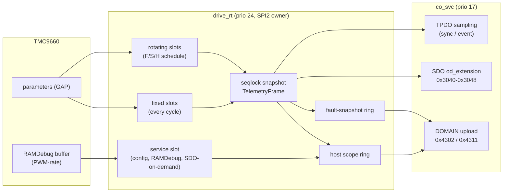
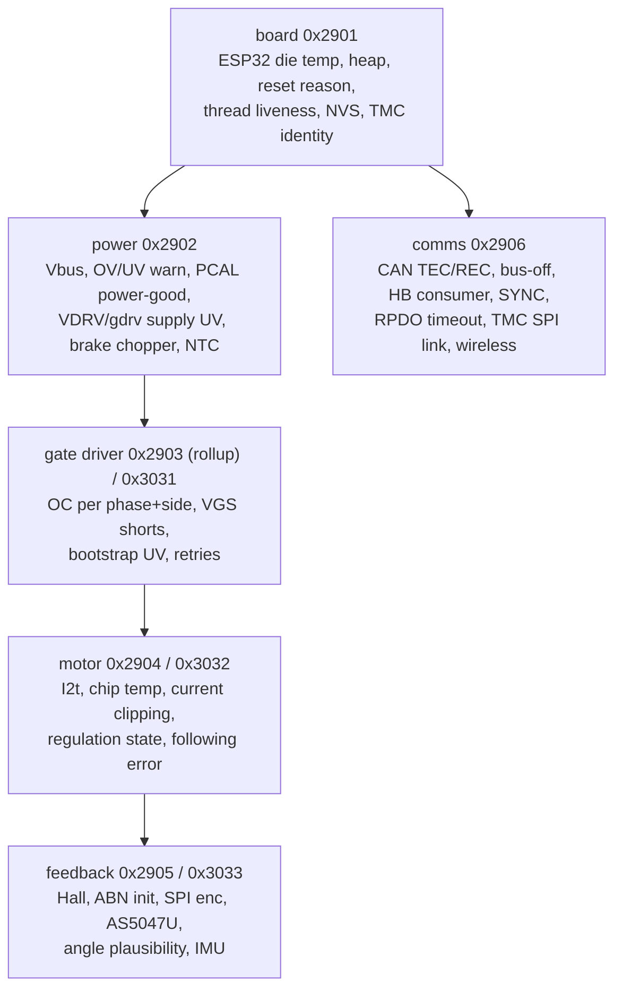
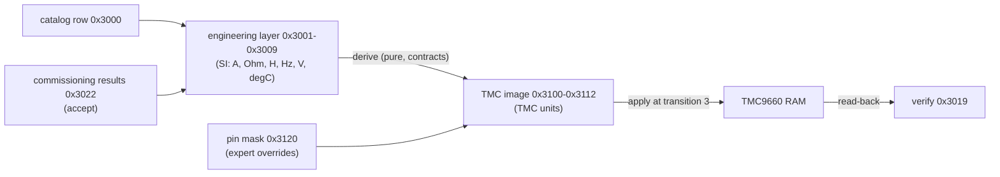
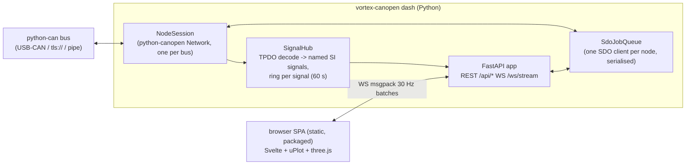

# Vortex V1 Drive Observability: TMC9660 Telemetry, Diagnostics, Configuration and Visualisation

| | |
|---|---|
| Status | Draft for owner review |
| Date | 2026-11-01 |
| Companion | `canopen-node.md` (the "CANopen design"). Section numbers prefixed "C§" refer to it |
| Scope | Everything the TMC9660 can report or be told, exposed through the Vortex CANopen object dictionary, the `vortex-canopen` CLI and a local web dashboard |
| Code base read | `hf-tmc9660-driver@bc3cfcc`, `hf-hal-vortex-v1@28f1a63` (`ci/fix-workflows`), `hf-core@54cbb5e`, `hardfoc-vortex-v1@0d98cde` |

Paths are relative to the repository named in each section. Object indices are for axis 1. Axis *n* adds 0x400·(*n*−1) in the 0x3000–0x3FFF block, as C§5.3 says.

---

## 0. Summary

The goal is a node that shows and controls every capability of the TMC9660 through one object dictionary (OD). The research produced five findings that shape the design:

1. **The chip surface is large, and it can now be enumerated mechanically.** The driver's X-macro lists contain 288 axis parameters, 55 global parameters, 4 flag words (93 named bits) and 61 option enums: 865 rows in all. A small parser (Appendix B) reads them exhaustively and checks its own row count against the header. It also acts as a CI gate: every parameter must be bound to an OD object or explicitly excluded. Today 0 are unmapped and 42 are excluded (TMCL-script variables and UART addressing).
2. **SPI is the bottleneck. The CANopen design's budget of ~25 µs per TMCL access is not what the code does today.** `SpiCommInterface::transferTMCL` (`inc/tmc9660_comm_interface.hpp`) puts a fixed `kTmclPairGapUs = 1000` µs between the command frame and the reply-request frame. `HalSpiTmc9660Comm::hostSpiTransferTMCLPair` (`hf-hal-vortex-v1/lib/core/handlers/tmc9660/Tmc9660Handler.cpp:184-203`) then adds `DelayUs(200)`. A parameter read therefore costs about **1.25 ms**. On top of that, the NOT_READY retry budget allows up to 50 × 200 µs = 10 ms. Six accesses per SYNC would take about 7.5 ms, so 1 kHz CSP (C§4.5, R13) is impossible until this gap is characterised and reduced. Measuring and tuning it is the first implementation step (§7, PR 2b). Every budget below is given as a function of the per-access time, so the design holds whatever the measurement shows.
3. **PWM-rate signals can only come from the chip's own RAMDebug engine.** Phase currents, FOC interim voltages, raw ADC values and the open-loop angle change at the PWM/FOC rate. No host polling can follow them. The TMC9660 has an on-chip capture engine (TMCL opcode 142, Table 16 transcribed in `tmc9660_param_mode_tmcl.hpp:330-404`) with parameter channels, a trigger with mask, shift and threshold, pre-trigger and a prescaler. The design therefore has **two scope engines behind one OD interface**: a host engine (cycle rate, any OD signal, free for signals already fetched) and a TMC engine (PWM-rate, chip parameters only). It also turns RAMDebug into a **PWM-rate black box** that is armed on gate-driver faults.
4. **The driver has defects that block the design.** They are listed in §1.9. The `RamDebug` wrapper sends the wrong sub-commands and cannot configure channels. The `Parameters` enum aliases the global heartbeat parameters onto axis ids 3/4, which are `MOTOR_PWM_FREQUENCY`/`COMMUTATION_MODE`. `Heartbeat::configureAuto` arms the UART watchdog on an SPI board.
5. **Firmware facts from the bench outweigh the datasheet.** The FW051V100 parameter scans (`examples/esp32/docs/TMCL_PARAM_SCAN_*.md`) show which parameters answer before and after `MOTOR_TYPE` is set, which subsystems the bootloader gates, and which writes the ROM rejects (NR 245/246 gate currents, Y2 and VGS-short writes, I²t time constant < ~1 s). These become a **firmware quirk profile** that the configuration validator enforces (§4.3).

The design adds 56 OD objects. Board-level objects are 0x2801 and 0x2900–0x2906. Axis objects are 0x3019, 0x3023–0x3024, 0x3030–0x3048 and 0x3100–0x3121. Service objects are 0x4300–0x4312. It adds eight new pytest suites in host CI. Its implementation PRs slot into C§10.2.

---

## 1. TMC9660 capability inventory

### 1.1 Method and sources

- **Parameters:** `hf-tmc9660-driver/inc/parameter_mode/tmc9660_param_mode_tmcl.hpp`. Each parameter group is an X-macro `#define <GROUP>_LIST(X)` with rows `X(NAME, NR, /*!< doc */)`. `enum class Parameters` (line 5227) includes 25 of these lists. Global banks 0/2/3 are separate lists (lines 457-596). Flag words use `FLAG(bit)` or literal masks (lines 4945-5215).
- **Units:** `inc/tmc9660_units.hpp` (k_RPM, acceleration factor, φe scale, `MotorContext::cpr()`) and `src/tmc9660.ipp` (chip temperature `T = raw·0.01615 − 268.15`, lines 4754-4756 and 5162-5164).
- **Bench reality:** `hf-hal-vortex-v1/examples/esp32/docs/` (`TMCL_PARAM_SCAN_FAILURES.md`, `TMCL_PARAM_SCAN_POST_CONFIG.md`, `BLDC_BRINGUP.md`, `BLDC_UART_BRINGUP.md`, `TMC9660_DEEP_AUDIT_REPORT.md`, `TMC9660_FOC_ABN_DEEP_DIVE_REPORT.md`) and `main/common/vortex_bench_safety.hpp`, `vortex_motor_bench_common.hpp`.
- **Vendor documents:** TMC9660 datasheet <https://www.analog.com/media/en/technical-documentation/data-sheets/tmc9660.pdf>, Parameter Mode Reference Manual <https://www.analog.com/media/en/technical-documentation/data-sheets/tmc9660-parameter-mode-reference-manual.pdf>, AN-2601 Configuration and Bootstrapping <https://www.analog.com/media/en/technical-documentation/app-notes/an-2601.pdf>, AN-2630 Addon Reference Guide <https://www.analog.com/cn/resources/app-notes/an-2630.html>, product page <https://www.analog.com/en/products/tmc9660.html>. During this research the analog.com fetches timed out. Vendor facts quoted here therefore come from the driver's transcriptions of the manual's tables (table numbers kept in the header comments) and from the audit reports that cite manual pages. Facts that need the PDF are marked **(verify)**.

`tools/tmcl_inventory.py` (Appendix B) parses the header and asserts that the number of parsed rows equals the number of `X(` lines (865 = 865). It classifies every parameter and emits three outputs: the Appendix A tables, the YAML `subs:` for the TMC parameter image objects (§6), and a `--check` exit code for CI.

### 1.2 Inventory at a glance

| Class | Count | What it is | OD home |
|---|---:|---|---|
| (a) live telemetry | 54 | read-only measurements, PI internals, encoder raw values, loop counters | 0x3040–0x3045, CiA 402 actuals |
| (b) status / diagnostic words | 6 | `GENERAL_STATUS_FLAGS` (289), `GENERAL_ERROR_FLAGS` (299), `GDRV_ERROR_FLAGS` (300), `ADC_STATUS_FLAGS` (301), `ABN_1_INIT_STATE` (93), `VELOCITY_METER_MODE` (139) | 0x3030, 0x3043, health tree |
| (c) configuration | 264 (222 bound, 42 excluded) | motor, gate driver, protection, ADC, feedback, loops, ramp, biquads, brake, stop events, homing, step/dir, globals | 0x3100–0x3112 (TMC image) under engineering objects 0x3001–0x3009 |
| (d) commands / targets | 19 | targets and offsets, commutation mode, brake release, I²t reset, ABN clear, SPI-encoder transfer/LUT, power-down | CiA 402 objects, 0x3023, 0x3024 |
| flag bits | 93 | 31 status, 17 error, 31 gate-driver, 14 ADC clip | per-bit counters 0x3034–0x3036 |
| TMCL operations | 48 | `Op` enum: SAP/GAP/SGP/GGP/STAP/RFS/SIO/GIO/RamDebug/GetVersion/GetInfo/scripts/Boot | §1.7 |

The full per-parameter tables with bank:id, access, CANopen type, SI scaling, rate tier and OD binding are in Appendix A, generated by the script. The curated tables below cover what the design depends on.

Rate tiers used throughout: **C** = every `drive_rt` cycle (per SYNC); **F** = 50–100 Hz in rotating slots; **S** = 10 Hz; **H** = 1 Hz; **X** = scope/RAMDebug only (polling is meaningless at these rates); **E** = on demand (SDO snapshot); **B** = written at transition 3 and read back once.

### 1.3 Live telemetry (a): the signals that matter

| Signal | TMCL (bank:id) | Raw type | SI | Tier | OD |
|---|---|---|---|---|---|
| Position actual | A:144 `ACTUAL_POSITION` | I32 counts | rev = v / CPR (`CPR = 65536·pp` same-as-commutation, `6·pp` Hall, encoder CPR for ABN/SPI) | C | 0x6064, 0x3041:11 |
| Velocity actual | A:125 `ACTUAL_VELOCITY` | I32 | rpm = v / k_rpm, k_rpm = CPR·2²⁴/(40 MHz·60) (`tmc9660_units.hpp:102,182`) | C | 0x606C, 0x3041:10 |
| Torque current Iq | A:105 `ACTUAL_TORQUE` | I16 mA | A = v·10⁻³ | C | 0x6077 (‰), 0x3041:01 |
| Iq + Id in one access | A:331 `TORQUE_FLUX_COMBINED_ACTUAL_VALUES` | 2×I16 packed, unscaled | needs current scale (§1.4) | C (replaces 105+107) | 0x3041:01/02 |
| Flux current Id | A:107 `ACTUAL_FLUX` | I32 mA | A | F | 0x3041:02 |
| Ud, Uq in one access | A:332 `VOLTAGE_D_Q_COMBINED_ACTUAL_VALUES` | 2×I16 packed | modulation, V via Vbus (§1.4) | F | 0x3041:03/04 |
| Torque/flux targets | A:330 `TORQUE_FLUX_COMBINED_TARGET_VALUES` | 2×I16 | A | F | 0x3042:09 |
| Averaged torque/velocity | A:333/334 `INTEGRATED_ACTUAL_*` | U32 running sum | mean over the poll interval = Δsum/Δsamples (verify sample rate) | F | 0x3042:10/11 |
| Supply voltage | A:290 `SUPPLY_VOLTAGE` | U16 0.1 V | V = v·0.1 | F | 0x6079 (mV), 0x3041:05 |
| Total motor current | A:231 `ACTUAL_TOTAL_MOTOR_CURRENT` | mA | A | F | 0x3040:07 |
| Chip temperature | A:296 `CHIP_TEMPERATURE` | U16 | °C = v·0.01615 − 268.15 | S | 0x2300:02, 0x3041:06 |
| External temperature | A:293 `EXTERNAL_TEMPERATURE` | U16 AIN3 raw | NTC curve on the host (`TemperatureManager` reads AIN3 through `ADC_TMC9660_AIN3`, `lib/managers/TemperatureManager.cpp:167`) | S | 0x2300:01, 0x3041:07 |
| I²t sums 1/2 | A:226/229 `IIT_SUM_*` | U32 A²·ms | % of `IIT_LIMIT_*` | S | 0x3040:11/12, 0x3041:08/09 |
| Ramp generator state | A:69 `RAMP_VELOCITY`, A:70 `RAMP_POSITION` | I32 | rpm / rev | F | 0x3040:04/05 (CiA 0x606B/0x6062 in pp/pv) |
| PI internals | A:116-119, 131-132, 150-151 | I32 | internal | S (X while tuning) | 0x3042 |
| Electrical angles | A:74 `HALL_PHI_E`, A:89 `ABN_1_PHI_E`, A:193 SPI angle, A:45 `OPENLOOP_ANGLE` | I16 | °e = v·360/65536 | S / X | 0x3043, 0x3044 |
| Encoder raw | A:100 `ABN_1_VALUE`, A:178 `ABN_2_VALUE`, A:192 SPI counter | U32 | counts | S | 0x3043 |
| Raw inputs | A:304 `MCC_INPUTS_RAW` | U16 bitfield (ABN, Hall, REF switches, driver enabled, filtered Hall, ABN2/StepDir) | bits | S | 0x3043:08, 0x60FD mirror |
| Phase voltages / currents (FOC interim) | A:305-307, 311-315 | I16 | internal (§1.4) | X | 0x3044 (scope) |
| ADC raw / scaled | A:13-16, 38-41 | I16 | ADC LSB | X / H | 0x3044 |
| Latched position | A:154 `LATCH_POSITION`, A:170 `LAST_REFERENCE_POSITION` | I32 | rev | S / H | 0x3043 |
| Loop rates | G0:12-14 `MAIN/TORQUE/VELOCITY_LOOPS` | U32 /s | loops/s | H | 0x3045 |

There is no PWM duty-cycle parameter. The duty cycle is derived from the FOC interim voltages (A:305-307) or from the d/q voltages (A:332), as the modulation index *m* = |U_dq| / U_full-scale (§1.4). It is published in 0x3046:03.

### 1.4 Units: what is solid and what still needs calibration

**Solid** (driver math audited against the manual, `TMC9660_DEEP_AUDIT_REPORT.md` §2): currents in mA; supply in 0.1 V; chip temperature formula; k_RPM; acceleration register = (dv/dt)·2¹⁷/40 MHz (fixed in May 2026, `docs/troubleshooting.md`); φe as 65536 per electrical revolution; break-before-make at 8.33 ns/LSB; drive time = (2v+3)/120 MHz; `OPENLOOP_VOLTAGE` 0..16383 = 0..100 % duty; I²t in A²·ms. One caveat: with a Hall sensor as the velocity source, the period meter reads 7/6 high (`tmc9660_units.hpp:178-181`). Position stays exact.

**Internal units to calibrate** (none of these is documented in the driver):

| Quantity | Hypothesis | Calibration step (bench, then frozen into 0x3048) |
|---|---|---|
| 331/330 packed Iq/Id | the same mA scale as `ACTUAL_TORQUE` without `CURRENT_SCALING_FACTOR` | regress 331.hi against 105 over a torque sweep; store the A/LSB in 0x3048:05 |
| 332 packed Ud/Uq, A:305-307, A:314 | full scale ±32767 corresponds to `OUTPUT_VOLTAGE_LIMIT` normalisation | open-loop voltage mode at known `OPENLOOP_VOLTAGE` → compare; store V/LSB at 1 V bus in 0x3048:06 |
| A:311-313, 315 FOC currents | ADC-scaled current before mA conversion | compare RAMDebug 311 against 105 at a steady state |
| A:333/334 integration period | summed per FOC or velocity loop | read 333 twice with a known Δt at constant torque |
| `OUTPUT_VOLTAGE_LIMIT` | 32767 = 100 % circular limit | sweep in open loop and observe U_dq saturation |

Until a calibration exists, the OD publishes these quantities as raw `I16` with `units: raw`. The `R32` SI versions in 0x3040 report NaN.

### 1.5 Status and diagnostic flags (b)

All four words are read through GAP. The error and ADC words are write-1-to-clear (`Telemetry::clearGeneralErrorFlags`, `clearGateDriverErrorFlags`, `clearADCStatusFlags`, `inc/tmc9660.hpp` Telemetry block). The status word mixes read-only state with read-write-clear latches (bits 4, 5, 11, 12, 14, 17).

| Word / bits | Meaning | Health node (§3) | Use |
|---|---|---|---|
| status b0–b3 | regulation stopped / torque / velocity / position | motor | check that the commanded commutation mode is regulating. If b0 is set unexpectedly in Operation Enabled, the TMC fault handler has reverted to `SYSTEM_OFF` (the bench symptom in `BLDC_BRINGUP.md`) |
| status b4–b7 | config stored/loaded, config/script memory read-only | board | expect 0 for stored and loaded (TMC NVM not used, §4.7). If loaded = 1 at boot → warning |
| status b8, b21 | brake chopper active, Y2 used for braking | power | duty statistics, regen energy |
| status b9, b10, b15, b16 | position/velocity reached, ramper velocity/position reached | motor | statusword bit 10 in pp/pv; ramp-done events |
| status b11 | ADC offset calibrated (clear to recalibrate) | motor | commissioning step 1; refuse transition 4 if 0 |
| status b12, b13, b14, b17 | ramper latched, switch stop, deviation stop, second move | motor | homing latches; deviation stop → 0x8611 |
| status b18, b19 | I²t 1/2 active | motor | statusword bit 11 (internal limit) |
| status b20 | reference search finished | motor | homing done |
| status b23–b31 | feature availability: StepDir, REF R/H/L, ABN2, Hall, ABN1, SPI flash, I²C EEPROM | feedback / board | **validator input**: the configured feedback must be available (§4.3) |
| error b0, b1 | config storage verify failed, TMCL script missing | board | journal only (both features unused) |
| error b2 | home switch not found | motor | homing error, statusword bit 13 in hm |
| error b5 | Hall invalid state | feedback | fault if Hall is the commutation or velocity source |
| error b9 | watchdog event | board | TMC reset detected → full re-apply (§4.5) |
| error b13, b18 | external temperature exceeded / warning | power | NTC on AIN3 |
| error b14, b24 | chip temperature exceeded / warning | power | |
| error b16, b17 | I²t limit 1/2 exceeded | motor | |
| error b19, b20 | supply OV / UV warning | power | |
| error b21 | ADC input over 2 V | power | warning, unused AINx (masked on the bench, `kBenchOpenLoopIgnoredGeneralErrors`) |
| error b22, b23 | fault retry happened / all retries failed | gate driver | retry counter; retries failed → Fault |
| error b26 | heartbeat stopped | comms | the independent stop path (C§5.5) has acted |
| gdrv b0–b3, b16–b19 | low-/high-side overcurrent U/V/W/Y2 | gate driver | per-phase, per-side fault location |
| gdrv b4–b11, b20–b27 | discharge / charge (VGS) shorts per phase and side | gate driver | the spurious VGS trips on Vortex UVW (`BLDC_BRINGUP.md`) count here |
| gdrv b12–b15 | bootstrap undervoltage U/V/W/Y2 | gate driver | often caused by too-high duty with too-low PWM frequency |
| gdrv b29–b31 | gate-driver undervoltage, low voltage, supply undervoltage | power | VDRV rail |
| ADC b0–b13 | clipping on I0–I3, U0–U3, AIN0–3, VM, TEMP | motor / power | current-sense saturation (CSA gain too high) |

### 1.6 Configuration (c): groups and their OD homes

The CANopen design's engineering objects 0x3001–0x3009 stay (nameplate SI values from the catalog). Below them the design adds a **TMC parameter image**: one RECORD per driver group, with sub-indices in TMC units, generated from the header (§6.2). The image is normally derived from the engineering layer. Experts can pin individual sub-indices (0x3120), so the derivation does not overwrite them.

| Driver list (header) | IDs | Image object | Derived from |
|---|---|---|---|
| `MOTOR_CONFIG_LIST` (excl. 4) | 0-3, 5, 8, 9 | 0x3100 | 0x3001 type, pole pairs, PWM Hz, scheme; 0x607E polarity |
| `GATE_DRIVER_LIST` | 233-249 | 0x3101 | 0x3002 (`PowerStageProfile` math in the driver) |
| `UNDERVOLTAGE_/OVERCURRENT_/VGS_SHORT_PROTECTION_LIST` | 250-283 | 0x3102 | 0x3002 + quirk profile (VGS workaround) |
| `ADC_CONFIG_LIST` (config part) | 12, 17-37 | 0x3103 | 0x3002 shunt mΩ, peak A → CSA gain (highest with headroom), scaling factor |
| `TORQUE_FLUX_CONTROL_LIST` (config part) | 6, 7, 109-115, 308, 310 | 0x3104 | 0x3004, 0x6072/0x6073 clamps |
| `VELOCITY_CONTROL_LIST` (loop part) | 50, 51, 53, 67, 68, 123, 127-130, 133, 135, 137, 138 | 0x3105 | 0x3005, 0x3003 sensor |
| `POSITION_CONTROL_LIST` (config part) | 142, 145-149, 153, 155-157 | 0x3106 | 0x3006, 0x607D, 0x6067 |
| `VELOCITY_CONTROL_LIST` (ramp part) | 46, 47, 52, 54-66 | 0x3107 | 0x6081/0x6083/0x6084/0x6085 via k_rpm and the acceleration factor |
| Hall (in `FEEDBACK_SENSOR_CONFIG_LIST`) | 75-85 | 0x3108 | 0x3003, commissioning 0x3022 |
| ABN1 | 90-92, 94-98 | 0x3109 | 0x3003, 0x3022 |
| ABN2 | 174-177 | 0x310A | 0x3003, 0x3009 gear |
| SPI encoder | 181-184, 190, 191, 194-197, 201 | 0x310B | 0x3003. Answers `CMD_NOT_AVAILABLE` unless the bootloader enables it |
| `BIQUAD_FILTER_LIST` | 318-329 | 0x310C | host designer (`tune filter --notch 180Hz`) computes the coefficients |
| I²t, supply warnings, temperatures, fault handling | 224, 225, 227, 228, 286-288, 291, 292, 294, 295, 297, 298 | 0x310D | 0x3007, 0x2302 |
| Brake chopper + mechanical brake | 212-214, 217-219, 221 | 0x310E | 0x3008 |
| `RAMPER_STOP_CONFIG_LIST` | 134, 152, 161-164 | 0x310F | 0x6065 following-error window → deviation stop, 0x60FD switch mapping |
| `REFERENCE_SEARCH_LIST` | 165-169 | 0x3110 | 0x6098/0x6099 |
| `STEP_DIR_LIST` | 205-209 | 0x3111 | expert only (bootloader-gated) |
| global bank 0 | G0:3-7, 10, 77, 85 | 0x3112 | heartbeat SPI/20 ms, IO masks, wake, `AUTO_START_ENABLE=0`, `CLEAR_USER_VARIABLES=1` |

Excluded: G0:1/2 (UART addresses), G2:0-14 (script variables), G3:* (script timers and trigger transitions). G2:15 is reused as the configuration epoch token (§4.5).

### 1.7 Commands and procedures (d)

| TMCL op / parameter | Use on Vortex | OD / tool |
|---|---|---|
| SAP 104/124/143 targets, 108/126 offsets | cyclic set-points | 0x6071, 0x60FF, 0x607A, 0x60B1/0x60B2 |
| SAP 4 `COMMUTATION_MODE` | owned by the CiA 402 FSM (transition 4 sets the mode; leaving Operation Enabled sets `SYSTEM_OFF` or `SYSTEM_OFF_LOW_SIDE_FETS_ON`) | read-back in 0x3030:07; service override 0x3023:06 (Switched On only) |
| SAP 106/120 flux target/offset | field-weakening experiments | 0x3023:04/05 (service) |
| SAP 216 `RELEASE_BRAKE` | manual brake test | 0x3023:01 |
| SAP 230 `RESET_IIT_SUMS` | after a cool-down or for tests | 0x3023:02 |
| SAP 99 `ABN_1_CLEAR_ON_NEXT_NULL` | index-pulse homing (CiA methods 33/34) | 0x3023:03 |
| SAP 185-189, 198-199 | SPI-encoder raw transfer, LUT upload | 0x3024 DOMAIN procedure |
| RFS (13) start/stop/status | TMC reference search for homing methods 17-30 | driven by `hm` mode, status in 0x3043:11 |
| SGP/GGP bank 0 | heartbeat, IO, wake | 0x3112 |
| SGP G0:11 power-down | refused (wakes need board support) | 0x3023:07 returns abort 0x06090030 |
| SIO/GIO | TMC GPIO17/18, AIN reads (NTC) | 0x2400 (C§5.3), `TemperatureManager` |
| RamDebug (142) types 0-14 | TMC scope engine and PWM-rate fault capture | 0x4300-0x4312 |
| GetVersion (136) / GetInfo (157) | identity | 0x2002 |
| STAP / FactoryDefault / script ops / Boot | not used at runtime (§4.7). Raw access only through the 0x4100 bridge in service state | — |

### 1.8 Read cost model and measurement plan

The cost of one TMCL access on SPI is

`T_op = 2·T_frame + T_gap + T_post`, where `T_frame` ≈ CS setup + 64 bits at 10 MHz (6.4 µs) + IDF transaction overhead (about 10–15 µs). Measure it; do not assume it.

Pipelining: `transferTMCL(..., second_command)` already lets the second frame of access *k* carry the command of access *k*+1, so a batch of *N* accesses costs about `N·(T_gap + T_frame) + T_frame + T_post`.

| Scenario | T_gap | T_post | One access | Batch of 6 (pipelined) | Batch of 8 |
|---|---:|---:|---:|---:|---:|
| A: today (`kTmclPairGapUs`, HAL `DelayUs(200)`) | 1000 µs | 200 µs | ≈ 1.24 ms | ≈ 6.3 ms | ≈ 8.4 ms |
| B: conservative | 250 µs | 0 | ≈ 290 µs | ≈ 1.6 ms | ≈ 2.2 ms |
| C: target | 50 µs | 0 | ≈ 90 µs | ≈ 440 µs | ≈ 580 µs |
| D: best case (parser keeps up) | 10 µs | 0 | ≈ 50 µs | ≈ 200 µs | ≈ 260 µs |

Measurement plan (bench app `vortex_tmcl_timing`, PR 2b):

1. Instrument `HalSpiTmc9660Comm::hostSpiTransferTMCLPair` with `esp_timer_get_time()` around each frame and the gap. Count NOT_READY (0xF0) and 0x00 retries per access.
2. Sweep `T_gap` ∈ {1000, 500, 250, 100, 50, 25, 10} µs and `T_post` ∈ {200, 50, 0} µs, in three chip states: `SYSTEM_OFF`, open-loop current mode at 25 kHz PWM, and FOC (Hall or ABN) under load. Run 10⁵ GAP reads of 125/105/289 at each point. Record the latency histogram (p50/p99/max), the retry count and any value mismatch against a slow reference read.
3. Repeat the chosen point with pipelined batches of 6 and 8.
4. Read G0:12 `MAIN_LOOPS` in each state. If the TMCL parser is serviced in the chip's main loop, the minimum safe gap tracks 1/`MAIN_LOOPS`, so this is the number to report upstream.
5. Pass criterion for a default: 10⁶ accesses with zero corrupt values and p99 retries ≤ 1. Publish the result as the new `T_op` and update C§4.5.

Rules that hold whatever the outcome:

- Inside `drive_rt`, a gap longer than about 30 µs must not busy-wait at priority 24. Use a gptimer one-shot plus a task notification, or split the batch across the cycle.
- The NOT_READY budget inside `drive_rt` is at most 2 retries. After that the sample is marked **stale** (0x3041:14 sample age). A stale streak longer than 0x3047:06 cycles raises the "TMC link degraded" cause (§3.3), not a hang.
- Every TMC access in `drive_rt` records its latency into 0x3037.

### 1.9 Driver defects and gaps found (must fix before relying on them)

| # | Finding | Evidence | Fix (PR 2a) |
|---|---|---|---|
| D1 | `RamDebug::startCapture` sends type 6 (`SET_TRIGGER_MASK_SHIFT`) instead of 7 (`ENABLE_TRIGGER`). `readData` uses opcode `ReadMem` instead of `RamDebug` type 9 `READ_SAMPLE`. `getStatus` treats any non-zero state as running, but `COMPLETE` = 3. There is no API for channels, trigger, prescaler or pre-trigger | `src/tmc9660.ipp:5365-5395` against Table 16/17 in `tmc9660_param_mode_tmcl.hpp:330-420` | full RAMDebug API (`configure(Channels, Trigger, prescaler, samples, pre)`, `state()`, `info(kind)`, `readSamples(span)`) |
| D2 | `enum class Parameters` includes `HEARTBEAT_MONITORING_LIST` (ids 3, 4) and `HIBERNATION_WAKEUP_LIST` (10, 11). These are global bank-0 parameters, and 3/4 collide with `MOTOR_PWM_FREQUENCY`/`COMMUTATION_MODE`. `writeParameter(Parameters::HEARTBEAT_MONITORING_TIMEOUT, 20)` would SAP the commutation mode | `tmc9660_param_mode_tmcl.hpp:5227-5300`; duplicate-id check in the script | remove them from `Parameters`, keep only `GlobalParamBank0`. Add a `static_assert` for unique axis ids |
| D3 | `Heartbeat::configureAuto` selects `TMCL_UART_INTERFACE` when enabled. On the SPI-connected Vortex the watchdog would then never see traffic, or would never trip | `src/tmc9660.ipp:5447-5461` | take the interface explicitly. Vortex uses `configure(SPI_INTERFACE, 20)` |
| D4 | Fixed 1000 µs pair gap and 200 µs post-delay. The 10 ms NOT_READY budget suits only thread context | `tmc9660_comm_interface.hpp` `transferTMCL`; `Tmc9660Handler.cpp:180,201` | make gap, post-delay and retry budget per-call parameters. Add `readParameters(span<ids>, span<out>)` that pipelines |
| D5 | Doc comments disagree with the enums (`getMotorContext` says NR 8/9/132 for ids 0/1/123). The FOC_ABN report uses other numbers | `src/tmc9660.ipp:4832-4852`; `TMC9660_FOC_ABN_DEEP_DIVE_REPORT.md` §1 | the header enums are canonical (they match the 263 OK reads in the post-config scan). Fix the comments |
| D6 | 134 of 288 axis rows carry no access tag in the driver doc string, and the ADC clip flags have no description | Appendix A "RW*" | add a 4th X-macro column `ACCESS` and a units string. The script then needs no heuristics |
| D7 | No wrapper for IPD/HFI sensorless start, index latching or I²t remaining time | `TMC9660_DEEP_AUDIT_REPORT.md` §5 items 8, 9, 11 | out of scope here; noted for the roadmap |

### 1.10 Firmware facts that become rules (FW051V100, silicon rev 1 var 2)

- Before `MOTOR_TYPE` is set, 259 GAPs return `REPLY_WRONG_TYPE`. After `MOTOR_TYPE = BLDC`, 263 axis parameters read OK (`TMCL_PARAM_SCAN_POST_CONFIG.md`). The apply order must therefore set the motor type first. Telemetry must not start until the image has been applied.
- NR 181–201 (SPI encoder) and 205–209 (step/dir) return `REPLY_CMD_NOT_AVAILABLE` unless the bootloader enables them. Gaps at 86-88, 158-160, 179-180, 200 and 215 are not parameters. NR 230 is write-only.
- The ROM rejects Y2 and VGS-short on/off writes on the 3-phase build, NR 245/246 gate currents (`INVALID_VALUE`), and I²t time constants below about 1 s (`vortex_bench_safety.hpp`, I²t comment). The default UVW VGS-short protection false-trips on Vortex, so the bench disables it (`disable_vortex_uvw_vgs_short_protection`, `vortex_motor_bench_common.hpp:830`).
- Erratum 4: target updates are serviced in a ~1 kHz loop (`vortex_bench_safety.hpp:169-173`).
- AS5047U ABI → TMC ABN1 is a working bench path (`vortex_bldc_abn_as5047_dynamics.cpp:6-48`, 14-bit ABI = 16384 counts/rev). This partly answers C-Q5. It needs the ABN1 bootloader mux and the physical wiring.

---

## 2. Telemetry architecture on the node

### 2.1 Tiers



| Tier | Transport | Rate | Content | Cost on SPI2 |
|---|---|---|---|---|
| T1 cyclic PDO | sync TPDO2/3 + optional TPDO4 per profile | SYNC (250–1000 Hz) | statusword, position/velocity actual, Iq, error summary | fixed slots only |
| T2 event TPDO | TPDO type 254/255 with inhibit | on change, ≤ 100 Hz | health summary (0x2900:07), active causes (0x4003), TMC status words (0x3030), temperatures/power (0x2300/0x2301) | none (reads the snapshot) |
| T3 SDO snapshot | expedited/segmented SDO, served from the snapshot | client-paced, ≤ 20 Hz useful | 0x3040–0x3046 SI records, counters, link stats | none for signals already scheduled; one service access for an on-demand parameter |
| T4 scope capture | arm by SDO, read by block upload of a DOMAIN | host engine: cycle rate; TMC engine: RAMDebug rate | up to 8 channels × K samples | host: none or +1 access per extra parameter channel; TMC: readout in the service slot |
| T5 fault snapshot | always armed, frozen on fault | cycle rate + PWM-rate RAMDebug black box | last M ms of 8 fixed channels + RAMDebug fault capture | ~1 µs/cycle copy; readout after the fault |

### 2.2 `drive_rt` SPI schedule

Each cycle has three kinds of slots:

1. **Fixed slots** (always, in a pipelined batch): (1) SAP of the active target, (2) GAP position or velocity actual by mode (csp/pp → 144, csv/pv → 125, cst/tq → 331), (3) GAP 331 (Iq/Id) unless (2) already was 331, (4) GAP 289 status, (5) GAP 299/300 alternating (error words are fresh every 2 cycles), (6) AS5047U frame (host SPI, not TMCL). That is 5 TMCL accesses.
2. **Rotating slots** (default R = 2 per cycle): a static, precomputed table serves the F/S/H tiers. At 500 Hz, R = 2 gives 1000 accesses/s: for example 10 F signals × 50 Hz = 500, 21 S signals × 10 Hz = 210, 10 H signals × 1 Hz = 10, with 280 to spare. The table is generated at transition 3 from 0x3047 and the selected feedback (no Hall reads when Hall is unused). A `FAULTN` edge (PCAL95555 `GPIO_PCAL_TMC_FAULT_STATUS` → INT → `i2c_io`) preempts the rotation: on the next cycle the rotating slots read 299, 300 and 301.
3. **Service slot** (S = 2 per cycle in Operation Enabled, up to 16 otherwise): configuration apply and verify, RAMDebug arm/poll/readout, on-demand SDO GAPs (an SDO read of 0x3044:xx outside the scope), and the 0x4100 bridge.

Required SPI time per cycle = (5 + R + S)·(T_gap + T_frame) + T_frame + AS5047U ≈ 9·(T_gap + 20) + 35 µs.

| Scenario | SPI time / cycle | Max SYNC rate with SPI ≤ 50 % of cycle | Recommended |
|---|---:|---:|---|
| A (today) | ≈ 9.2 ms | ≈ 55 Hz | not usable for cyclic modes. Profile modes at 10 ms with R = 0, S = 1 |
| B | ≈ 2.5 ms | ≈ 200 Hz | 100–200 Hz |
| C | ≈ 665 µs | ≈ 750 Hz | 500 Hz (C§4.5 default) |
| D | ≈ 305 µs | ≈ 1.6 kHz (capped at 1 kHz by Erratum 4) | 1 kHz |

When the cycle cannot fit R + S, `drive_rt` drops service work first, then rotating slots. It never drops fixed slots. It counts each drop in 0x3037:09/10. The scheduler is a pure function in contracts (`TelemetrySchedule Build(Rates, Feedback, Mode, BudgetUs)`), which host tests cover.

### 2.3 Telemetry snapshot and freshness

`drive_rt` publishes a `TelemetryFrame` (about 160 B) through a seqlock, one per cycle. Every value carries the cycle number of its last successful read, so consumers know its age. 0x3041:14 is the age in cycles of the oldest fixed-slot value. TPDOs read the frame from the previous cycle, as C§4.4 specifies. SDO od_extensions copy the frame and convert it to SI (R32) on read, outside `drive_rt`.

### 2.4 PDO profiles added to `pdo apply`

| Profile | TPDO | Mapping (8 B) | Type | Use |
|---|---|---|---|---|
| `diag` | TPDO4 | 0x3041:01 Iq mA I16, 0x3041:05 Vbus 0.1 V U16, 0x3041:06 chip temp 0.1 °C I16, 0x3041:13 error summary U16 | 254, event 20 ms | dashboard power/health |
| `tune-current` | TPDO5 | 0x3041:01 Iq, 0x3041:02 Id, 0x3041:03 Ud, 0x3041:04 Uq (4×I16) | 1 (sync) | current-loop view at SYNC rate |
| `tune-velocity` | TPDO5 + TPDO6 | 0x606B demand I32 + 0x606C actual I32; 0x3041:01 Iq + 0x3046:01 following error I32 | 1 | velocity loop |
| `tune-position` | TPDO5 + TPDO6 | 0x6062 + 0x6064; 0x60F4 + 0x3041:01 | 1 | position loop |
| `angles` | TPDO8 | 0x3043:02 φe active I16, 0x2101:02 AS5047U compensated U16, 0x3046:05 angle divergence I16 (0.01 °), 0x3041:14 age U8, pad | 254, 10 ms | encoder vs motor angle |

Bus-load check: at 500 Hz and 1 Mbit/s, adding `tune-current` (one 8-byte frame, ≤ 135 µs) to the CSP default (C§4.5) gives (345 + 135)/2000 µs = 24 % plus SYNC. That is within the 60 % planning rule.

### 2.5 Scope engine

**One interface, two engines.** 0x4300:03 selects the engine. Both write the same capture format into one RAM buffer, so the tools never need to know which engine produced a capture.

| Property | Host engine (H) | TMC engine (T, RAMDebug) |
|---|---|---|
| Sample clock | `drive_rt` cycle (SYNC or gptimer), × decimation 1..65535 | RAMDebug frequency (`GET_INFO` 2) / (prescaler + 1) |
| Sources | any PDO-mappable OD object, any TMC parameter (an extra access per cycle each, admitted only if it fits the budget), host signals: demand values, following error, controlword/statusword, AS5047U angle/velocity/AGC, IMU (sample-and-hold of the 100–400 Hz `i2c_io` snapshot), SYNC jitter, RT step time | TMC axis and global parameters only (channel type 1/3) |
| Channels | ≤ 8 | ≤ `GET_INFO` 0 (query at boot, store in 0x4303:05) |
| Depth | K = RAM / (4·N): 32 KiB default → 1024 samples × 8 ch, 4096 × 2 ch | ≤ `GET_INFO` 1 words total (shared by channels) |
| Trigger | level (rising/falling/either, with hysteresis), bit-mask edge (status words), fault (any FaultBook activation), controlword edge (set-point ack, mode change), manual, external input (spare GPIO) | unconditional, rising/falling/dual signed or unsigned threshold, on a channel with mask/shift (`SET_TRIGGER_MASK_SHIFT`) |
| Pre-trigger | 0..K−1 samples | `SET_PRETRIGGER_COUNT` |
| Readout | no SPI | `READ_SAMPLE` in the service slot, one access per 32-bit word. 4 ch × 512 samples = 2048 accesses: ≈ 2 s at S = 2 and 500 Hz in Operation Enabled, ≈ 0.25 s idle with S = 16 in scenario C |

Source identifiers are U32 values written into 0x4301:1..8:

| Bits 31–28 | Class | Bits 27–0 |
|---|---|---|
| 1 | TMC axis parameter | axis<<16 \| parameter id |
| 2 | TMC global parameter | bank<<16 \| id |
| 3 | OD object | index<<8 \| sub |
| 4 | host internal signal | enum (`demand_pos`, `demand_vel`, `demand_torque`, `following_error`, `sync_jitter_us`, `rt_step_us`, `cw`, `sw`, …) |
| 5 | AS5047U | field (angle raw, compensated, velocity, AGC, magnitude, error flags) |
| 6 | IMU | field (quaternion i/j/k/r, accel xyz, gyro xyz, mag xyz) |

The Python package generates the source catalog from the OD YAML and the inventory, so names, units and scales are not stored on the device. The device exposes only a catalog hash (0x4303:09) to detect mismatches.

State machine (0x4300:02): `IDLE → ARMED (pre-trigger filling) → TRIGGERED → COMPLETE`, plus `READOUT` (TMC engine copying the chip buffer into node RAM) and `ERROR` (0x4300:10 reason: budget, source unavailable, RAMDebug reply code). Commands (0x4300:01): 1 arm, 2 force trigger, 3 stop, 4 reset, 5 re-arm automatically after readout (rolling mode for the live phase-current panel).

Capture format (0x4302 DOMAIN, little-endian):

```
header  { u32 magic 'VXSC'; u16 version=1; u8 engine; u8 n_ch;
          u32 n_samples; u32 trigger_index; u32 pre_samples;
          u32 sample_period_ns; u64 t0_uptime_us; u64 t0_time_ms (CiA TIME-synced);
          u16 trigger_cause; u16 flags (bit0 wrapped, bit1 stale samples present) }
channel { u32 source_id; u8 type (I16/I32/U16/U32/R32); u8 unit (CiA 303-2 code);
          u16 reserved; f32 scale_to_si; f32 offset } x n_ch
data    sample-major, n_samples x n_ch values, ring unrolled to start at oldest sample
crc32   over header+channel+data
```

The block upload runs at ≥ 20 kB/s (bench test B3), so a 32 KiB capture takes about 1.6 s on CAN and is near-instant over the Wi-Fi tunnel. The upload is served from the frozen buffer. A new arm is refused with abort 0x08000022 while an upload is in progress.

RAM budget on the C6: scope buffer 32 KiB (Kconfig `VORTEX_SCOPE_RAM_KB`, 8–64), fault-snapshot rings 2 × 8 KiB, TelemetryFrame and seqlock 0.5 KiB, schedule tables 1 KiB. Total ≈ 50 KiB, allocated once at boot from internal RAM and never freed. If Wi-Fi is enabled and free heap at boot drops below 64 KiB after allocation, the scope buffer shrinks to 16 KiB and 0x4303:03 reports the actual size.

### 2.6 Fault snapshot

- **Cycle-rate ring:** 8 fixed channels, I16 scaled (Iq, Id, Vbus, velocity, position low word, demand, statusword, TMC error summary), 1024 samples. At 500 Hz that is 2.05 s. `drive_rt` writes it every cycle in about 1 µs.
- **Freeze:** when FaultBook activates a cause of class Fault or Disable-now, the ring records 0x4310:02 post-trigger milliseconds (default 200), then freezes into slot 0 (latest) and, the first time after boot, also into slot 1. A frozen snapshot cannot be overwritten until it is read or cleared (0x4310:01 = 3). The journal entry (C§6.4) gets the snapshot sequence number.
- **PWM-rate black box:** while the user scope is idle, the TMC engine stays armed in fault-capture mode. Channels are 311/312/313 (FOC currents), 305 (U voltage) and 300 (GDRV flags). The trigger channel is 300, rising unsigned with threshold 0 and mask 0xFFFFFFFF. Pre-trigger is 75 %. On a gate-driver fault the chip itself holds the waveforms around the event. After the drive has stopped, `drive_rt` reads them out in the service slot into slot 2 of 0x4311. (Verify on the bench that a channel can trigger on parameter 300 and that RAMDebug keeps running after the fault handler has stopped the bridge.) Policy 0x4310:04 decides whether a user capture may pre-empt the black box (default yes, and the dashboard shows that the black box is off).
- **Persistence:** a snapshot is written to NVS `vortex_log` only outside Operation Enabled, which is the journal rule (C§4.4). Each record is ≤ 8 KiB, and one is kept. The readout is 0x4311 DOMAIN in the §2.5 format with `engine = 2` (cycle snapshot) or `3` (black box). 0x4312 lists the slots (sequence number, time, cause, size).

---

## 3. Diagnostics model

### 3.1 Health tree



The ordering expresses causality for the "root-cause" view. A child's fault is shown as caused by the parent when the parent faulted in the same or the previous cycle. For example, bootstrap undervoltage during a Vbus sag is attributed to power, not the gate driver. Each node is a RECORD with the same layout:

| Sub | Name | Type | Meaning |
|---|---|---|---|
| 1 | status | U8 | 0 unknown, 1 ok, 2 warning, 3 fault, 4 not fitted / disabled |
| 2 | active causes | U32 | bitmask of this node's cause ids (node-local numbering, decoded by the tool) |
| 3 | latched causes | U32 | OR since the last clear (write 0 to clear) |
| 4 | fault count | U32 | number of Fault-class activations since boot |
| 5 | warning count | U32 | |
| 6 | last EMCY code | U16 | |
| 7 | last event uptime | U32 ms | |
| 8 | worst value | I32 | node-specific (max temperature 0.1 °C, min Vbus 0.1 V, max I²t %, max following error, max TEC) |
| 9 | worst value uptime | U32 ms | |

0x2900 is the summary: sub1–6 hold the node statuses, sub7 is a U32 packed rollup (4 bits per node, PDO-mappable, sent on change) and sub8 clears all latches (write `0x726C6300`). Gate driver, motor and feedback are per axis (0x3031–0x3033). 0x2903–0x2905 are the worst-of over all axes.

Per-bit counters: 0x3034 ARRAY U16[32] counts rising edges of each `GENERAL_ERROR_FLAGS` bit, 0x3035 U16[32] does the same for `GDRV_ERROR_FLAGS` and 0x3036 U16[14] for `ADC_STATUS_FLAGS`. They saturate at 65535 and reset on 0x2900:08. TMC link statistics are in 0x3037 (accesses, failures by reply code, NOT_READY retries, stale samples, max latency µs, latency histogram, configured gap, slot drops).

### 3.2 Sources per node

| Node | Inputs | Read where |
|---|---|---|
| board | `esp_reset_reason`, die temperature, free heap, `LivenessMonitor` stale mask, NVS errors, TMC `WATCHDOG_EVENT`, TMC status b4/b5 (unexpected stored config), TMC FW id vs the quirk profile | `housekeep`, `drive_rt` |
| power | A:290 Vbus vs 0x310D thresholds, error b19/b20, PCAL P6 power-good, gdrv b29-31, status b8/b21 duty, A:293 NTC, error b13/b18, error b21 | `drive_rt` F/S tiers, `i2c_io` |
| gate driver | gdrv b0-b27, error b22/b23, 0x3035 counters | fixed slot (alternating) |
| motor | status b0-b3 vs commanded mode, I²t b16-b19 and sums, chip temperature b14/b24, ADC clip b0-b3, following error (host), velocity-in-torque-mode limit | fixed + S tier |
| feedback | error b5, `ABN_1_INIT_STATE`, availability bits b27-b29 vs configuration, AS5047U diagnostics (`As5047uDiagnostics`: magnetic field, AGC warning, CORDIC overflow, comm errors), φe vs AS5047U divergence (0x3046:05), BNO08x liveness | fixed (AS5047U) + S tier |
| comms | CO_EM errors, port TEC/REC/state (0x4202), HB consumer, SYNC jitter (0x4201), RPDO timeout, 0x3037 link statistics, wireless (0x2602) | `co_svc`, `drive_rt` |

### 3.3 Extensions to the fault policy table (C§6.4)

The rows in C§6.4 stay. The rows below cover TMC flags and observability causes that it does not have. EMCY bytes 3–7 keep the C§6.4 layout {cause id, raw flags u32}, so a decoder can always tell the exact bit. Codes marked (verify) need checking against the CiA 301/402 tables before the YAML freezes.

| Cause | Source | EMCY | ER | Class → reaction | Node |
|---|---|---|---|---|---|
| VGS charge/discharge short (any phase/side) | gdrv b4-11, b20-27 | 0x5410 output stage (verify) | 0,7 | Disable now | gate driver |
| Bootstrap undervoltage | gdrv b12-15 | 0x5410 + sub-cause | 0,7 | Disable now if repeated ≥ 3 in 100 ms, else Warn | gate driver |
| Gate-driver supply UV / low voltage | gdrv b29-31 | 0x5110 supply low voltage (verify) | 0,2 | Disable now | power |
| TMC fault retries exhausted | error b23 | 0x5410 | 0,7 | Fault | gate driver |
| TMC fault retry happened | error b22 | none (journal + counter) | — | Info | gate driver |
| Regulation dropped unexpectedly (status b0 set or commutation read-back ≠ commanded in Operation Enabled) | status b0-b3, A:4 read-back | 0xFF50 (manufacturer) | 0,7 | Fault | motor |
| Current-sense clipping (I0-I3), ≥ N consecutive cycles in Operation Enabled | ADC b0-b3 | 0x5210 measurement circuit (verify) | 0,1 | Fault (Warn while N not reached) | motor |
| Other ADC clipping (U, AIN, VM, TEMP) | ADC b4-b13 | 0x5210 | 7 | Warn | power |
| ADC input > 2 V | error b21 | 0x5210 | 7 | Warn (masked for unused AIN by configuration) | power |
| External (NTC) temperature warning / exceeded | error b18 / b13 | 0x4310 | 3 / 0,3 | Warn / Fault | power |
| TMC deviation stop | status b14 | 0x8611 | 0,5 | Fault (same as the host following error) | motor |
| TMC switch stop | status b13 | 0x8612 | 5 | Quick stop | motor |
| Home switch not found | error b2 | 0xFF30 (manufacturer) | 5 | hm error (statusword bit 13), no fault | motor |
| ABN init not DONE within `ABN_1_INIT_DELAY` + 500 ms | A:93 | 0x7305-class (verify) | 0,5 | Refuse transition 4 | feedback |
| Configured feedback not available | status b27-b29 | 0x6320 | 0,7 | Refuse transition 3 | feedback |
| Commutation angle vs AS5047U divergence > 0x3046 limit | host | 0x7300-class | 0,5 | Fault if the AS5047U is the reference, else Warn | feedback |
| TMC link degraded (stale streak > limit, or failure rate > 1 %) | 0x3037 | 0x7510 | 0,7 | Warn → Disable now if the streak exceeds 3 × the TMC heartbeat timeout | comms |
| Brake chopper duty > limit for > T | status b8 statistics | 0xFF60 (manufacturer) | 2 | Warn | power |
| Config image verify mismatch | §4.4 | 0x6320 | 0,7 | Refuse transition 3 | board |
| TMC reset detected (`WATCHDOG_EVENT` or epoch token lost) | error b9, G2:15 | 0x6010 | 0,7 | Fault, full re-apply before transition 3 | board |
| Unexpected TMC NVM config loaded | status b5 at boot | 0xFF20 (manufacturer) | 7 | Warn (the image overwrites it) | board |

---

## 4. Configuration model

### 4.1 Two layers, one truth



- The **engineering layer** is the user's view. It keeps the CANopen design's 0x3001–0x3009 objects, refined to carry the extra nameplate data the derivation needs: Rs, Ls, Kt, J (optional), peak and continuous current, shunt, FET Qg/Rds(on), target current-loop bandwidth.
- The **TMC image** is the chip's view. It is generated from the header (one sub-index per TMC parameter, §6.2). `derive(Eng, BoardFacts, QuirkProfile) → Image` is a pure function in `contracts/tmc_image.hpp`. It contains the driver's auto-config math (`CurrentSensing::configureAuto` gain choice, `GateDriver` power-stage profile, `Protection::configureAuto` I²t and threshold encoding, Ramp k_rpm/acceleration conversion). The firmware therefore no longer calls the driver's `configureAuto` helpers at runtime. It applies a precomputed image. Host tests cover the math.
- **Pinning:** 0x3120 is an ARRAY U32[19], one bitmask per image object. A set bit means "keep the user's value and do not re-derive it". Any SDO write to an image sub-index sets its pin bit automatically. `params unpin <obj>` clears it. The parameter editor (§5.3) shows pinned values with a marker.
- **Persistence:** both layers persist in group A (`od_app`). Calibration-type results (Hall offsets, ABN N-offset, ADC offsets once accepted) persist in group K. The image is saved too, so a DCF reproduces a drive exactly even if a later firmware changes the derivation. On restore with a newer firmware, un-pinned sub-indices are re-derived and pinned ones are kept.

### 4.2 Validation rules

Writes are validated in two passes:

1. **On SDO write** (od_extension): data type, the YAML `low`/`high` range and access. Violations abort 0x06090031/0x06090032/0x06090030, as C§6.2 specifies.
2. **At transition 3**, over the whole image. The failure code goes to 0x3019:03 and the first offending object/sub-index to 0x3019:04. The transition is refused with EMCY 0x6320.

| Code | Rule |
|---|---|
| 0x01 | range: every image value inside the inventory range (Appendix A) |
| 0x02 | `MAX_TORQUE` (6) ≤ min(board limit, catalog peak, 0x6073 · rated). `MAX_FLUX` (7) ≥ `OPENLOOP_CURRENT` (46) whenever an open-loop or forced-φe ABN init is configured (`vortex_bench_safety.hpp` `kMaxFluxCurrentMa` note) |
| 0x03 | supply: UV warn (292) < nominal < OV warn (291) < brake-chopper limit (213) + hysteresis (214) < board absolute maximum |
| 0x04 | temperature: warning < shutdown for chip (298/297) and external (295/294); external thresholds converted from °C with the NTC curve |
| 0x05 | I²t: time constants ≥ 1000 ms (ROM floor); limit 1 ≥ limit 2 scaled by time (window 1 is the shorter one) |
| 0x06 | PWM 10–100 kHz; `OUTPUT_VOLTAGE_LIMIT` ≤ 32767; dead time (235/236) ≥ the FET requirement from 0x3002 |
| 0x07 | feedback: the commutation mode, velocity sensor (123) and position sensor (142) must each be fitted (status b27–b29 availability) **and** muxed by the bootloader (`DeviceCapabilities`, the `BootloaderConfig` board fact). ABN `STEPS` > 0 when ABN is selected. SPI-encoder sub-indices only if `spiEncoder` |
| 0x08 | Y2: no Y2 sub-index differs from the default when `y2Phase = false` (Vortex) |
| 0x09 | quirk profile (keyed by TMC FW id in 0x2002): skip NR 245/246 on FW051V100 unless the user pinned them and set 0x3121:03 "allow"; VGS-short UVW policy (disable or max deglitch) applied |
| 0x0A | position: limit low < limit high; `POSITION_REACHED_THRESHOLD` consistent with 0x6067 |
| 0x0B | ramp: `RAMP_VMAX` ≥ the motor-side speed implied by 0x607F and the gear ratio; `RAMP_VSTOP` ≥ 1 |
| 0x0C | heartbeat: config = SPI; timeout ≥ 3 × the idle `drive_rt` period and ≤ 50 ms |
| 0x0D | globals: `AUTO_START_ENABLE` = 0, `CLEAR_USER_VARIABLES` = 1 |
| 0x0E | verify mismatch (§4.4) |
| 0x0F | TMCL error during apply (the reply code goes to 0x3019:05) |

### 4.3 Apply order at transition 3

The order follows the proven bench sequence (`BENCH_MATRIX.md` "TMC9660 BLDC bring-up shape", `configure_complete_bldc`) and the firmware facts in §1.10. It runs in the `drive_rt` service slot with S raised to 16 accesses per cycle, because the bridge is off. The statusword stays in Ready to Switch On until the apply finishes. 0x3019:01 shows progress.

| Step | Writes | Notes |
|---|---|---|
| 0 | read G2:15 epoch, error b9, FW id | decides between full and differential apply (§4.5) |
| 1 | A:4 = `SYSTEM_OFF` | |
| 2 | 0x3100 motor (type **first**, then pole pairs, direction, PWM, scheme, idle behaviour, voltage limit) | before the motor type is set, most other parameters answer `WRONG_TYPE` |
| 3 | 0x3101 gate driver (UVW only, quirk skips) | |
| 4 | 0x3102 protection (UVLO, OC, VGS) | Vortex VGS policy |
| 5 | 0x3103 current sensing | |
| 6 | 0x3108–0x310B the selected feedback only | |
| 7 | 0x3104 current loop, 0x3105 velocity loop, 0x3106 position loop, 0x310C biquads | |
| 8 | 0x3107 ramp and open-loop | |
| 9 | 0x310D protection (supply warnings, temperatures, I²t, fault handling) | |
| 10 | 0x310E brake, 0x310F stop events/switches, 0x3110 reference search, 0x3111 step/dir | |
| 11 | 0x3112 globals (SGP): heartbeat SPI + timeout last among the globals, so that a slow apply does not trip it | |
| 12 | clear error/gdrv/ADC flags (write-1-clear all) | |
| 13 | ADC offset calibration if status b11 = 0 (motor stationary) | |
| 14 | read-back verify (§4.4) | |
| 15 | write G2:15 = CRC32(image) | epoch token |

Transition 4 then writes the target to zero, sets DRV_EN (PCAL), sets the commutation mode and reads back A:4 and status b0–b3 within 20 ms, else Fault 0xFF50. That is the C§5.6 behaviour plus the revert check.

Time estimate: about 230 writes + 230 reads + flag clears ≈ 470 accesses. Scenario A: ≈ 0.6 s. Scenario C with S = 16 at 500 Hz: ≈ 60 ms.

### 4.4 Read-back verification

Every RW/RWE sub-index that was written is read back with GAP/GGP. Write-only parameters (230) and RWC latches are skipped. A tolerance table covers parameters that the chip rounds or normalises. For example, `MOTOR_PWM_FREQUENCY` is accepted within ±1 % (verify which parameters are rounded by observing them on the bench, and record them in the quirk profile). The result is in 0x3019: verified count, mismatch count, first mismatch (index, sub, wanted, got) and the TMCL reply code. A mismatch refuses transition 3 (code 0x0E). `diag config` and the parameter editor show the full mismatch list, which the tool fetches by re-reading 0x3100–0x3112 against the stored image.

### 4.5 Differential apply and TMC reset detection

G2:15 (a TMCL-script user variable that Vortex does not need for scripts) holds the CRC32 of the last applied image. `CLEAR_USER_VARIABLES = 1` makes the chip clear it on reset. At the next transition 3:

- If G2:15 = CRC(last applied), `WATCHDOG_EVENT` = 0 and the chip has not been reset (no bootloader re-entry since the last apply), then only the sub-indices that changed since the last apply are written and verified. This is typically a few gains during tuning, which keeps tuning iterations under 50 ms.
- Otherwise the full apply runs. A mismatch that appears while the drive is enabled means the TMC reset under us: Fault 0x6010 (§3.3).

### 4.6 DCF export and import, diff against stored and defaults

- **Export** (`params export dcf FILE`): python-canopen uploads every object whose YAML `persist` is `app`, `cal` or `comm`. That includes the image and the pin masks. It writes a CiA 306 DCF with `[DeviceComissioning]` (node-ID, bit-rate, node name). Comments record the OD hash (0x5FFE), the firmware build (0x2000) and the TMC FW id (0x2002). The library function is `canopen.objectdictionary.export_od(od, f, doc_type="dcf")`.
- **Import** (`params import dcf FILE [--store]`): this refuses unless the drive is in Pre-operational or Switched On and holds authority (C§6.6). It checks the OD hash. If the hash differs, it maps by (index, sub, name) and reports dropped entries, which is the same rule as the TLV restore (C§6.7). It writes the engineering layer, then the pin masks, then the pinned image sub-indices. It optionally calls 0x1010:03/:04.
- **Diff:** the device exposes the stored TLV blobs read-only as 0x2801:01–03 DOMAIN (comm/app/cal). The tool decodes them with the same codec as the firmware (the Python port is shared in the package and tested against C++ fixtures). It then shows three columns: live / stored / default (from the EDS). The dashboard parameter editor uses the same data.

### 4.7 TMC9660 non-volatile memory is not used

- The OD is the single truth. The chip is reprogrammed at every transition 3 (C§6.1). Storing on the chip would create a second truth that could diverge silently.
- `NvmStorage::storeToFlash` (STAP 0xFFF) needs external SPI flash or I²C EEPROM configured through the bootloader (`inc/tmc9660.hpp` NvmStorage warning). The Vortex SPI boot configuration has `enable_flash = false`, so the SPI port stays free for TMCL (`TMCL_PARAM_SCAN_POST_CONFIG.md` table).
- Enforcement: STAP, FactoryDefault and the script opcodes are refused by the 0x4100 bridge unless a build flag `VORTEX_TMC_EXPERT` is set. At boot, status b5 `CONFIG_LOADED` = 1 raises the "unexpected TMC NVM config" warning, because someone used the vendor tool on this board. `AUTO_START_ENABLE` = 0 guarantees that no stored script runs.

---

## 5. Visualisation

### 5.1 CLI additions (`vortex-canopen`, C§9.2)

| Command | Function | Data path |
|---|---|---|
| `plot SIG... [--profile diag\|tune-*] [--rate] [--csv F]` | live plot of named signals (the catalog resolves names to OD, scale and units). Applies the matching PDO profile temporarily and restores the mapping on exit | TPDO |
| `scope arm --engine host\|tmc --ch iq,id,uq,ud --trigger 'iq>1.5A rising' --pre 25% --samples 2048 --decim 1`, `scope wait`, `scope fetch -o cap.vxsc`, `scope show cap.vxsc [--fft --cursors]`, `scope export --csv\|--parquet` | the scope engine (§2.5) | SDO + block upload |
| `scope rolling --ch iu,iv,iw` | re-arm loop for live phase currents (TMC engine) | as above |
| `diag tree [--watch]` | health tree with statuses, latches, counters and worst values. Shows root-cause attribution | SDO 0x2900–0x2906, 0x3031–0x3037 |
| `diag flags [--watch]` | decoded TMC status/error/gdrv/ADC words, with the bit names generated from the inventory | 0x3030 |
| `diag snapshot list\|fetch\|clear` | fault snapshots and the PWM-rate black box | 0x4310–0x4312 |
| `diag link` | TMCL latency histogram, retries, stale counts, slot drops; CAN statistics; SYNC jitter | 0x3037, 0x4201, 0x4202 |
| `diag config` | apply/verify status and the mismatch list | 0x3019, 0x3100–0x3112 |
| `tune current [--bw 1kHz] [--step 0.5A] [--apply]` | derive Kp/Ki from R, L and the bandwidth (C§6.3 step 7). Run a bounded Iq step in cst with a TMC-engine capture of 330/331 triggered on the target change. Report rise time, overshoot and steady-state error. Suggest gains and iterate. `--apply` writes 0x3104 (differential apply, §4.5) | scope + image |
| `tune velocity [--bw 50Hz]`, `tune position` | the same for the outer loops (host engine at SYNC rate) | |
| `tune filter --notch F --q Q \| --lowpass F` | compute biquad coefficients for 0x310C (fixed-point format verified against the defaults in Appendix A, e.g. bCoeff_0 = 1048576 = 1.0 in Q20 (verify)) | image |
| `params diff [--against stored\|defaults\|FILE.dcf]`, `params pin\|unpin` | §4.6 | |
| `dash [--port 8765] [--bind 127.0.0.1] [--allow-control]` | web dashboard (§5.2) | all |

### 5.2 Web dashboard: architecture



- **Backend:** FastAPI on uvicorn, bound to 127.0.0.1 by default. A random session token is printed in the URL and checked on REST and WebSocket. There is one `NodeSession` per bus, and it uses the same transport options as the CLI (`--interface/--channel` or `--url`). `SignalHub` subscribes to TPDO callbacks and to EMCY/heartbeat. It decodes values with the catalog and pushes them to subscribed clients in 33 ms batches (msgpack: `{sig_id: [t0, dt, values...]}`). `SdoJobQueue` serialises SDO jobs (snapshot polls, scope fetches, parameter reads/writes) with priorities, so a 32 KiB block upload cannot starve the 2 Hz health poll.
- **Frontend:** a static single-page app built at release time and shipped inside the wheel (no Node.js at install). It uses Svelte for the UI, uPlot (<https://github.com/leeoniya/uPlot>) for all time-series and FFT plots (it renders tens of thousands of points per frame), and three.js for the IMU attitude. Library versions are pinned in `package-lock.json`. The bundle must work offline.
- **Safety:** without `--allow-control` the dashboard is read-only. Commands that can move the motor (wizard steps, enable, tune steps) are hidden. The server refuses any write to 0x6040, 0x3020, 0x3023 or 0x3100–0x3112. With `--allow-control`, motion buttons need a confirmation and use the same authority rules as the CLI (C§7.4). The page shows a persistent "control enabled" banner and a large quick-stop button that writes 0x6040 = quick stop.
- **Recording:** any panel can record to Parquet (signals plus EMCY/state events) via a toolbar button. The recordings replay in the same UI (`dash --replay FILE`).

### 5.3 Panels (wireframes, data sources, rates)

**P1 Drive state machine**

```
+-- Drive ------------------------------------------------------------+
| [NotReady]->[SwOnDisabled]->[Ready]->[SwitchedOn]->[(OpEnabled)]     |
|                       ^ fault reset   [QuickStop]   [FaultReact]->[Fault]
| mode: csv (0x6061)  cw 0x000F  sw 0x0637  authority: CAN  liveness: HB ok
| warn: I2t1 active | target reached | internal limit                   |
| [Shutdown] [Switch on] [Enable] [Quick stop] [Fault reset]  (control) |
+---------------------------------------------------------------------+
```
Sources: TPDO1 (0x6041/0x6061, event, ≤ 100 Hz), 0x2700, 0x603F, 0x4003. The view updates on each TPDO. The last transitions (from the TPDO history) are listed under the diagram.

**P2 Currents and voltages (live + rolling phase view)**

```
+-- Currents / voltages ----------------------------------------------+
| Iq, Id [A]  ~~~~~~~~~~~~~~~~~~~~~~~~~~~~~  (SYNC-rate, 10 s window)  |
| Ud, Uq [V]  ~~~~~~~~~~~~~~~~~~~~~~~~~~~~~                            |
| Phase Iu Iv Iw [A]  /\/\/\/\  (RAMDebug rolling, 3 ch x 256, ~1 Hz) |
| |Idq| 1.23 A   m = 0.41   Vbus 24.1 V   P_el 18.2 W                  |
+---------------------------------------------------------------------+
```
Sources: `tune-current` TPDO (SYNC rate, decimated in the hub to ≤ 500 Hz per trace). Phase traces come from the TMC engine in rolling mode (0x4300:01 = 5), refreshed when the engine is free, typically ≤ 1 Hz in Operation Enabled because of the readout cost. Power comes from 0x3046:02 (TPDO `diag`, 50 Hz).

**P3 Motion tracking with demand overlay** and **P4 Following error**

```
+-- Tracking ---------------------------+ +-- Following error --------+
| pos demand -- / actual ==  [rev]       | | e(t) [rev]   ---window---  |
| vel demand -- / actual ==  [rpm]       | | histogram |e|, max, RMS    |
| torque demand -- / actual ==  [%]      | | 0x6065 window, 0x6066 time |
| [x] load side (gear 0x3009)           | | events: 0x8611 markers     |
+---------------------------------------+ +---------------------------+
```
Sources: `tune-velocity` / `tune-position` profiles at SYNC rate. 0x60F4 and 0x3046:01. Window parameters by SDO when the panel opens. Markers come from EMCY.

**P5 Temperature and power**

```
+-- Thermal / power ---------------------------------------------------+
| chip degC ---  NTC degC ---  ESP32 degC ---  (warn/shutdown lines)    |
| Vbus V ---  OV/UV warn lines   brake chopper duty %  ---             |
| I2t1 % ---  I2t2 % ---  "time to I2t trip at present current: 41 s"  |
+---------------------------------------------------------------------+
```
Sources: TPDO `diag` (chip temperature, Vbus, 50 Hz). 0x2300/0x2301 event TPDO. 0x3040:11/12 I²t by SDO poll at 2 Hz. The trip-time estimate uses the I²t model on the host.

**P6 Fault journal timeline**

```
+-- Faults -----------------------------------------------------------+
| t ->  |--W--|-----F(0x2310 I2t)--------|--W 0x3200--|   [zoom] [filter]
| row per node: board / power / gate / motor / feedback / comms         |
| click event -> cause, raw flags, 402 state, pos/vel/I, [open snapshot]|
+---------------------------------------------------------------------+
```
Sources: 0x4000/0x4001 block upload on open and on every new EMCY. The live EMCY stream is merged in. Snapshot links open P10 with 0x4311.

**P7 Health tree**

```
+-- Health ------------------------------------------------------------+
| (o) board   (o) power   (!) gate driver   (o) motor   (o) feedback   |
|             \- Vbus 24.1 V min 22.8   \- VGS short V-HS x3 (latched) |
| counters [gdrv bits heat-map 32]   [clear latches] (control)         |
+---------------------------------------------------------------------+
```
Sources: 0x2900:07 event TPDO (on change) plus a 2 Hz SDO poll of the expanded node (0x2901–0x2906, 0x3031–0x3036). Per-bit names come from the inventory.

**P8 IMU 3D orientation**

```
+-- IMU ------------------------------+
|   [three.js board model, axes]      |  roll/pitch/yaw deg, accuracy rad
|   accel / gyro sparklines           |  calibration status 0..3 x4
+-------------------------------------+
```
Sources: `imu-stream` profile TPDO5–7 (C§5.4, 100 Hz), with 0x2220 status by SDO at 1 Hz. The view interpolates with slerp to the display frame rate.

**P9 Encoder vs motor angle**

```
+-- Angles -----------------------------------------------------------+
| theta_e TMC (phi_e) ---   theta_e from AS5047U*pp ---   diff (deg_e)  |
| scatter: AS5047U mech angle (x) vs TMC position mod rev (y)           |
| open-loop slip: commanded vs measured speed                          |
+---------------------------------------------------------------------+
```
Sources: `angles` profile TPDO8 (100 Hz). The divergence comes from 0x3046:05. For PWM-rate inspection, a one-click capture of A:89/74/193 + host AS5047U at SYNC rate.

**P10 Scope viewer**

```
+-- Scope -------------------------------------------------------------+
| engine [host|tmc]  ch1 [iq v] ch2 [uq v] ... trigger [iq] [>] [1.5 A] |
| pre [25%] samples [2048] decim [1]   [Arm] [Force] [Stop]  state: ARMED
| ~~~~~~~~~ plot with cursors A|B: dt, dy, freq ~~~~~~~~~~~~~~~~~~~~~~~ |
| [FFT] Hann window, dB, peaks table   [export csv/parquet] [save .vxsc]|
+---------------------------------------------------------------------+
```
Sources: 0x4300/0x4301 SDO for setup and state (5 Hz while armed). 0x4302 block upload on COMPLETE. The FFT runs in the browser on the uploaded buffer. Offline `.vxsc` files open by drag and drop.

**P11 Commissioning wizard** (control mode only)

```
+-- Commissioning ------------------------------------------------------+
| 1 Motor row [bench_24v_30w_bldc v]  2 ADC offsets [run] ok            |
| 3 Direction [run]  4 Pole pairs/CPR [run] 7 = 7  5 Hall learn/ABN align|
| 6 R/L [run] R=1.41 Ohm L=392 uH   7 Current loop [run] (step plot)    |
| 8 Velocity loop [run]   [Accept 0x3020=0x80]  [Save 0x1010:03/04]     |
+---------------------------------------------------------------------+
```
Sources: 0x3020–0x3022 (SDO, 5 Hz while running). Each step shows its scope capture (the commissioning procedures arm the scope). Limits come from C§6.3.

**P12 Parameter editor**

```
+-- Parameters ---------------------------------------------------------+
| tree: engineering 0x3001.. | TMC image 0x3100..  | search [ramp_a]    |
| name           live     stored   default  unit   pin  status          |
| torque_p        400      400       50      -      *    ok              |
| ramp_amax      1250     1000     1000    rpm/s        changed (live)   |
| [write] [revert to stored] [revert to default] [export DCF] [import]  |
+---------------------------------------------------------------------+
```
Sources: SDO bulk reads (segmented, about 300 sub-indices in ≈ 2 s on CAN), 0x2801 DOMAIN for the stored values, EDS defaults, 0x3120 pins and 0x3019 verify results. Writes go through the job queue with range checks from the EDS.

**P13 Link and timing**

```
+-- Link / timing -------------------------------------------------------+
| TMCL latency hist (p50 85 us, p99 140 us, max 1.9 ms)  retries/s 0.2   |
| slot drops: rotating 0, service 12   stale streak max 1                |
| SYNC jitter hist (0x4201)   RT WCET   CAN TEC/REC, bus load estimate    |
+-----------------------------------------------------------------------+
```
Sources: 0x3037, 0x4200–0x4202 at 1 Hz SDO, and the bus load measured by the hub from the frame rate.

---

## 6. OD additions (YAML fragment for `od/vortex_od.yaml`)

### 6.1 Conventions

The keys are the C§4.2 attributes: `name` (ParameterName), `object_type` (VAR/ARRAY/RECORD/DOMAIN), `data_type`, `access`, `pdo_mapping`, `default`, `low`/`high`, `units`, `persist` (`comm|app|cal|none`), `od_extension`, `fd_only` and `docs`. The fragment adds two keys, which `odgen` must learn:

- `tmc: {bank: axis|0|2, id: N}` binds a sub-index to a TMC parameter. The `TmcParamGroup`/`TmcTelemetry` extensions use it to find the parameter. `tmcl_inventory.py --check` uses it to prove coverage.
- `source: snapshot|service|ram` says where an od_extension serves the value from. `snapshot` means the `drive_rt` seqlock frame, with no SPI on read. `service` means a GAP in the service slot, so the SDO response is deferred. `ram` means node RAM.

Sub-index 0 of RECORD and ARRAY objects is implicit (highest sub-index), as in CANopenNode v4. Names are snake_case. `odgen` derives the ParameterName from them. `pdo_mapping: true` is only set where the classic 8-byte limit allows a useful mapping. The indices are for axis 1. The generator replicates the axis objects at +0x400 per axis.

### 6.2 Fragment

```yaml
objects:
  # ---------------- board level ----------------
  - index: 0x2801
    name: stored_parameter_image
    object_type: RECORD
    od_extension: StoredImageReader
    source: ram
    docs: TLV blobs exactly as stored in NVS (C 6.7), for live/stored/default diff.
    subs:
      - {sub: 1, name: comm_group, data_type: DOMAIN, access: ro}
      - {sub: 2, name: app_group, data_type: DOMAIN, access: ro}
      - {sub: 3, name: cal_group, data_type: DOMAIN, access: ro}

  - index: 0x2900
    name: health_summary
    object_type: RECORD
    od_extension: HealthTree
    source: ram
    subs:
      - {sub: 1, name: board_status, data_type: U8, access: ro, pdo_mapping: true}
      - {sub: 2, name: power_status, data_type: U8, access: ro, pdo_mapping: true}
      - {sub: 3, name: gate_driver_status, data_type: U8, access: ro, pdo_mapping: true}
      - {sub: 4, name: motor_status, data_type: U8, access: ro, pdo_mapping: true}
      - {sub: 5, name: feedback_status, data_type: U8, access: ro, pdo_mapping: true}
      - {sub: 6, name: comms_status, data_type: U8, access: ro, pdo_mapping: true}
      - {sub: 7, name: packed_rollup, data_type: U32, access: ro, pdo_mapping: true,
         docs: "4 bits per node, node n at bits 4n..4n+3; event TPDO on change"}
      - {sub: 8, name: clear_latches, data_type: U32, access: wo, docs: "write 0x726C6300"}

  # 0x2901..0x2906: identical layout, one per node (board, power, gate_driver_rollup,
  # motor_rollup, feedback_rollup, comms). odgen expands `template: health_node`.
  - index: 0x2901
    name: health_board
    object_type: RECORD
    template: health_node
    od_extension: HealthTree
    source: ram
    subs: &health_node
      - {sub: 1, name: status, data_type: U8, access: ro, pdo_mapping: true}
      - {sub: 2, name: active_causes, data_type: U32, access: ro, pdo_mapping: true}
      - {sub: 3, name: latched_causes, data_type: U32, access: rw, docs: "write 0 clears"}
      - {sub: 4, name: fault_count, data_type: U32, access: ro}
      - {sub: 5, name: warning_count, data_type: U32, access: ro}
      - {sub: 6, name: last_emcy_code, data_type: U16, access: ro}
      - {sub: 7, name: last_event_uptime, data_type: U32, access: ro, units: ms}
      - {sub: 8, name: worst_value, data_type: I32, access: ro, docs: node-specific scaled value}
      - {sub: 9, name: worst_value_uptime, data_type: U32, access: ro, units: ms}
  - {index: 0x2902, name: health_power, object_type: RECORD, od_extension: HealthTree, source: ram, subs: *health_node}
  - {index: 0x2903, name: health_gate_driver_rollup, object_type: RECORD, od_extension: HealthTree, source: ram, subs: *health_node}
  - {index: 0x2904, name: health_motor_rollup, object_type: RECORD, od_extension: HealthTree, source: ram, subs: *health_node}
  - {index: 0x2905, name: health_feedback_rollup, object_type: RECORD, od_extension: HealthTree, source: ram, subs: *health_node}
  - {index: 0x2906, name: health_comms, object_type: RECORD, od_extension: HealthTree, source: ram, subs: *health_node}

  # ---------------- axis level: status, health, counters ----------------
  - index: 0x3019
    name: tmc_config_apply_status
    object_type: RECORD
    od_extension: TmcApply
    source: ram
    subs:
      - {sub: 1, name: state, data_type: U8, access: ro, pdo_mapping: true,
         docs: "0 idle, 1 deriving, 2 writing, 3 calibrating, 4 verifying, 5 done, 6 failed; progress in sub 2"}
      - {sub: 2, name: progress_pct, data_type: U8, access: ro}
      - {sub: 3, name: failure_code, data_type: U8, access: ro, docs: "rule code, section 4.2"}
      - {sub: 4, name: first_offender, data_type: U32, access: ro, docs: "index<<8|sub"}
      - {sub: 5, name: tmcl_reply_code, data_type: U8, access: ro}
      - {sub: 6, name: written_count, data_type: U16, access: ro}
      - {sub: 7, name: verified_count, data_type: U16, access: ro}
      - {sub: 8, name: mismatch_count, data_type: U16, access: ro}
      - {sub: 9, name: mismatch_wanted, data_type: I32, access: ro}
      - {sub: 10, name: mismatch_got, data_type: I32, access: ro}
      - {sub: 11, name: image_crc, data_type: U32, access: ro}
      - {sub: 12, name: chip_epoch_token, data_type: U32, access: ro, tmc: {bank: 2, id: 15}}
      - {sub: 13, name: last_apply_kind, data_type: U8, access: ro, docs: "0 none, 1 full, 2 differential"}
      - {sub: 14, name: last_apply_duration, data_type: U16, access: ro, units: ms}

  - index: 0x3023
    name: tmc_service_actions
    object_type: RECORD
    od_extension: TmcService
    source: service
    docs: Service-only (C 6.6). Writes refused in Operation Enabled except sub 1 with brake policy.
    subs:
      - {sub: 1, name: release_brake, data_type: U8, access: rw, tmc: {bank: axis, id: 216}}
      - {sub: 2, name: reset_i2t_sums, data_type: U8, access: wo, tmc: {bank: axis, id: 230}}
      - {sub: 3, name: abn1_clear_on_next_null, data_type: U8, access: rw, tmc: {bank: axis, id: 99}}
      - {sub: 4, name: target_flux, data_type: I16, access: rw, units: mA, low: -10000, high: 10000, tmc: {bank: axis, id: 106}}
      - {sub: 5, name: flux_offset, data_type: I16, access: rw, units: mA, low: -4700, high: 4700, tmc: {bank: axis, id: 120}}
      - {sub: 6, name: commutation_mode_override, data_type: U8, access: rw, tmc: {bank: axis, id: 4},
         docs: "Switched On only; FSM owns it otherwise"}
      - {sub: 7, name: power_down, data_type: U8, access: wo, tmc: {bank: 0, id: 11}, docs: "always aborts 0x06090030 on V1"}
      - {sub: 8, name: clear_tmc_flags, data_type: U32, access: wo, docs: "bit0 error, bit1 gdrv, bit2 adc, bit3 status latches"}
      - {sub: 9, name: recalibrate_adc_offsets, data_type: U8, access: wo, docs: "clears status b11; Switched On, motor still"}

  - index: 0x3024
    name: tmc_spi_encoder_procedure
    object_type: RECORD
    od_extension: TmcService
    source: service
    subs:
      - {sub: 1, name: raw_transfer, data_type: DOMAIN, access: rw,
         tmc_ids: [185, 186, 187, 188, 189], docs: "write <=16 B tx, read rx"}
      - {sub: 2, name: lut_image, data_type: DOMAIN, access: rw, tmc_ids: [198, 199],
         docs: "256 x I8 correction LUT, written via address/data"}

  - index: 0x3030
    name: tmc_status_words
    object_type: RECORD
    od_extension: TmcTelemetry
    source: snapshot
    subs:
      - {sub: 1, name: general_status_flags, data_type: U32, access: ro, pdo_mapping: true, tmc: {bank: axis, id: 289}}
      - {sub: 2, name: general_error_flags, data_type: U32, access: ro, pdo_mapping: true, tmc: {bank: axis, id: 299}}
      - {sub: 3, name: gdrv_error_flags, data_type: U32, access: ro, pdo_mapping: true, tmc: {bank: axis, id: 300}}
      - {sub: 4, name: adc_status_flags, data_type: U32, access: ro, pdo_mapping: true, tmc: {bank: axis, id: 301}}
      - {sub: 5, name: error_flags_latched, data_type: U32, access: rw, docs: "OR of sub 2 since clear"}
      - {sub: 6, name: gdrv_flags_latched, data_type: U32, access: rw}
      - {sub: 7, name: commutation_mode_readback, data_type: U8, access: ro, pdo_mapping: true, tmc: {bank: axis, id: 4}}
      - {sub: 8, name: faultn_pin, data_type: U8, access: ro, pdo_mapping: true, docs: "PCAL GPIO_PCAL_TMC_FAULT_STATUS"}

  - {index: 0x3031, name: health_gate_driver, object_type: RECORD, od_extension: HealthTree, source: ram, subs: *health_node}
  - {index: 0x3032, name: health_motor, object_type: RECORD, od_extension: HealthTree, source: ram, subs: *health_node}
  - {index: 0x3033, name: health_feedback, object_type: RECORD, od_extension: HealthTree, source: ram, subs: *health_node}

  - {index: 0x3034, name: tmc_error_bit_counters, object_type: ARRAY, data_type: U16, length: 32, access: ro,
     od_extension: TmcCounters, source: ram, docs: "rising edges per GENERAL_ERROR_FLAGS bit"}
  - {index: 0x3035, name: tmc_gdrv_bit_counters, object_type: ARRAY, data_type: U16, length: 32, access: ro,
     od_extension: TmcCounters, source: ram}
  - {index: 0x3036, name: tmc_adc_clip_counters, object_type: ARRAY, data_type: U16, length: 14, access: ro,
     od_extension: TmcCounters, source: ram}

  - index: 0x3037
    name: tmc_link_stats
    object_type: RECORD
    od_extension: TmcLinkStats
    source: ram
    subs:
      - {sub: 1, name: accesses, data_type: U32, access: ro}
      - {sub: 2, name: failures, data_type: U32, access: ro}
      - {sub: 3, name: not_ready_retries, data_type: U32, access: ro}
      - {sub: 4, name: checksum_errors, data_type: U32, access: ro}
      - {sub: 5, name: reply_errors, data_type: U32, access: ro, docs: "TMCL status != 100/101"}
      - {sub: 6, name: stale_samples, data_type: U32, access: ro}
      - {sub: 7, name: max_stale_streak, data_type: U16, access: ro, units: cycles}
      - {sub: 8, name: max_latency, data_type: U16, access: ro, units: us}
      - {sub: 9, name: rotating_slot_drops, data_type: U32, access: ro}
      - {sub: 10, name: service_slot_drops, data_type: U32, access: ro}
      - {sub: 11, name: configured_gap, data_type: U16, access: rw, units: us, low: 5, high: 2000, default: 1000,
         persist: app, docs: "set from PR 2b measurement"}
      - {sub: 12, name: latency_histogram, data_type: DOMAIN, access: ro, docs: "16 x U32 log2 buckets from 8 us"}

  # ---------------- axis level: telemetry ----------------
  - index: 0x3040
    name: axis_live_si
    object_type: RECORD
    od_extension: TmcTelemetry
    source: snapshot
    docs: SI values (R32); NaN when stale (>0x3047:06 cycles) or uncalibrated (section 1.4).
    subs:
      - {sub: 1, name: iq, data_type: R32, access: ro, pdo_mapping: true, units: A, tmc: {bank: axis, id: 105}}
      - {sub: 2, name: id, data_type: R32, access: ro, pdo_mapping: true, units: A, tmc: {bank: axis, id: 107}}
      - {sub: 3, name: velocity, data_type: R32, access: ro, pdo_mapping: true, units: rpm, tmc: {bank: axis, id: 125}}
      - {sub: 4, name: ramp_velocity, data_type: R32, access: ro, units: rpm, tmc: {bank: axis, id: 69}}
      - {sub: 5, name: ramp_position, data_type: R32, access: ro, units: rev, tmc: {bank: axis, id: 70}}
      - {sub: 6, name: position, data_type: R32, access: ro, pdo_mapping: true, units: rev, tmc: {bank: axis, id: 144}}
      - {sub: 7, name: total_motor_current, data_type: R32, access: ro, units: A, tmc: {bank: axis, id: 231}}
      - {sub: 8, name: vbus, data_type: R32, access: ro, pdo_mapping: true, units: V, tmc: {bank: axis, id: 290}}
      - {sub: 9, name: chip_temperature, data_type: R32, access: ro, units: degC, tmc: {bank: axis, id: 296}}
      - {sub: 10, name: external_temperature, data_type: R32, access: ro, units: degC, tmc: {bank: axis, id: 293}}
      - {sub: 11, name: i2t_1_utilisation, data_type: R32, access: ro, units: "%", tmc: {bank: axis, id: 226}}
      - {sub: 12, name: i2t_2_utilisation, data_type: R32, access: ro, units: "%", tmc: {bank: axis, id: 229}}
      - {sub: 13, name: openloop_angle, data_type: R32, access: ro, units: deg_e, tmc: {bank: axis, id: 45}}
      - {sub: 14, name: ud, data_type: R32, access: ro, units: V, tmc: {bank: axis, id: 332}}
      - {sub: 15, name: uq, data_type: R32, access: ro, units: V, tmc: {bank: axis, id: 332}}

  - index: 0x3041
    name: axis_live_packed
    object_type: RECORD
    od_extension: TmcTelemetry
    source: snapshot
    docs: PDO-friendly scaled integers for the diag/tune profiles.
    subs:
      - {sub: 1, name: iq_ma, data_type: I16, access: ro, pdo_mapping: true, units: mA, tmc: {bank: axis, id: 331}}
      - {sub: 2, name: id_ma, data_type: I16, access: ro, pdo_mapping: true, units: mA, tmc: {bank: axis, id: 331}}
      - {sub: 3, name: ud_raw, data_type: I16, access: ro, pdo_mapping: true, units: raw, tmc: {bank: axis, id: 332}}
      - {sub: 4, name: uq_raw, data_type: I16, access: ro, pdo_mapping: true, units: raw, tmc: {bank: axis, id: 332}}
      - {sub: 5, name: vbus_100mv, data_type: U16, access: ro, pdo_mapping: true, units: 0.1 V, tmc: {bank: axis, id: 290}}
      - {sub: 6, name: chip_temp_ddegc, data_type: I16, access: ro, pdo_mapping: true, units: 0.1 degC, tmc: {bank: axis, id: 296}}
      - {sub: 7, name: ext_temp_ddegc, data_type: I16, access: ro, pdo_mapping: true, units: 0.1 degC, tmc: {bank: axis, id: 293}}
      - {sub: 8, name: i2t_1_pct, data_type: U8, access: ro, pdo_mapping: true, tmc: {bank: axis, id: 226}}
      - {sub: 9, name: i2t_2_pct, data_type: U8, access: ro, pdo_mapping: true, tmc: {bank: axis, id: 229}}
      - {sub: 10, name: velocity_internal, data_type: I32, access: ro, pdo_mapping: true, tmc: {bank: axis, id: 125}}
      - {sub: 11, name: position_counts, data_type: I32, access: ro, pdo_mapping: true, tmc: {bank: axis, id: 144}}
      - {sub: 12, name: status_flags_low, data_type: U16, access: ro, pdo_mapping: true, tmc: {bank: axis, id: 289}}
      - {sub: 13, name: error_summary, data_type: U16, access: ro, pdo_mapping: true,
         docs: "b0 any gdrv, b1 OC, b2 VGS, b3 bootstrap UV, b4 gdrv supply UV, b5 I2t, b6 OT, b7 OT warn,
                b8 UV warn, b9 OV warn, b10 Hall, b11 HB stopped, b12 ADC clip, b13 regulation dropped,
                b14 stale TMC data, b15 retry happened"}
      - {sub: 14, name: sample_age, data_type: U8, access: ro, pdo_mapping: true, units: cycles}

  - index: 0x3042
    name: axis_loop_internals
    object_type: RECORD
    od_extension: TmcTelemetry
    source: snapshot
    subs:
      - {sub: 1, name: torque_pi_error, data_type: I32, access: ro, tmc: {bank: axis, id: 116}}
      - {sub: 2, name: flux_pi_error, data_type: I32, access: ro, tmc: {bank: axis, id: 117}}
      - {sub: 3, name: torque_pi_integrator, data_type: I32, access: ro, tmc: {bank: axis, id: 118}}
      - {sub: 4, name: flux_pi_integrator, data_type: I32, access: ro, tmc: {bank: axis, id: 119}}
      - {sub: 5, name: velocity_pi_integrator, data_type: I32, access: ro, tmc: {bank: axis, id: 131}}
      - {sub: 6, name: velocity_pi_error, data_type: I32, access: ro, tmc: {bank: axis, id: 132}}
      - {sub: 7, name: position_pi_integrator, data_type: I32, access: ro, tmc: {bank: axis, id: 150}}
      - {sub: 8, name: position_pi_error, data_type: I32, access: ro, tmc: {bank: axis, id: 151}}
      - {sub: 9, name: torque_flux_targets, data_type: U32, access: ro, pdo_mapping: true, tmc: {bank: axis, id: 330}}
      - {sub: 10, name: integrated_torque, data_type: U32, access: ro, tmc: {bank: axis, id: 333}}
      - {sub: 11, name: integrated_velocity, data_type: U32, access: ro, tmc: {bank: axis, id: 334}}

  - index: 0x3043
    name: axis_feedback_raw
    object_type: RECORD
    od_extension: TmcTelemetry
    source: snapshot
    subs:
      - {sub: 1, name: hall_phi_e, data_type: I16, access: ro, pdo_mapping: true, tmc: {bank: axis, id: 74}}
      - {sub: 2, name: abn1_phi_e, data_type: I16, access: ro, pdo_mapping: true, tmc: {bank: axis, id: 89}}
      - {sub: 3, name: abn1_init_state, data_type: U8, access: ro, tmc: {bank: axis, id: 93}}
      - {sub: 4, name: abn1_counter, data_type: U32, access: ro, tmc: {bank: axis, id: 100}}
      - {sub: 5, name: abn2_counter, data_type: U32, access: ro, tmc: {bank: axis, id: 178}}
      - {sub: 6, name: spi_encoder_counter, data_type: U32, access: ro, tmc: {bank: axis, id: 192}}
      - {sub: 7, name: spi_encoder_angle, data_type: I16, access: ro, tmc: {bank: axis, id: 193}}
      - {sub: 8, name: mcc_inputs_raw, data_type: U16, access: ro, pdo_mapping: true, tmc: {bank: axis, id: 304}}
      - {sub: 9, name: velocity_meter_mode, data_type: U8, access: ro, tmc: {bank: axis, id: 139}}
      - {sub: 10, name: latch_position, data_type: I32, access: ro, tmc: {bank: axis, id: 154}}
      - {sub: 11, name: last_reference_position, data_type: I32, access: ro, tmc: {bank: axis, id: 170}}
      - {sub: 12, name: active_phi_e, data_type: I16, access: ro, pdo_mapping: true,
         docs: "phi_e of the configured commutation source"}

  - index: 0x3044
    name: axis_pwm_rate_signals
    object_type: RECORD
    od_extension: TmcTelemetry
    source: service
    docs: Meaningful only through the TMC scope engine; an SDO read is a single service-slot GAP.
    subs:
      - {sub: 1, name: adc_i0_raw, data_type: I16, access: ro, tmc: {bank: axis, id: 13}}
      - {sub: 2, name: adc_i1_raw, data_type: I16, access: ro, tmc: {bank: axis, id: 14}}
      - {sub: 3, name: adc_i2_raw, data_type: I16, access: ro, tmc: {bank: axis, id: 15}}
      - {sub: 4, name: adc_i3_raw, data_type: I16, access: ro, tmc: {bank: axis, id: 16}}
      - {sub: 5, name: adc_i0, data_type: I16, access: ro, tmc: {bank: axis, id: 38}}
      - {sub: 6, name: adc_i1, data_type: I16, access: ro, tmc: {bank: axis, id: 39}}
      - {sub: 7, name: adc_i2, data_type: I16, access: ro, tmc: {bank: axis, id: 40}}
      - {sub: 8, name: adc_i3, data_type: I16, access: ro, tmc: {bank: axis, id: 41}}
      - {sub: 9, name: foc_voltage_ux, data_type: I16, access: ro, tmc: {bank: axis, id: 305}}
      - {sub: 10, name: foc_voltage_wy, data_type: I16, access: ro, tmc: {bank: axis, id: 306}}
      - {sub: 11, name: foc_voltage_v, data_type: I16, access: ro, tmc: {bank: axis, id: 307}}
      - {sub: 12, name: foc_current_ux, data_type: I16, access: ro, tmc: {bank: axis, id: 311}}
      - {sub: 13, name: foc_current_v, data_type: I16, access: ro, tmc: {bank: axis, id: 312}}
      - {sub: 14, name: foc_current_wy, data_type: I16, access: ro, tmc: {bank: axis, id: 313}}
      - {sub: 15, name: foc_voltage_uq, data_type: I16, access: ro, tmc: {bank: axis, id: 314}}
      - {sub: 16, name: foc_current_iq, data_type: I16, access: ro, tmc: {bank: axis, id: 315}}

  - index: 0x3045
    name: tmc_loop_rates
    object_type: RECORD
    od_extension: TmcTelemetry
    source: snapshot
    subs:
      - {sub: 1, name: main_loops, data_type: U32, access: ro, units: 1/s, tmc: {bank: 0, id: 12}}
      - {sub: 2, name: torque_loops, data_type: U32, access: ro, units: 1/s, tmc: {bank: 0, id: 13}}
      - {sub: 3, name: velocity_loops, data_type: U32, access: ro, units: 1/s, tmc: {bank: 0, id: 14}}

  - index: 0x3046
    name: axis_derived
    object_type: RECORD
    od_extension: DerivedSignals
    source: snapshot
    subs:
      - {sub: 1, name: following_error, data_type: I32, access: ro, pdo_mapping: true, units: inc}
      - {sub: 2, name: electrical_power, data_type: R32, access: ro, pdo_mapping: true, units: W,
         docs: "1.5*(Ud*Id+Uq*Iq) once calibrated"}
      - {sub: 3, name: modulation_index, data_type: R32, access: ro, units: "1"}
      - {sub: 4, name: openloop_slip, data_type: R32, access: ro, units: rpm,
         docs: "commanded minus AS5047U-measured, open-loop modes"}
      - {sub: 5, name: angle_divergence, data_type: I16, access: ro, pdo_mapping: true, units: 0.01 deg_e}
      - {sub: 6, name: angle_divergence_limit, data_type: U16, access: rw, units: 0.01 deg_e, default: 3000, persist: app}
      - {sub: 7, name: i2t_time_to_trip, data_type: R32, access: ro, units: s}

  - index: 0x3047
    name: telemetry_schedule
    object_type: RECORD
    od_extension: TelemetrySchedule
    source: ram
    persist: app
    subs:
      - {sub: 1, name: rotating_slots, data_type: U8, access: rw, low: 0, high: 8, default: 2}
      - {sub: 2, name: service_slots_enabled, data_type: U8, access: rw, low: 1, high: 8, default: 2}
      - {sub: 3, name: service_slots_idle, data_type: U8, access: rw, low: 1, high: 32, default: 16}
      - {sub: 4, name: fast_tier_hz, data_type: U16, access: rw, low: 0, high: 200, default: 50}
      - {sub: 5, name: slow_tier_hz, data_type: U16, access: rw, low: 0, high: 50, default: 10}
      - {sub: 6, name: stale_limit_cycles, data_type: U8, access: rw, low: 1, high: 50, default: 5}
      - {sub: 7, name: extra_param_mask, data_type: U32, access: rw, default: 0, docs: "enable optional S-tier groups"}
      - {sub: 8, name: achieved_cycle_budget, data_type: U16, access: ro, units: us}

  - index: 0x3048
    name: unit_context
    object_type: RECORD
    od_extension: UnitContext
    source: ram
    subs:
      - {sub: 1, name: k_rpm, data_type: R32, access: ro}
      - {sub: 2, name: cpr, data_type: U32, access: ro}
      - {sub: 3, name: pole_pairs, data_type: U8, access: ro}
      - {sub: 4, name: accel_factor, data_type: R32, access: ro, docs: "rpm/s per RAMP_A LSB"}
      - {sub: 5, name: packed_current_scale, data_type: R32, access: rw, persist: cal, units: A/LSB}
      - {sub: 6, name: packed_voltage_scale, data_type: R32, access: rw, persist: cal, units: V/LSB/V}
      - {sub: 7, name: foc_current_scale, data_type: R32, access: rw, persist: cal, units: A/LSB}
      - {sub: 8, name: hall_velocity_correction, data_type: R32, access: rw, persist: cal, default: 0.857142857}

  # ---------------- axis level: TMC image meta ----------------
  - {index: 0x3120, name: tmc_image_pin_mask, object_type: ARRAY, data_type: U32, length: 19, access: rw,
     persist: app, docs: "bit n of entry k pins sub n+1 of 0x3100+k-1"}
  - index: 0x3121
    name: tmc_quirk_profile
    object_type: RECORD
    od_extension: TmcApply
    source: ram
    subs:
      - {sub: 1, name: profile_id, data_type: U16, access: ro, docs: "selected by TMC FW id, e.g. 1 = FW051V100"}
      - {sub: 2, name: skipped_params_mask, data_type: U32, access: ro}
      - {sub: 3, name: allow_quirk_overrides, data_type: U8, access: rw, default: 0, persist: app}
      - {sub: 4, name: vgs_uvw_policy, data_type: U8, access: rw, default: 1, persist: app,
         docs: "0 chip default, 1 disable UVW VGS short, 2 max deglitch"}

  # ---------------- service: scope and fault snapshot ----------------
  - index: 0x4300
    name: scope_control
    object_type: RECORD
    od_extension: Scope
    source: ram
    subs:
      - {sub: 1, name: command, data_type: U8, access: rw, docs: "1 arm, 2 force, 3 stop, 4 reset, 5 rolling"}
      - {sub: 2, name: state, data_type: U8, access: ro, pdo_mapping: true,
         docs: "0 idle, 1 armed, 2 triggered, 3 complete, 4 readout, 5 error"}
      - {sub: 3, name: engine, data_type: U8, access: rw, default: 0, docs: "0 host, 1 tmc"}
      - {sub: 4, name: channel_count, data_type: U8, access: rw, low: 1, high: 8, default: 4}
      - {sub: 5, name: samples, data_type: U32, access: rw, default: 1024}
      - {sub: 6, name: pretrigger_samples, data_type: U32, access: rw, default: 256}
      - {sub: 7, name: decimation, data_type: U16, access: rw, low: 1, high: 65535, default: 1,
         docs: "host: cycles per sample; tmc: prescaler+1"}
      - {sub: 8, name: trigger_channel, data_type: U8, access: rw, low: 0, high: 8, default: 1, docs: "0 = trigger source 0x4300:15"}
      - {sub: 9, name: trigger_mode, data_type: U8, access: rw,
         docs: "0 manual, 1 rise, 2 fall, 3 either, 4 bitmask edge, 5 fault, 6 controlword edge, 7 external input"}
      - {sub: 10, name: error_reason, data_type: U8, access: ro}
      - {sub: 11, name: trigger_level, data_type: I32, access: rw}
      - {sub: 12, name: trigger_hysteresis, data_type: U32, access: rw}
      - {sub: 13, name: trigger_mask, data_type: U32, access: rw, default: 0xFFFFFFFF}
      - {sub: 14, name: trigger_shift, data_type: U8, access: rw, default: 0}
      - {sub: 15, name: trigger_source, data_type: U32, access: rw, docs: "source id when trigger_channel = 0"}
      - {sub: 16, name: sample_period, data_type: U32, access: ro, units: ns}
      - {sub: 17, name: trigger_uptime, data_type: U32, access: ro, units: ms}
      - {sub: 18, name: readout_progress_pct, data_type: U8, access: ro}

  - {index: 0x4301, name: scope_channels, object_type: ARRAY, data_type: U32, length: 8, access: rw,
     od_extension: Scope, source: ram, docs: "source ids, section 2.5"}
  - {index: 0x4302, name: scope_data, object_type: VAR, data_type: DOMAIN, access: ro,
     od_extension: Scope, source: ram, docs: "VXSC capture, block upload"}

  - index: 0x4303
    name: scope_info
    object_type: RECORD
    od_extension: Scope
    source: ram
    subs:
      - {sub: 1, name: host_max_channels, data_type: U8, access: ro}
      - {sub: 2, name: host_max_samples, data_type: U32, access: ro}
      - {sub: 3, name: host_buffer_bytes, data_type: U32, access: ro}
      - {sub: 4, name: host_sample_rate, data_type: U32, access: ro, units: Hz}
      - {sub: 5, name: tmc_max_channels, data_type: U32, access: ro, docs: "RamDebug GET_INFO 0"}
      - {sub: 6, name: tmc_buffer_words, data_type: U32, access: ro, docs: "GET_INFO 1"}
      - {sub: 7, name: tmc_sample_rate, data_type: U32, access: ro, units: Hz, docs: "GET_INFO 2"}
      - {sub: 8, name: format_version, data_type: U16, access: const, default: 1}
      - {sub: 9, name: source_catalog_hash, data_type: U32, access: const}

  - index: 0x4310
    name: fault_snapshot_control
    object_type: RECORD
    od_extension: FaultSnapshot
    source: ram
    subs:
      - {sub: 1, name: command, data_type: U8, access: rw, docs: "1 arm, 2 disarm, 3 clear all"}
      - {sub: 2, name: post_trigger, data_type: U16, access: rw, units: ms, default: 200, persist: app}
      - {sub: 3, name: blackbox_enable, data_type: U8, access: rw, default: 1, persist: app}
      - {sub: 4, name: user_scope_preempts_blackbox, data_type: U8, access: rw, default: 1, persist: app}
      - {sub: 5, name: frozen_count, data_type: U8, access: ro, pdo_mapping: true}
  - {index: 0x4311, name: fault_snapshot_data, object_type: ARRAY, data_type: DOMAIN, length: 3, access: ro,
     od_extension: FaultSnapshot, source: ram, docs: "1 latest, 2 first since boot, 3 PWM-rate black box"}
  - {index: 0x4312, name: fault_snapshot_directory, object_type: ARRAY, data_type: U32, length: 12, access: ro,
     od_extension: FaultSnapshot, source: ram, docs: "per slot: sequence, uptime ms, cause|emcy, size"}

  # ---------------- axis level: TMC parameter image (generated) ----------------
  # Generated by: tools/tmcl_inventory.py inc/parameter_mode/tmc9660_param_mode_tmcl.hpp --yaml
  # Ranges and defaults come from the driver doc strings. Pinning and derivation: section 4.1.
  - index: 0x3100
    name: tmc_motor
    object_type: RECORD
    persist: app
    od_extension: TmcParamGroup
    subs:
      - {sub: 1, name: motor_type, data_type: U8, access: rw, default: 0, tmc: {bank: axis, id: 0}}
      - {sub: 2, name: motor_pole_pairs, data_type: U8, access: rw, low: 0, high: 127, default: 1, tmc: {bank: axis, id: 1}}
      - {sub: 3, name: motor_direction, data_type: U8, access: rw, default: 0, tmc: {bank: axis, id: 2}}
      - {sub: 4, name: motor_pwm_frequency, data_type: U32, access: rw, low: 10000, high: 100000, default: 25000, tmc: {bank: axis, id: 3}}
      - {sub: 5, name: output_voltage_limit, data_type: U16, access: rw, low: 0, high: 32767, default: 8000, tmc: {bank: axis, id: 5}}
      - {sub: 6, name: pwm_switching_scheme, data_type: U8, access: rw, default: 1, tmc: {bank: axis, id: 8}}
      - {sub: 7, name: idle_motor_pwm_behavior, data_type: U8, access: rw, tmc: {bank: axis, id: 9}}
  - index: 0x3101
    name: tmc_gate_driver
    object_type: RECORD
    persist: app
    od_extension: TmcParamGroup
    subs:
      - {sub: 1, name: pwm_l_output_polarity, data_type: U8, access: rw, tmc: {bank: axis, id: 233}}
      - {sub: 2, name: pwm_h_output_polarity, data_type: U8, access: rw, tmc: {bank: axis, id: 234}}
      - {sub: 3, name: break_before_make_time_low_uvw, data_type: U8, access: rw, low: 0, high: 255, tmc: {bank: axis, id: 235}}
      - {sub: 4, name: break_before_make_time_high_uvw, data_type: U8, access: rw, low: 0, high: 255, tmc: {bank: axis, id: 236}}
      - {sub: 5, name: break_before_make_time_low_y2, data_type: U8, access: rw, low: 0, high: 255, tmc: {bank: axis, id: 237}}
      - {sub: 6, name: break_before_make_time_high_y2, data_type: U8, access: rw, low: 0, high: 255, tmc: {bank: axis, id: 238}}
      - {sub: 7, name: use_adaptive_drive_time_uvw, data_type: U8, access: rw, tmc: {bank: axis, id: 239}}
      - {sub: 8, name: use_adaptive_drive_time_y2, data_type: U8, access: rw, tmc: {bank: axis, id: 240}}
      - {sub: 9, name: drive_time_sink_uvw, data_type: U8, access: rw, low: 0, high: 255, tmc: {bank: axis, id: 241}}
      - {sub: 10, name: drive_time_source_uvw, data_type: U8, access: rw, low: 0, high: 255, tmc: {bank: axis, id: 242}}
      - {sub: 11, name: drive_time_sink_y2, data_type: U8, access: rw, low: 0, high: 255, tmc: {bank: axis, id: 243}}
      - {sub: 12, name: drive_time_source_y2, data_type: U8, access: rw, low: 0, high: 255, tmc: {bank: axis, id: 244}}
      - {sub: 13, name: uvw_sink_current, data_type: U8, access: rw, tmc: {bank: axis, id: 245}}
      - {sub: 14, name: uvw_source_current, data_type: U8, access: rw, tmc: {bank: axis, id: 246}}
      - {sub: 15, name: y2_sink_current, data_type: U8, access: rw, tmc: {bank: axis, id: 247}}
      - {sub: 16, name: y2_source_current, data_type: U8, access: rw, tmc: {bank: axis, id: 248}}
      - {sub: 17, name: bootstrap_current_limit, data_type: U8, access: rw, tmc: {bank: axis, id: 249}}
  - index: 0x3102
    name: tmc_gate_protection
    object_type: RECORD
    persist: app
    od_extension: TmcParamGroup
    subs:
      - {sub: 1, name: supply_level, data_type: U8, access: rw, low: 0, high: 16, default: 0, tmc: {bank: axis, id: 250}}
      - {sub: 2, name: vdrv_enable, data_type: U8, access: rw, low: 0, high: 1, default: 1, tmc: {bank: axis, id: 251}}
      - {sub: 3, name: bst_uvw_enable, data_type: U8, access: rw, low: 0, high: 1, default: 1, tmc: {bank: axis, id: 252}}
      - {sub: 4, name: bst_y2_enable, data_type: U8, access: rw, low: 0, high: 1, default: 1, tmc: {bank: axis, id: 253}}
      - {sub: 5, name: uvw_low_side_enable, data_type: U8, access: rw, default: 1, tmc: {bank: axis, id: 254}}
      - {sub: 6, name: uvw_high_side_enable, data_type: U8, access: rw, default: 1, tmc: {bank: axis, id: 255}}
      - {sub: 7, name: y2_low_side_enable, data_type: U8, access: rw, default: 1, tmc: {bank: axis, id: 256}}
      - {sub: 8, name: y2_high_side_enable, data_type: U8, access: rw, default: 1, tmc: {bank: axis, id: 257}}
      - {sub: 9, name: uvw_low_side_threshold, data_type: U8, access: rw, low: 0, high: 15, default: 0, tmc: {bank: axis, id: 258}}
      - {sub: 10, name: uvw_high_side_threshold, data_type: U8, access: rw, low: 0, high: 15, default: 0, tmc: {bank: axis, id: 259}}
      - {sub: 11, name: y2_low_side_threshold, data_type: U8, access: rw, low: 0, high: 15, default: 0, tmc: {bank: axis, id: 260}}
      - {sub: 12, name: y2_high_side_threshold, data_type: U8, access: rw, low: 0, high: 15, default: 0, tmc: {bank: axis, id: 261}}
      - {sub: 13, name: uvw_low_side_blanking, data_type: U8, access: rw, low: 0, high: 7, default: 2, tmc: {bank: axis, id: 262}}
      - {sub: 14, name: uvw_high_side_blanking, data_type: U8, access: rw, low: 0, high: 7, default: 2, tmc: {bank: axis, id: 263}}
      - {sub: 15, name: y2_low_side_blanking, data_type: U8, access: rw, low: 0, high: 7, default: 2, tmc: {bank: axis, id: 264}}
      - {sub: 16, name: y2_high_side_blanking, data_type: U8, access: rw, low: 0, high: 7, default: 2, tmc: {bank: axis, id: 265}}
      - {sub: 17, name: uvw_low_side_deglitch, data_type: U8, access: rw, low: 0, high: 7, default: 6, tmc: {bank: axis, id: 266}}
      - {sub: 18, name: uvw_high_side_deglitch, data_type: U8, access: rw, low: 0, high: 7, default: 6, tmc: {bank: axis, id: 267}}
      - {sub: 19, name: y2_low_side_deglitch, data_type: U8, access: rw, low: 0, high: 7, default: 6, tmc: {bank: axis, id: 268}}
      - {sub: 20, name: y2_high_side_deglitch, data_type: U8, access: rw, low: 0, high: 7, default: 6, tmc: {bank: axis, id: 269}}
      - {sub: 21, name: uvw_low_side_use_vds, data_type: U8, access: rw, default: 1, tmc: {bank: axis, id: 270}}
      - {sub: 22, name: y2_low_side_use_vds, data_type: U8, access: rw, default: 1, tmc: {bank: axis, id: 271}}
      - {sub: 23, name: uvw_low_side_on_enable, data_type: U8, access: rw, low: 0, high: 1, default: 1, tmc: {bank: axis, id: 272}}
      - {sub: 24, name: uvw_low_side_off_enable, data_type: U8, access: rw, low: 0, high: 1, default: 1, tmc: {bank: axis, id: 273}}
      - {sub: 25, name: uvw_high_side_on_enable, data_type: U8, access: rw, low: 0, high: 1, default: 1, tmc: {bank: axis, id: 274}}
      - {sub: 26, name: uvw_high_side_off_enable, data_type: U8, access: rw, low: 0, high: 1, default: 1, tmc: {bank: axis, id: 275}}
      - {sub: 27, name: y2_low_side_on_enable, data_type: U8, access: rw, low: 0, high: 1, default: 1, tmc: {bank: axis, id: 276}}
      - {sub: 28, name: y2_low_side_off_enable, data_type: U8, access: rw, low: 0, high: 1, default: 1, tmc: {bank: axis, id: 277}}
      - {sub: 29, name: y2_high_side_on_enable, data_type: U8, access: rw, low: 0, high: 1, default: 1, tmc: {bank: axis, id: 278}}
      - {sub: 30, name: y2_high_side_off_enable, data_type: U8, access: rw, low: 0, high: 1, default: 1, tmc: {bank: axis, id: 279}}
      - {sub: 31, name: uvw_blanking, data_type: U8, access: rw, low: 0, high: 3, default: 1, tmc: {bank: axis, id: 280}}
      - {sub: 32, name: y2_blanking, data_type: U8, access: rw, low: 0, high: 3, default: 1, tmc: {bank: axis, id: 281}}
      - {sub: 33, name: uvw_deglitch, data_type: U8, access: rw, low: 0, high: 7, default: 1, tmc: {bank: axis, id: 282}}
      - {sub: 34, name: y2_deglitch, data_type: U8, access: rw, low: 0, high: 7, default: 1, tmc: {bank: axis, id: 283}}
  - index: 0x3103
    name: tmc_current_sensing
    object_type: RECORD
    persist: app
    od_extension: TmcParamGroup
    subs:
      - {sub: 1, name: adc_shunt_type, data_type: U8, access: rw, default: 4, tmc: {bank: axis, id: 12}}
      - {sub: 2, name: csa_gain_adc_i0_to_adc_i2, data_type: U8, access: rw, default: 1, tmc: {bank: axis, id: 17}}
      - {sub: 3, name: csa_gain_adc_i3, data_type: U8, access: rw, default: 1, tmc: {bank: axis, id: 18}}
      - {sub: 4, name: csa_filter_adc_i0_to_adc_i2, data_type: U8, access: rw, default: 0, tmc: {bank: axis, id: 19}}
      - {sub: 5, name: csa_filter_adc_i3, data_type: U8, access: rw, default: 0, tmc: {bank: axis, id: 20}}
      - {sub: 6, name: current_scaling_factor, data_type: U16, access: rw, low: 1, high: 65535, default: 520, tmc: {bank: axis, id: 21}}
      - {sub: 7, name: phase_ux1_adc_mapping, data_type: U8, access: rw, default: 0, tmc: {bank: axis, id: 22}}
      - {sub: 8, name: phase_vx2_adc_mapping, data_type: U8, access: rw, default: 1, tmc: {bank: axis, id: 23}}
      - {sub: 9, name: phase_wy1_adc_mapping, data_type: U8, access: rw, default: 2, tmc: {bank: axis, id: 24}}
      - {sub: 10, name: phase_y2_adc_mapping, data_type: U8, access: rw, default: 3, tmc: {bank: axis, id: 25}}
      - {sub: 11, name: adc_i0_scale, data_type: U16, access: rw, low: 1, high: 32767, default: 1024, tmc: {bank: axis, id: 26}}
      - {sub: 12, name: adc_i1_scale, data_type: U16, access: rw, low: 1, high: 32767, default: 1024, tmc: {bank: axis, id: 27}}
      - {sub: 13, name: adc_i2_scale, data_type: U16, access: rw, low: 1, high: 32767, default: 1024, tmc: {bank: axis, id: 28}}
      - {sub: 14, name: adc_i3_scale, data_type: U16, access: rw, low: 1, high: 32767, default: 1024, tmc: {bank: axis, id: 29}}
      - {sub: 15, name: adc_i0_inverted, data_type: U8, access: rw, default: 1, tmc: {bank: axis, id: 30}}
      - {sub: 16, name: adc_i1_inverted, data_type: U8, access: rw, default: 1, tmc: {bank: axis, id: 31}}
      - {sub: 17, name: adc_i2_inverted, data_type: U8, access: rw, default: 1, tmc: {bank: axis, id: 32}}
      - {sub: 18, name: adc_i3_inverted, data_type: U8, access: rw, default: 1, tmc: {bank: axis, id: 33}}
      - {sub: 19, name: adc_i0_offset, data_type: I16, access: rw, low: -32768, high: 32767, default: 0, tmc: {bank: axis, id: 34}}
      - {sub: 20, name: adc_i1_offset, data_type: I16, access: rw, low: -32768, high: 32767, default: 0, tmc: {bank: axis, id: 35}}
      - {sub: 21, name: adc_i2_offset, data_type: I16, access: rw, low: -32768, high: 32767, default: 0, tmc: {bank: axis, id: 36}}
      - {sub: 22, name: adc_i3_offset, data_type: I16, access: rw, low: -32768, high: 32767, default: 0, tmc: {bank: axis, id: 37}}
  - index: 0x3104
    name: tmc_current_loop
    object_type: RECORD
    persist: app
    od_extension: TmcParamGroup
    subs:
      - {sub: 1, name: max_torque, data_type: U16, access: rw, low: 0, high: 65535, default: 2000, tmc: {bank: axis, id: 6}}
      - {sub: 2, name: max_flux, data_type: U16, access: rw, low: 0, high: 65535, default: 2000, tmc: {bank: axis, id: 7}}
      - {sub: 3, name: torque_p, data_type: U16, access: rw, low: 0, high: 32767, default: 50, tmc: {bank: axis, id: 109}}
      - {sub: 4, name: torque_i, data_type: U16, access: rw, low: 0, high: 32767, default: 100, tmc: {bank: axis, id: 110}}
      - {sub: 5, name: flux_p, data_type: U16, access: rw, low: 0, high: 32767, default: 50, tmc: {bank: axis, id: 111}}
      - {sub: 6, name: flux_i, data_type: U16, access: rw, low: 0, high: 32767, default: 100, tmc: {bank: axis, id: 112}}
      - {sub: 7, name: separate_torque_flux_pi_parameters, data_type: U8, access: rw, default: 0, tmc: {bank: axis, id: 113}}
      - {sub: 8, name: current_norm_p, data_type: U8, access: rw, default: 0, tmc: {bank: axis, id: 114}}
      - {sub: 9, name: current_norm_i, data_type: U8, access: rw, default: 1, tmc: {bank: axis, id: 115}}
      - {sub: 10, name: fieldweakening_i, data_type: U16, access: rw, low: 0, high: 32767, default: 0, tmc: {bank: axis, id: 308}}
      - {sub: 11, name: fieldweakening_voltage_threshold, data_type: U16, access: rw, low: 0, high: 32767, default: 32767, tmc: {bank: axis, id: 310}}
  - index: 0x3105
    name: tmc_velocity_loop
    object_type: RECORD
    persist: app
    od_extension: TmcParamGroup
    subs:
      - {sub: 1, name: velocity_sensor_selection, data_type: U8, access: rw, default: 0, tmc: {bank: axis, id: 123}}
      - {sub: 2, name: velocity_p, data_type: U16, access: rw, low: 0, high: 32767, default: 800, tmc: {bank: axis, id: 127}}
      - {sub: 3, name: velocity_i, data_type: U16, access: rw, low: 0, high: 32767, default: 1, tmc: {bank: axis, id: 128}}
      - {sub: 4, name: velocity_norm_p, data_type: U8, access: rw, default: 2, tmc: {bank: axis, id: 129}}
      - {sub: 5, name: velocity_norm_i, data_type: U8, access: rw, default: 2, tmc: {bank: axis, id: 130}}
      - {sub: 6, name: velocity_scaling_factor, data_type: U16, access: rw, low: 1, high: 2047, default: 1, tmc: {bank: axis, id: 133}}
      - {sub: 7, name: velocity_loop_downsampling, data_type: U8, access: rw, low: 0, high: 127, default: 5, tmc: {bank: axis, id: 135}}
      - {sub: 8, name: velocity_meter_switch_threshold, data_type: U32, access: rw, low: 0, high: 134217727, default: 2000, tmc: {bank: axis, id: 137}}
      - {sub: 9, name: velocity_meter_switch_hysteresis, data_type: U16, access: rw, low: 0, high: 65535, default: 500, tmc: {bank: axis, id: 138}}
      - {sub: 10, name: acceleration_ff_gain, data_type: U16, access: rw, low: 0, high: 65535, default: 8, tmc: {bank: axis, id: 50}}
      - {sub: 11, name: acceleration_ff_shift, data_type: U8, access: rw, default: 4, tmc: {bank: axis, id: 51}}
      - {sub: 12, name: acceleration_feedforward_enable, data_type: U8, access: rw, default: 0, tmc: {bank: axis, id: 67}}
      - {sub: 13, name: velocity_feedforward_enable, data_type: U8, access: rw, default: 0, tmc: {bank: axis, id: 68}}
      - {sub: 14, name: direct_velocity_mode, data_type: U8, access: rw, default: 1, tmc: {bank: axis, id: 53}}
  - index: 0x3106
    name: tmc_position_loop
    object_type: RECORD
    persist: app
    od_extension: TmcParamGroup
    subs:
      - {sub: 1, name: position_sensor_selection, data_type: U8, access: rw, default: 0, tmc: {bank: axis, id: 142}}
      - {sub: 2, name: position_scaling_factor, data_type: U16, access: rw, low: 1024, high: 65535, default: 1024, tmc: {bank: axis, id: 145}}
      - {sub: 3, name: position_p, data_type: U16, access: rw, low: 0, high: 32767, default: 5, tmc: {bank: axis, id: 146}}
      - {sub: 4, name: position_i, data_type: U16, access: rw, low: 0, high: 32767, default: 0, tmc: {bank: axis, id: 147}}
      - {sub: 5, name: position_norm_p, data_type: U8, access: rw, default: 1, tmc: {bank: axis, id: 148}}
      - {sub: 6, name: position_norm_i, data_type: U8, access: rw, default: 1, tmc: {bank: axis, id: 149}}
      - {sub: 7, name: position_loop_downsampling, data_type: U8, access: rw, low: 0, high: 127, default: 0, tmc: {bank: axis, id: 153}}
      - {sub: 8, name: position_limit_low, data_type: I32, access: rw, low: -2147483648, high: 2147483647, default: -2147483648, tmc: {bank: axis, id: 155}}
      - {sub: 9, name: position_limit_high, data_type: I32, access: rw, low: -2147483648, high: 2147483647, default: 2147483647, tmc: {bank: axis, id: 156}}
      - {sub: 10, name: position_reached_threshold, data_type: U32, access: rw, low: 0, high: 2147483647, default: 0, tmc: {bank: axis, id: 157}}
  - index: 0x3107
    name: tmc_ramp_openloop
    object_type: RECORD
    persist: app
    od_extension: TmcParamGroup
    subs:
      - {sub: 1, name: openloop_current, data_type: U16, access: rw, low: 0, high: 65535, default: 1000, tmc: {bank: axis, id: 46}}
      - {sub: 2, name: openloop_voltage, data_type: U16, access: rw, low: 0, high: 16383, default: 0, tmc: {bank: axis, id: 47}}
      - {sub: 3, name: ramp_enable, data_type: U8, access: rw, default: 0, tmc: {bank: axis, id: 52}}
      - {sub: 4, name: ramp_amax, data_type: U32, access: rw, low: 1, high: 8388607, default: 1000, tmc: {bank: axis, id: 54}}
      - {sub: 5, name: ramp_a1, data_type: U32, access: rw, low: 1, high: 8388607, default: 8000, tmc: {bank: axis, id: 55}}
      - {sub: 6, name: ramp_a2, data_type: U32, access: rw, low: 1, high: 8388607, default: 4000, tmc: {bank: axis, id: 56}}
      - {sub: 7, name: ramp_dmax, data_type: U32, access: rw, low: 1, high: 8388607, default: 1000, tmc: {bank: axis, id: 57}}
      - {sub: 8, name: ramp_d1, data_type: U32, access: rw, low: 1, high: 8388607, default: 8000, tmc: {bank: axis, id: 58}}
      - {sub: 9, name: ramp_d2, data_type: U32, access: rw, low: 1, high: 8388607, default: 8000, tmc: {bank: axis, id: 59}}
      - {sub: 10, name: ramp_vmax, data_type: U32, access: rw, low: 0, high: 134217727, default: 134217727, tmc: {bank: axis, id: 60}}
      - {sub: 11, name: ramp_v1, data_type: U32, access: rw, low: 0, high: 134217727, default: 0, tmc: {bank: axis, id: 61}}
      - {sub: 12, name: ramp_v2, data_type: U32, access: rw, low: 0, high: 134217727, default: 0, tmc: {bank: axis, id: 62}}
      - {sub: 13, name: ramp_vstart, data_type: U32, access: rw, low: 0, high: 8388607, default: 0, tmc: {bank: axis, id: 63}}
      - {sub: 14, name: ramp_vstop, data_type: U32, access: rw, low: 1, high: 8388607, default: 1, tmc: {bank: axis, id: 64}}
      - {sub: 15, name: ramp_tvmax, data_type: U16, access: rw, low: 0, high: 65535, default: 0, tmc: {bank: axis, id: 65}}
      - {sub: 16, name: ramp_tzerowait, data_type: U16, access: rw, low: 0, high: 65535, default: 0, tmc: {bank: axis, id: 66}}
  - index: 0x3108
    name: tmc_hall
    object_type: RECORD
    persist: app
    od_extension: TmcParamGroup
    subs:
      - {sub: 1, name: hall_sector_offset, data_type: U8, access: rw, default: 0, tmc: {bank: axis, id: 75}}
      - {sub: 2, name: hall_filter_length, data_type: U8, access: rw, low: 0, high: 255, default: 0, tmc: {bank: axis, id: 76}}
      - {sub: 3, name: hall_position_0_offset, data_type: I16, access: rw, low: -32768, high: 32767, default: 0, tmc: {bank: axis, id: 77}}
      - {sub: 4, name: hall_position_60_offset, data_type: I16, access: rw, low: -32768, high: 32767, default: 10922, tmc: {bank: axis, id: 78}}
      - {sub: 5, name: hall_position_120_offset, data_type: I16, access: rw, low: -32768, high: 32767, default: 21845, tmc: {bank: axis, id: 79}}
      - {sub: 6, name: hall_position_180_offset, data_type: I16, access: rw, low: -32768, high: 32767, default: -32768, tmc: {bank: axis, id: 80}}
      - {sub: 7, name: hall_position_240_offset, data_type: I16, access: rw, low: -32768, high: 32767, default: -21846, tmc: {bank: axis, id: 81}}
      - {sub: 8, name: hall_position_300_offset, data_type: I16, access: rw, low: -32768, high: 32767, default: -10923, tmc: {bank: axis, id: 82}}
      - {sub: 9, name: hall_invert_direction, data_type: U8, access: rw, default: 0, tmc: {bank: axis, id: 83}}
      - {sub: 10, name: hall_extrapolation_enable, data_type: U8, access: rw, default: 0, tmc: {bank: axis, id: 84}}
      - {sub: 11, name: hall_phi_e_offset, data_type: I16, access: rw, low: -32768, high: 32767, default: 0, tmc: {bank: axis, id: 85}}
  - index: 0x3109
    name: tmc_abn1
    object_type: RECORD
    persist: app
    od_extension: TmcParamGroup
    subs:
      - {sub: 1, name: abn_1_steps, data_type: U32, access: rw, low: 0, high: 16777215, default: 65536, tmc: {bank: axis, id: 90}}
      - {sub: 2, name: abn_1_direction, data_type: U8, access: rw, default: 0, tmc: {bank: axis, id: 91}}
      - {sub: 3, name: abn_1_init_method, data_type: U8, access: rw, default: 0, tmc: {bank: axis, id: 92}}
      - {sub: 4, name: abn_1_init_delay, data_type: U16, access: rw, low: 1000, high: 10000, default: 1000, tmc: {bank: axis, id: 94}}
      - {sub: 5, name: abn_1_init_velocity, data_type: I32, access: rw, low: -200000, high: 200000, default: 5, tmc: {bank: axis, id: 95}}
      - {sub: 6, name: abn_1_n_channel_phi_e_offset, data_type: I16, access: rw, low: -32768, high: 32767, default: 0, tmc: {bank: axis, id: 96}}
      - {sub: 7, name: abn_1_n_channel_inverted, data_type: U8, access: rw, default: 0, tmc: {bank: axis, id: 97}}
      - {sub: 8, name: abn_1_n_channel_filtering, data_type: U8, access: rw, default: 0, tmc: {bank: axis, id: 98}}
  - index: 0x310A
    name: tmc_abn2
    object_type: RECORD
    persist: app
    od_extension: TmcParamGroup
    subs:
      - {sub: 1, name: abn_2_steps, data_type: U32, access: rw, low: 0, high: 16777215, default: 1024, tmc: {bank: axis, id: 174}}
      - {sub: 2, name: abn_2_direction, data_type: U8, access: rw, default: 0, tmc: {bank: axis, id: 175}}
      - {sub: 3, name: abn_2_gear_ratio, data_type: U8, access: rw, low: 1, high: 255, default: 1, tmc: {bank: axis, id: 176}}
      - {sub: 4, name: abn_2_enable, data_type: U8, access: rw, default: 0, tmc: {bank: axis, id: 177}}
  - index: 0x310B
    name: tmc_spi_encoder
    object_type: RECORD
    persist: app
    od_extension: TmcParamGroup
    subs:
      - {sub: 1, name: spi_encoder_cs_settle_delay_time, data_type: U16, access: rw, low: 0, high: 6375, default: 0, tmc: {bank: axis, id: 181}}
      - {sub: 2, name: spi_encoder_cs_idle_delay_time, data_type: U8, access: rw, low: 0, high: 102, default: 0, tmc: {bank: axis, id: 182}}
      - {sub: 3, name: spi_encoder_main_transfer_cmd_size, data_type: U8, access: rw, low: 1, high: 16, default: 1, tmc: {bank: axis, id: 183}}
      - {sub: 4, name: spi_encoder_secondary_transfer_cmd_size, data_type: U8, access: rw, low: 0, high: 15, default: 0, tmc: {bank: axis, id: 184}}
      - {sub: 5, name: spi_encoder_position_counter_mask, data_type: U32, access: rw, low: 0, high: 4294967295, default: 0, tmc: {bank: axis, id: 190}}
      - {sub: 6, name: spi_encoder_position_counter_shift, data_type: U8, access: rw, low: 0, high: 127, default: 0, tmc: {bank: axis, id: 191}}
      - {sub: 7, name: spi_encoder_initialization_method, data_type: U8, access: rw, default: 0, tmc: {bank: axis, id: 194}}
      - {sub: 8, name: spi_encoder_direction, data_type: U8, access: rw, default: 0, tmc: {bank: axis, id: 195}}
      - {sub: 9, name: spi_encoder_offset, data_type: U32, access: rw, low: 0, high: 4294967295, default: 0, tmc: {bank: axis, id: 196}}
      - {sub: 10, name: spi_lut_correction_enable, data_type: U8, access: rw, default: 0, tmc: {bank: axis, id: 197}}
      - {sub: 11, name: spi_lut_common_shift_factor, data_type: I16, access: rw, low: -128, high: 127, default: 0, tmc: {bank: axis, id: 201}}
  - index: 0x310C
    name: tmc_biquad
    object_type: RECORD
    persist: app
    od_extension: TmcParamGroup
    subs:
      - {sub: 1, name: target_torque_biquad_filter_enable, data_type: U8, access: rw, default: 0, tmc: {bank: axis, id: 318}}
      - {sub: 2, name: target_torque_biquad_filter_acoeff_1, data_type: I32, access: rw, low: -2147483648, high: 2147483647, default: 0, tmc: {bank: axis, id: 319}}
      - {sub: 3, name: target_torque_biquad_filter_acoeff_2, data_type: I32, access: rw, low: -2147483648, high: 2147483647, default: 0, tmc: {bank: axis, id: 320}}
      - {sub: 4, name: target_torque_biquad_filter_bcoeff_0, data_type: I32, access: rw, low: -2147483648, high: 2147483647, default: 1048576, tmc: {bank: axis, id: 321}}
      - {sub: 5, name: target_torque_biquad_filter_bcoeff_1, data_type: I32, access: rw, low: -2147483648, high: 2147483647, default: 0, tmc: {bank: axis, id: 322}}
      - {sub: 6, name: target_torque_biquad_filter_bcoeff_2, data_type: I32, access: rw, low: -2147483648, high: 2147483647, default: 0, tmc: {bank: axis, id: 323}}
      - {sub: 7, name: actual_velocity_biquad_filter_enable, data_type: U8, access: rw, default: 1, tmc: {bank: axis, id: 324}}
      - {sub: 8, name: actual_velocity_biquad_filter_acoeff_1, data_type: I32, access: rw, low: -2147483648, high: 2147483647, default: 1849195, tmc: {bank: axis, id: 325}}
      - {sub: 9, name: actual_velocity_biquad_filter_acoeff_2, data_type: I32, access: rw, low: -2147483648, high: 2147483647, default: 15961938, tmc: {bank: axis, id: 326}}
      - {sub: 10, name: actual_velocity_biquad_filter_bcoeff_0, data_type: I32, access: rw, low: -2147483648, high: 2147483647, default: 3665, tmc: {bank: axis, id: 327}}
      - {sub: 11, name: actual_velocity_biquad_filter_bcoeff_1, data_type: I32, access: rw, low: -2147483648, high: 2147483647, default: 7329, tmc: {bank: axis, id: 328}}
      - {sub: 12, name: actual_velocity_biquad_filter_bcoeff_2, data_type: I32, access: rw, low: -2147483648, high: 2147483647, default: 3665, tmc: {bank: axis, id: 329}}
  - index: 0x310D
    name: tmc_protection
    object_type: RECORD
    persist: app
    od_extension: TmcParamGroup
    subs:
      - {sub: 1, name: thermal_winding_time_constant_1, data_type: U16, access: rw, default: 3000, tmc: {bank: axis, id: 224}}
      - {sub: 2, name: iit_limit_1, data_type: U32, access: rw, default: 4294967295, tmc: {bank: axis, id: 225}}
      - {sub: 3, name: thermal_winding_time_constant_2, data_type: U16, access: rw, default: 6000, tmc: {bank: axis, id: 227}}
      - {sub: 4, name: iit_limit_2, data_type: U32, access: rw, default: 4294967295, tmc: {bank: axis, id: 228}}
      - {sub: 5, name: supply_overvoltage_warning_threshold, data_type: U16, access: rw, low: 0, high: 1000, tmc: {bank: axis, id: 291}}
      - {sub: 6, name: supply_undervoltage_warning_threshold, data_type: U16, access: rw, low: 0, high: 1000, tmc: {bank: axis, id: 292}}
      - {sub: 7, name: external_temperature_shutdown_threshold, data_type: U16, access: rw, low: 0, high: 65535, default: 65535, tmc: {bank: axis, id: 294}}
      - {sub: 8, name: external_temperature_warning_threshold, data_type: U16, access: rw, low: 0, high: 65535, default: 65535, tmc: {bank: axis, id: 295}}
      - {sub: 9, name: chip_temperature_shutdown_threshold, data_type: U16, access: rw, low: 0, high: 65535, default: 65535, tmc: {bank: axis, id: 297}}
      - {sub: 10, name: chip_temperature_warning_threshold, data_type: U16, access: rw, low: 0, high: 65535, default: 65535, tmc: {bank: axis, id: 298}}
      - {sub: 11, name: gdrv_retry_behaviour, data_type: U8, access: rw, default: 0, tmc: {bank: axis, id: 286}}
      - {sub: 12, name: drive_fault_behaviour, data_type: U8, access: rw, default: 0, tmc: {bank: axis, id: 287}}
      - {sub: 13, name: fault_handler_number_of_retries, data_type: U8, access: rw, low: 0, high: 255, default: 5, tmc: {bank: axis, id: 288}}
  - index: 0x310E
    name: tmc_brake
    object_type: RECORD
    persist: app
    od_extension: TmcParamGroup
    subs:
      - {sub: 1, name: brake_chopper_enable, data_type: U8, access: rw, default: 0, tmc: {bank: axis, id: 212}}
      - {sub: 2, name: brake_chopper_voltage_limit, data_type: U16, access: rw, low: 50, high: 1000, default: 260, tmc: {bank: axis, id: 213}}
      - {sub: 3, name: brake_chopper_hysteresis, data_type: U8, access: rw, low: 0, high: 50, default: 5, tmc: {bank: axis, id: 214}}
      - {sub: 4, name: brake_releasing_duty_cycle, data_type: U8, access: rw, low: 0, high: 99, default: 75, tmc: {bank: axis, id: 217}}
      - {sub: 5, name: brake_holding_duty_cycle, data_type: U8, access: rw, low: 0, high: 99, default: 11, tmc: {bank: axis, id: 218}}
      - {sub: 6, name: brake_releasing_duration, data_type: U16, access: rw, low: 0, high: 65535, default: 80, tmc: {bank: axis, id: 219}}
      - {sub: 7, name: invert_brake_output, data_type: U8, access: rw, default: 0, tmc: {bank: axis, id: 221}}
  - index: 0x310F
    name: tmc_stop_events
    object_type: RECORD
    persist: app
    od_extension: TmcParamGroup
    subs:
      - {sub: 1, name: stop_on_velocity_deviation, data_type: U32, access: rw, low: 0, high: 200000, default: 0, tmc: {bank: axis, id: 134}}
      - {sub: 2, name: stop_on_position_deviation, data_type: U32, access: rw, low: 0, high: 2147483647, default: 0, tmc: {bank: axis, id: 152}}
      - {sub: 3, name: reference_switch_enable, data_type: U8, access: rw, default: 0, tmc: {bank: axis, id: 161}}
      - {sub: 4, name: reference_switch_polarity_and_swap, data_type: U8, access: rw, default: 0, tmc: {bank: axis, id: 162}}
      - {sub: 5, name: reference_switch_latch_settings, data_type: U8, access: rw, default: 0, tmc: {bank: axis, id: 163}}
      - {sub: 6, name: event_stop_settings, data_type: U8, access: rw, default: 0, tmc: {bank: axis, id: 164}}
  - index: 0x3110
    name: tmc_reference_search
    object_type: RECORD
    persist: app
    od_extension: TmcParamGroup
    subs:
      - {sub: 1, name: reference_switch_search_mode, data_type: U8, access: rw, default: 0, tmc: {bank: axis, id: 165}}
      - {sub: 2, name: reference_switch_search_speed, data_type: I32, access: rw, low: -134217728, high: 134217727, default: 0, tmc: {bank: axis, id: 166}}
      - {sub: 3, name: reference_switch_speed, data_type: I32, access: rw, low: -134217728, high: 134217727, default: 0, tmc: {bank: axis, id: 167}}
      - {sub: 4, name: right_limit_switch_position, data_type: I32, access: rw, low: -2147483648, high: 2147483647, default: 0, tmc: {bank: axis, id: 168}}
      - {sub: 5, name: home_switch_position, data_type: I32, access: rw, low: -2147483648, high: 2147483647, default: 0, tmc: {bank: axis, id: 169}}
  - index: 0x3111
    name: tmc_step_dir
    object_type: RECORD
    persist: app
    od_extension: TmcParamGroup
    subs:
      - {sub: 1, name: step_dir_step_divider_shift, data_type: U8, access: rw, default: 0, tmc: {bank: axis, id: 205}}
      - {sub: 2, name: step_dir_enable, data_type: U8, access: rw, default: 0, tmc: {bank: axis, id: 206}}
      - {sub: 3, name: step_dir_extrapolation_enable, data_type: U8, access: rw, default: 0, tmc: {bank: axis, id: 207}}
      - {sub: 4, name: step_dir_step_signal_timeout_limit, data_type: U16, access: rw, low: 1, high: 2000, default: 1000, tmc: {bank: axis, id: 208}}
      - {sub: 5, name: step_dir_maximum_extrapolation_velocity, data_type: U32, access: rw, low: 0, high: 2147483647, default: 2147483647, tmc: {bank: axis, id: 209}}
  - index: 0x3112
    name: tmc_globals
    object_type: RECORD
    persist: app
    od_extension: TmcParamGroup
    subs:
      - {sub: 1, name: heartbeat_monitoring_config, data_type: U8, access: rw, default: 0, tmc: {bank: 0, id: 3}}
      - {sub: 2, name: heartbeat_monitoring_timeout, data_type: U32, access: rw, low: 1, high: 4294967295, default: 100, tmc: {bank: 0, id: 4}}
      - {sub: 3, name: io_direction_mask, data_type: U32, access: rw, default: 0, tmc: {bank: 0, id: 5}}
      - {sub: 4, name: io_input_pullup_pulldown_enable_mask, data_type: U32, access: rw, default: 0, tmc: {bank: 0, id: 6}}
      - {sub: 5, name: io_input_pullup_pulldown_direction_mask, data_type: U32, access: rw, default: 0, tmc: {bank: 0, id: 7}}
      - {sub: 6, name: wake_pin_control_enable, data_type: U8, access: rw, default: 0, tmc: {bank: 0, id: 10}}
      - {sub: 7, name: auto_start_enable, data_type: U8, access: rw, default: 1, tmc: {bank: 0, id: 77}}
      - {sub: 8, name: clear_user_variables, data_type: U8, access: rw, default: 0, tmc: {bank: 0, id: 85}}
```

Object count added by this fragment: 15 board and service objects (0x2801, 0x2900–0x2906, 0x4300–0x4303, 0x4310–0x4312), 22 axis objects (0x3019, 0x3023, 0x3024, 0x3030–0x3037, 0x3040–0x3048, 0x3120, 0x3121) and 19 generated image objects (0x3100–0x3112), 56 in total. C§5.3 0x3030 is redefined here (a superset of its sub-indices). C§5.3 0x3001–0x3009 keep their role as the engineering layer.

---

## 7. Implementation steps (slotted into C§10.2)

Steps marked "new" insert between the existing PRs. "Ext" means an existing PR grows. Every step lists its host-sim coverage. `SimAxisPort` must emulate each item the step relies on.

| # | Slot | Repo | Content | Acceptance criteria | Host-sim coverage |
|---|---|---|---|---|---|
| O1 | new **2a** (after C-PR 2) | hf-tmc9660-driver | Fix D1–D6: full RamDebug API; remove the aliased lists from `Parameters` and add a `static_assert` on unique ids; explicit heartbeat interface; per-call gap/post-delay/retry; pipelined `readParameters`; 4th X-macro column for access and units | unit tests on TMCL frame encoding for every RamDebug type and for pipelined batches. Bench: RAMDebug capture of 105/125 at 2 channels × 256 samples matches GAP readings within noise. Heartbeat on SPI trips within timeout + 5 ms | n/a (driver repo); the frame codec tests run on the host |
| O2 | new **2b** | hf-hal-vortex-v1 | `vortex_tmcl_timing` bench app (§1.8); HAL `hostSpiTransferTMCLPair` without a fixed post-delay and with non-busy waits above 30 µs; publish the chosen `T_gap` | the report table in `examples/esp32/docs/TMCL_TIMING.md`: latency p50/p99/max per gap and chip state; 10⁶ accesses with 0 corrupt values at the chosen default; C§4.5 updated with the measured `T_op` | n/a |
| O3 | ext **4** | hardfoc-vortex-v1 `tools/` | `tmcl_inventory.py` (Appendix B) vendored. `odgen` learns the `tmc:`/`source:`/`template:` keys. CI job `tmc-inventory` runs `--check` against the pinned driver header | CI fails when a driver bump adds an unmapped parameter. The generated YAML for 0x3100–0x3112 is byte-identical to the checked-in YAML | the inventory JSON is a fixture that `SimAxisPort` loads (below) |
| O4 | new **8a** (after C-PR 8) | hardfoc-vortex-v1 | telemetry scheduler (contracts `TelemetrySchedule`), fixed/rotating/service slots, seqlock `TelemetryFrame`, 0x3030, 0x3037, 0x3040–0x3048, the `diag`/`tune-*`/`angles` PDO profiles | `test_telemetry.py`: every 0x3040–0x3046 sub-index tracks the sim within the stated scaling; tier rates within ±10 %; staleness and NaN behaviour when the sim delays replies; slot drops counted when the budget is reduced; schedule table unit tests (GoogleTest) for every mode × feedback combination | `SimAxisPort` serves every axis parameter in Appendix A.1/A.2 from its motor model (Iq/Id/Ud/Uq, velocity, position, ramp state, PI internals, I²t sums, temperatures, Vbus, encoder counters, packed 330–334, loop rates). Configurable per-access latency, NOT_READY injection and corrupt-reply injection |
| O5 | new **8b** | hardfoc-vortex-v1 | TMC image 0x3100–0x3112, pin mask 0x3120, `derive()` in contracts, apply engine (§4.3), verify (§4.4), epoch token (§4.5), quirk profile 0x3121, 0x3019 | `test_config_apply.py`: full apply order (the sim rejects SAPs before the motor type is set with `WRONG_TYPE`); every validation code 0x01–0x0F has a negative test; verify mismatch injected → transition 3 refused with 0x6320 and 0x3019:04 correct; differential apply writes only the changed sub-indices; a sim TMC reset forces a full apply and, in OE, Fault 0x6010. Bench: apply on FW051V100 with zero mismatches | sim parameter store with inventory ranges, access rules (W-only 230, RWC latches), `CMD_NOT_AVAILABLE` for SPI-encoder and step/dir when the sim bootloader disables them, FW051V100 quirks (reject 245/246, Y2, VGS on/off), G2:15 cleared on sim reset, availability bits b23–b31 from the sim board config |
| O6 | ext **9** | hardfoc-vortex-v1 | health tree 0x2900–0x2906, 0x3031–0x3036, the §3.3 fault-table rows, root-cause attribution, fault-snapshot ring and freeze 0x4310–0x4312 (cycle engine) | `test_health.py`: every §3.3 row: inject → node status, latch, counter, EMCY code and bytes 3–7, 402 reaction; the attribution case (Vbus sag + bootstrap UV → power). `test_fault_snapshot.py`: freeze timing (post-trigger within ±1 cycle), no overwrite until read, NVS write only outside OE, DOMAIN CRC | sim injects every flag bit of the 4 words (93 bits) individually and in combinations; the regulation-drop behaviour (gdrv fault → commutation reverts to `SYSTEM_OFF`); FAULTN pin edge |
| O7 | new **10a** (after C-PR 10) | hardfoc-vortex-v1 | scope engine (host and TMC), source ids, triggers, 0x4300–0x4303 DOMAIN, PWM-rate black box | `test_scope.py`: each trigger mode; pre-trigger position exact; decimation; budget refusal for an extra TMC channel that does not fit; capture format round trip (Python decoder vs C++ encoder fixture); black box captures a sim gdrv fault with the trigger at 75 %. Bench: rolling 3-phase capture at 25 kHz PWM shows 120° phase relation | sim RAMDebug: channel table, prescaler, trigger mask/shift/threshold/type, pre-trigger, states IDLE→TRIGGER→PRETRIGGER→CAPTURE→COMPLETE, `GET_INFO` values from a fixture (to match the bench query), sample generation at the sim PWM rate from the motor model |
| O8 | ext **11** | hardfoc-vortex-v1 | commissioning procedures arm the scope and store captures; unit calibration steps (§1.4) write 0x3048:05–07; `tune filter` coefficient checks | commissioning in the sim produces R/L within 5 % of the sim motor and gains within 10 % of the analytic values; calibration recovers the sim's hidden packed scales within 1 % | the sim motor model exposes R, L, Kt, J and hidden scales for 331/332/311-315 |
| O9 | ext **12** | hardfoc-vortex-v1 `tools/` | CLI `plot`/`scope`/`diag`/`tune`/`params diff\|pin\|unpin`; DCF export/import with image and pins; 0x2801 decoder | `test_cli.py` additions run against the host node; `test_dcf.py`: export → factory reset → import → store → power-cycle fixture → byte-equal live image; OD-hash mismatch path reports dropped entries | — |
| O10 | new **12a** | hardfoc-vortex-v1 `tools/` | `vortex-canopen dash` (FastAPI, WebSocket hub, SPA bundle in the wheel), all panels in §5.3, recording/replay | `test_dash.py`: REST schema snapshot; WS stream delivers the subscribed signals at ≥ 25 Hz from the host node; read-only mode refuses control writes (HTTP 403 and no CAN frame emitted); the token is required. The optional Playwright smoke test (self-hosted runner) loads every panel without console errors. Bench: the dashboard over USB-CAN and over the Wi-Fi tunnel | uses the same host node + sim; the replay fixture provides deterministic UI tests |
| O11 | ext **13** | hardfoc-vortex-v1 | wireless mirrors include the `diag` TPDO and the 0x2900:07 rollup; the dashboard works over `tls://` | `test_authority.py`: the dashboard with `--allow-control` over wireless still cannot enable motion unless policy 0x2701 allows it | — |

Dependencies: O1 → O2 → O4. O3 → O5. O4 → O6, O7. O5 → O8. O4–O7 → O9 → O10. Until O2 lands, C-PR 8 should run at a 10 ms profile-mode cycle with R = 0 and S = 1. This is scenario A, and it is safe.

---

## 8. Open questions

| # | Question | Default if no answer |
|---|---|---|
| Q14 | Is the 1000 µs TMCL pair gap a chip requirement (parser serviced in the main loop) or a conservative bench value? Does ADI document a minimum? | measure (O2); keep 1000 µs until then and limit cyclic modes to ≤ 100 Hz |
| Q15 | RAMDebug limits on FW051V100: channels, buffer words, sample frequency (`GET_INFO` 0/1/2). Can it trigger on parameter 300, and does it keep sampling after the fault handler has stopped the bridge? | query at boot; disable the black box if the trigger test fails |
| Q16 | Scales of the packed values 330–332 and the FOC interim values 305–315 (not in the driver) | calibrate per §1.4 and keep NaN until calibrated |
| Q17 | Is AS5047U ABI → TMC ABN1 routed on production V1 boards, or only on the bench rig? | treat as a bench option; the board fact in the catalog decides validator rule 0x07 |
| Q18 | RAM: may the scope reserve 32 KiB when Wi-Fi is enabled? | 32 KiB, shrink to 16 KiB automatically |
| Q19 | Should the dashboard ever allow control over Wi-Fi? | no (consistent with C-Q12) |
| Q20 | Keep the image's NR 245/246 skip permanent for FW051V100, or ask ADI for a fixed ROM? | permanent skip in the quirk profile; revisit on a new FW id |

---

## Appendix A. Generated inventory

Generated by `tmcl_inventory.py <header> --tables` against `hf-tmc9660-driver@bc3cfcc`. Columns: **Bank:id** (A = axis parameter, SAP/GAP; G*n* = global bank *n*, SGP/GGP); **Acc** (R, RW, RWE = RW and storable with STAP, RWC = write-1-to-clear, W; **RW\*** = the driver doc carries no access tag, see D6, and the datasheet table is the authority); **Type** = CANopen data type inferred from the documented range; **SI** = conversion from the raw value *v* (CPR and k_rpm from 0x3048; "internal (1.4)" = needs calibration); **Tier** (§1.2); **OD** = binding. Read cost is one TMCL access per parameter (§1.8). The exceptions are 331/332/330, which carry two values per access.

### A.1 Live telemetry (54)

| Bank:id | Name | Group | Acc | Type | SI scaling | Tier | OD |
|---|---|---|---|---|---|---|---|
| A:13 | `ADC_I0_RAW` | adc_config | R | I16 | internal (1.4) | X | 0x3044 |
| A:14 | `ADC_I1_RAW` | adc_config | R | I16 | internal (1.4) | X | 0x3044 |
| A:15 | `ADC_I2_RAW` | adc_config | R | I16 | internal (1.4) | X | 0x3044 |
| A:16 | `ADC_I3_RAW` | adc_config | R | I16 | internal (1.4) | X | 0x3044 |
| A:38 | `ADC_I0` | adc_config | R | I16 | internal (1.4) | H | 0x3044 |
| A:39 | `ADC_I1` | adc_config | R | I16 | internal (1.4) | H | 0x3044 |
| A:40 | `ADC_I2` | adc_config | R | I16 | internal (1.4) | H | 0x3044 |
| A:41 | `ADC_I3` | adc_config | R | I16 | internal (1.4) | H | 0x3044 |
| A:330 | `TORQUE_FLUX_COMBINED_TARGET_VALUES` | combined_diagnostic_values | R | U32 | internal (1.4) | F | 0x3042 |
| A:331 | `TORQUE_FLUX_COMBINED_ACTUAL_VALUES` | combined_diagnostic_values | R | U32 | internal (1.4) | C | 0x3041 |
| A:332 | `VOLTAGE_D_Q_COMBINED_ACTUAL_VALUES` | combined_diagnostic_values | R | U32 | internal (1.4) | F | 0x3041 |
| A:333 | `INTEGRATED_ACTUAL_TORQUE_VALUE` | combined_diagnostic_values | R | U32 | internal (1.4) | F | 0x3042 |
| A:334 | `INTEGRATED_ACTUAL_VELOCITY_VALUE` | combined_diagnostic_values | R | U32 | rpm = v/k_rpm; k_rpm = CPR*2^24/(40e6*60) | F | 0x3042 |
| A:74 | `HALL_PHI_E` | feedback_sensor_config | R | I16 | deg_e = v*360/65536 | S | 0x3043 |
| A:89 | `ABN_1_PHI_E` | feedback_sensor_config | R | I16 | deg_e = v*360/65536 | S | 0x3043 |
| A:100 | `ABN_1_VALUE` | feedback_sensor_config | R | U32 | - | S | 0x3043 |
| A:178 | `ABN_2_VALUE` | feedback_sensor_config | R | U32 | - | S | 0x3043 |
| A:192 | `SPI_ENCODER_POSITION_COUNTER_VALUE` | feedback_sensor_config | R | U32 | rev = v/CPR | S | 0x3043 |
| A:193 | `SPI_ENCODER_COMMUTATION_ANGLE` | feedback_sensor_config | R | I16 | deg_e = v*360/65536 | S | 0x3043 |
| G0:12 | `MAIN_LOOPS` | global_bank0 | R | U32 | loops/s | H | 0x3045 |
| G0:13 | `TORQUE_LOOPS` | global_bank0 | R | U32 | loops/s | H | 0x3045 |
| G0:14 | `VELOCITY_LOOPS` | global_bank0 | R | U32 | loops/s | H | 0x3045 |
| A:226 | `IIT_SUM_1` | iit_monitor | R | U32 | A^2*s = v*1e-3 | S | 0x3040 |
| A:229 | `IIT_SUM_2` | iit_monitor | R | U32 | A^2*s = v*1e-3 | S | 0x3040 |
| A:231 | `ACTUAL_TOTAL_MOTOR_CURRENT` | iit_monitor | R | U16 | A = v*1e-3 | F | 0x3040 |
| A:304 | `MCC_INPUTS_RAW` | internal_measurement | R | U16 | - | S | 0x3043 |
| A:305 | `FOC_VOLTAGE_UX` | internal_measurement | R | I16 | internal (1.4) | X | 0x3044 |
| A:306 | `FOC_VOLTAGE_WY` | internal_measurement | R | I16 | internal (1.4) | X | 0x3044 |
| A:307 | `FOC_VOLTAGE_V` | internal_measurement | R | I16 | internal (1.4) | X | 0x3044 |
| A:311 | `FOC_CURRENT_UX` | internal_measurement | R | I16 | internal (1.4) | X | 0x3044 |
| A:312 | `FOC_CURRENT_V` | internal_measurement | R | I16 | internal (1.4) | X | 0x3044 |
| A:313 | `FOC_CURRENT_WY` | internal_measurement | R | I16 | internal (1.4) | X | 0x3044 |
| A:314 | `FOC_VOLTAGE_UQ` | internal_measurement | R | I16 | internal (1.4) | X | 0x3044 |
| A:315 | `FOC_CURRENT_IQ` | internal_measurement | R | I16 | internal (1.4) | X | 0x3044 |
| A:144 | `ACTUAL_POSITION` | position_control | RW | I32 | rev = v/CPR | C | 0x6064, 0x3040, 0x3041 |
| A:150 | `POSITION_PI_INTEGRATOR` | position_control | R | I32 | internal (1.4) | S | 0x3042 |
| A:151 | `POSITION_PI_ERROR` | position_control | R | I32 | rev = v/CPR | S | 0x3042 |
| A:154 | `LATCH_POSITION` | position_control | R | I32 | rev = v/CPR | S | 0x3043 |
| A:170 | `LAST_REFERENCE_POSITION` | reference_search | R | I32 | rev = v/CPR | H | 0x3043 |
| A:290 | `SUPPLY_VOLTAGE` | system_status_supply | R | U16 | V = v*0.1 | F | 0x6079, 0x3040 |
| A:293 | `EXTERNAL_TEMPERATURE` | temperature_protection | R | U16 | AIN3 raw; NTC curve host-side | S | 0x3040 |
| A:296 | `CHIP_TEMPERATURE` | temperature_protection | R | U16 | degC = v*0.01615-268.15 | S | 0x3040 |
| A:105 | `ACTUAL_TORQUE` | torque_flux_control | R | I16 | A = v*1e-3 | C | 0x6077, 0x3040, 0x3041 |
| A:107 | `ACTUAL_FLUX` | torque_flux_control | R | I32 | A = v*1e-3 | F | 0x3040, 0x3041 |
| A:116 | `TORQUE_PI_ERROR` | torque_flux_control | R | I32 | internal (1.4) | S | 0x3042 |
| A:117 | `FLUX_PI_ERROR` | torque_flux_control | R | I32 | internal (1.4) | S | 0x3042 |
| A:118 | `TORQUE_PI_INTEGRATOR` | torque_flux_control | R | I32 | internal (1.4) | S | 0x3042 |
| A:119 | `FLUX_PI_INTEGRATOR` | torque_flux_control | R | I32 | internal (1.4) | S | 0x3042 |
| A:45 | `OPENLOOP_ANGLE` | velocity_control | R | I16 | deg_e = v*360/65536 | X | 0x3040 |
| A:69 | `RAMP_VELOCITY` | velocity_control | R | I32 | rpm = v/k_rpm; k_rpm = CPR*2^24/(40e6*60) | F | 0x3040 |
| A:70 | `RAMP_POSITION` | velocity_control | R | I32 | rev = v/CPR | F | 0x3040 |
| A:125 | `ACTUAL_VELOCITY` | velocity_control | R | I32 | rpm = v/k_rpm; k_rpm = CPR*2^24/(40e6*60) | C | 0x606C, 0x3040, 0x3041 |
| A:131 | `VELOCITY_PI_INTEGRATOR` | velocity_control | R | I32 | internal (1.4) | S | 0x3042 |
| A:132 | `VELOCITY_PI_ERROR` | velocity_control | R | I32 | rpm = v/k_rpm; k_rpm = CPR*2^24/(40e6*60) | S | 0x3042 |

### A.2 Status words (6)

| Bank:id | Name | Group | Acc | Type | SI scaling | Tier | OD |
|---|---|---|---|---|---|---|---|
| A:289 | `GENERAL_STATUS_FLAGS` | errors_and_flags | R | U32 | - | C | 0x3030 |
| A:299 | `GENERAL_ERROR_FLAGS` | errors_and_flags | R | U32 | - | C | 0x3030 |
| A:300 | `GDRV_ERROR_FLAGS` | errors_and_flags | R | U32 | - | C | 0x3030 |
| A:301 | `ADC_STATUS_FLAGS` | errors_and_flags | RWC | U32 | - | F | 0x3030 |
| A:93 | `ABN_1_INIT_STATE` | feedback_sensor_config | R | U8 | - | H | 0x3043 |
| A:139 | `VELOCITY_METER_MODE` | velocity_control | R | U8 | - | S | 0x3043 |

### A.3 Configuration (264)

| Bank:id | Name | Group | Acc | Type | SI scaling | Tier | OD |
|---|---|---|---|---|---|---|---|
| A:12 | `ADC_SHUNT_TYPE` | adc_config | RW* | U8 | - | B | 0x3103 |
| A:17 | `CSA_GAIN_ADC_I0_TO_ADC_I2` | adc_config | RW* | U8 | - | B | 0x3103 |
| A:18 | `CSA_GAIN_ADC_I3` | adc_config | RW* | U8 | - | B | 0x3103 |
| A:19 | `CSA_FILTER_ADC_I0_TO_ADC_I2` | adc_config | RW* | U8 | - | B | 0x3103 |
| A:20 | `CSA_FILTER_ADC_I3` | adc_config | RW* | U8 | - | B | 0x3103 |
| A:21 | `CURRENT_SCALING_FACTOR` | adc_config | RW* | U16 | - | B | 0x3103 |
| A:22 | `PHASE_UX1_ADC_MAPPING` | adc_config | RW* | U8 | - | B | 0x3103 |
| A:23 | `PHASE_VX2_ADC_MAPPING` | adc_config | RW* | U8 | - | B | 0x3103 |
| A:24 | `PHASE_WY1_ADC_MAPPING` | adc_config | RW* | U8 | - | B | 0x3103 |
| A:25 | `PHASE_Y2_ADC_MAPPING` | adc_config | RW* | U8 | - | B | 0x3103 |
| A:26 | `ADC_I0_SCALE` | adc_config | RW* | U16 | internal (1.4) | B | 0x3103 |
| A:27 | `ADC_I1_SCALE` | adc_config | RW* | U16 | internal (1.4) | B | 0x3103 |
| A:28 | `ADC_I2_SCALE` | adc_config | RW* | U16 | internal (1.4) | B | 0x3103 |
| A:29 | `ADC_I3_SCALE` | adc_config | RW* | U16 | internal (1.4) | B | 0x3103 |
| A:30 | `ADC_I0_INVERTED` | adc_config | RW* | U8 | internal (1.4) | B | 0x3103 |
| A:31 | `ADC_I1_INVERTED` | adc_config | RW* | U8 | internal (1.4) | B | 0x3103 |
| A:32 | `ADC_I2_INVERTED` | adc_config | RW* | U8 | internal (1.4) | B | 0x3103 |
| A:33 | `ADC_I3_INVERTED` | adc_config | RW* | U8 | internal (1.4) | B | 0x3103 |
| A:34 | `ADC_I0_OFFSET` | adc_config | RW* | I16 | internal (1.4) | B | 0x3103 |
| A:35 | `ADC_I1_OFFSET` | adc_config | RW* | I16 | internal (1.4) | B | 0x3103 |
| A:36 | `ADC_I2_OFFSET` | adc_config | RW* | I16 | internal (1.4) | B | 0x3103 |
| A:37 | `ADC_I3_OFFSET` | adc_config | RW* | I16 | internal (1.4) | B | 0x3103 |
| A:318 | `TARGET_TORQUE_BIQUAD_FILTER_ENABLE` | biquad_filter | RWE | U8 | - | B | 0x310C |
| A:319 | `TARGET_TORQUE_BIQUAD_FILTER_ACOEFF_1` | biquad_filter | RWE | I32 | - | B | 0x310C |
| A:320 | `TARGET_TORQUE_BIQUAD_FILTER_ACOEFF_2` | biquad_filter | RWE | I32 | - | B | 0x310C |
| A:321 | `TARGET_TORQUE_BIQUAD_FILTER_BCOEFF_0` | biquad_filter | RWE | I32 | - | B | 0x310C |
| A:322 | `TARGET_TORQUE_BIQUAD_FILTER_BCOEFF_1` | biquad_filter | RWE | I32 | - | B | 0x310C |
| A:323 | `TARGET_TORQUE_BIQUAD_FILTER_BCOEFF_2` | biquad_filter | RWE | I32 | - | B | 0x310C |
| A:324 | `ACTUAL_VELOCITY_BIQUAD_FILTER_ENABLE` | biquad_filter | RWE | U8 | - | B | 0x310C |
| A:325 | `ACTUAL_VELOCITY_BIQUAD_FILTER_ACOEFF_1` | biquad_filter | RWE | I32 | - | B | 0x310C |
| A:326 | `ACTUAL_VELOCITY_BIQUAD_FILTER_ACOEFF_2` | biquad_filter | RWE | I32 | - | B | 0x310C |
| A:327 | `ACTUAL_VELOCITY_BIQUAD_FILTER_BCOEFF_0` | biquad_filter | RWE | I32 | - | B | 0x310C |
| A:328 | `ACTUAL_VELOCITY_BIQUAD_FILTER_BCOEFF_1` | biquad_filter | RWE | I32 | - | B | 0x310C |
| A:329 | `ACTUAL_VELOCITY_BIQUAD_FILTER_BCOEFF_2` | biquad_filter | RWE | I32 | - | B | 0x310C |
| A:212 | `BRAKE_CHOPPER_ENABLE` | brake_chopper | RWE | U8 | - | B | 0x310E |
| A:213 | `BRAKE_CHOPPER_VOLTAGE_LIMIT` | brake_chopper | RWE | U16 | V = v*0.1 | B | 0x310E |
| A:214 | `BRAKE_CHOPPER_HYSTERESIS` | brake_chopper | RWE | U8 | V = v*0.1 | B | 0x310E |
| A:286 | `GDRV_RETRY_BEHAVIOUR` | fault_handling | RWE | U8 | - | B | 0x310D |
| A:287 | `DRIVE_FAULT_BEHAVIOUR` | fault_handling | RWE | U8 | - | B | 0x310D |
| A:288 | `FAULT_HANDLER_NUMBER_OF_RETRIES` | fault_handling | RWE | U8 | - | B | 0x310D |
| A:75 | `HALL_SECTOR_OFFSET` | feedback_sensor_config | RW* | U8 | - | B | 0x3108 |
| A:76 | `HALL_FILTER_LENGTH` | feedback_sensor_config | RW* | U8 | - | B | 0x3108 |
| A:77 | `HALL_POSITION_0_OFFSET` | feedback_sensor_config | RW* | I16 | deg_e = v*360/65536 | B | 0x3108 |
| A:78 | `HALL_POSITION_60_OFFSET` | feedback_sensor_config | RW* | I16 | deg_e = v*360/65536 | B | 0x3108 |
| A:79 | `HALL_POSITION_120_OFFSET` | feedback_sensor_config | RW* | I16 | deg_e = v*360/65536 | B | 0x3108 |
| A:80 | `HALL_POSITION_180_OFFSET` | feedback_sensor_config | RW* | I16 | deg_e = v*360/65536 | B | 0x3108 |
| A:81 | `HALL_POSITION_240_OFFSET` | feedback_sensor_config | RW* | I16 | deg_e = v*360/65536 | B | 0x3108 |
| A:82 | `HALL_POSITION_300_OFFSET` | feedback_sensor_config | RW* | I16 | deg_e = v*360/65536 | B | 0x3108 |
| A:83 | `HALL_INVERT_DIRECTION` | feedback_sensor_config | RW* | U8 | - | B | 0x3108 |
| A:84 | `HALL_EXTRAPOLATION_ENABLE` | feedback_sensor_config | RW* | U8 | - | B | 0x3108 |
| A:85 | `HALL_PHI_E_OFFSET` | feedback_sensor_config | RW* | I16 | deg_e = v*360/65536 | B | 0x3108 |
| A:90 | `ABN_1_STEPS` | feedback_sensor_config | RW* | U32 | - | B | 0x3109 |
| A:91 | `ABN_1_DIRECTION` | feedback_sensor_config | RW* | U8 | - | B | 0x3109 |
| A:92 | `ABN_1_INIT_METHOD` | feedback_sensor_config | RW* | U8 | - | B | 0x3109 |
| A:94 | `ABN_1_INIT_DELAY` | feedback_sensor_config | RW* | U16 | ms | B | 0x3109 |
| A:95 | `ABN_1_INIT_VELOCITY` | feedback_sensor_config | RW* | I32 | rpm = v/k_rpm; k_rpm = CPR*2^24/(40e6*60) | B | 0x3109 |
| A:96 | `ABN_1_N_CHANNEL_PHI_E_OFFSET` | feedback_sensor_config | RW* | I16 | deg_e = v*360/65536 | B | 0x3109 |
| A:97 | `ABN_1_N_CHANNEL_INVERTED` | feedback_sensor_config | RW* | U8 | - | B | 0x3109 |
| A:98 | `ABN_1_N_CHANNEL_FILTERING` | feedback_sensor_config | RW* | U8 | - | B | 0x3109 |
| A:174 | `ABN_2_STEPS` | feedback_sensor_config | RW* | U32 | - | B | 0x310A |
| A:175 | `ABN_2_DIRECTION` | feedback_sensor_config | RW* | U8 | - | B | 0x310A |
| A:176 | `ABN_2_GEAR_RATIO` | feedback_sensor_config | RW* | U8 | - | B | 0x310A |
| A:177 | `ABN_2_ENABLE` | feedback_sensor_config | RW* | U8 | - | B | 0x310A |
| A:181 | `SPI_ENCODER_CS_SETTLE_DELAY_TIME` | feedback_sensor_config | RW* | U16 | - | B | 0x310B |
| A:182 | `SPI_ENCODER_CS_IDLE_DELAY_TIME` | feedback_sensor_config | RW* | U8 | - | B | 0x310B |
| A:183 | `SPI_ENCODER_MAIN_TRANSFER_CMD_SIZE` | feedback_sensor_config | RW* | U8 | - | B | 0x310B |
| A:184 | `SPI_ENCODER_SECONDARY_TRANSFER_CMD_SIZE` | feedback_sensor_config | RW* | U8 | - | B | 0x310B |
| A:190 | `SPI_ENCODER_POSITION_COUNTER_MASK` | feedback_sensor_config | RW* | U32 | rev = v/CPR | B | 0x310B |
| A:191 | `SPI_ENCODER_POSITION_COUNTER_SHIFT` | feedback_sensor_config | RW* | U8 | rev = v/CPR | B | 0x310B |
| A:194 | `SPI_ENCODER_INITIALIZATION_METHOD` | feedback_sensor_config | RW* | U8 | - | B | 0x310B |
| A:195 | `SPI_ENCODER_DIRECTION` | feedback_sensor_config | RW* | U8 | - | B | 0x310B |
| A:196 | `SPI_ENCODER_OFFSET` | feedback_sensor_config | RW* | U32 | - | B | 0x310B |
| A:197 | `SPI_LUT_CORRECTION_ENABLE` | feedback_sensor_config | RW* | U8 | - | B | 0x310B |
| A:201 | `SPI_LUT_COMMON_SHIFT_FACTOR` | feedback_sensor_config | RW* | I16 | - | B | 0x310B |
| A:233 | `PWM_L_OUTPUT_POLARITY` | gate_driver | RW* | U8 | - | B | 0x3101 |
| A:234 | `PWM_H_OUTPUT_POLARITY` | gate_driver | RW* | U8 | - | B | 0x3101 |
| A:235 | `BREAK_BEFORE_MAKE_TIME_LOW_UVW` | gate_driver | RW* | U8 | ns = v*8.33 | B | 0x3101 |
| A:236 | `BREAK_BEFORE_MAKE_TIME_HIGH_UVW` | gate_driver | RW* | U8 | ns = v*8.33 | B | 0x3101 |
| A:237 | `BREAK_BEFORE_MAKE_TIME_LOW_Y2` | gate_driver | RW* | U8 | ns = v*8.33 | B | 0x3101 |
| A:238 | `BREAK_BEFORE_MAKE_TIME_HIGH_Y2` | gate_driver | RW* | U8 | ns = v*8.33 | B | 0x3101 |
| A:239 | `USE_ADAPTIVE_DRIVE_TIME_UVW` | gate_driver | RW* | U8 | - | B | 0x3101 |
| A:240 | `USE_ADAPTIVE_DRIVE_TIME_Y2` | gate_driver | RW* | U8 | - | B | 0x3101 |
| A:241 | `DRIVE_TIME_SINK_UVW` | gate_driver | RW* | U8 | ns = (2v+3)/0.12 | B | 0x3101 |
| A:242 | `DRIVE_TIME_SOURCE_UVW` | gate_driver | RW* | U8 | ns = (2v+3)/0.12 | B | 0x3101 |
| A:243 | `DRIVE_TIME_SINK_Y2` | gate_driver | RW* | U8 | ns = (2v+3)/0.12 | B | 0x3101 |
| A:244 | `DRIVE_TIME_SOURCE_Y2` | gate_driver | RW* | U8 | ns = (2v+3)/0.12 | B | 0x3101 |
| A:245 | `UVW_SINK_CURRENT` | gate_driver | RW* | U8 | - | B | 0x3101 |
| A:246 | `UVW_SOURCE_CURRENT` | gate_driver | RW* | U8 | - | B | 0x3101 |
| A:247 | `Y2_SINK_CURRENT` | gate_driver | RW* | U8 | - | B | 0x3101 |
| A:248 | `Y2_SOURCE_CURRENT` | gate_driver | RW* | U8 | - | B | 0x3101 |
| A:249 | `BOOTSTRAP_CURRENT_LIMIT` | gate_driver | RW* | U8 | - | B | 0x3101 |
| G0:1 | `SERIAL_ADDRESS` | global_bank0 | RWE | U8 | - | B | excl. |
| G0:2 | `SERIAL_HOST_ADDRESS` | global_bank0 | RWE | U8 | - | B | excl. |
| G0:3 | `HEARTBEAT_MONITORING_CONFIG` | global_bank0 | RWE | U8 | - | B | 0x3112 |
| G0:4 | `HEARTBEAT_MONITORING_TIMEOUT` | global_bank0 | RWE | U32 | ms | B | 0x3112 |
| G0:5 | `IO_DIRECTION_MASK` | global_bank0 | RWE | U32 | - | B | 0x3112 |
| G0:6 | `IO_INPUT_PULLUP_PULLDOWN_ENABLE_MASK` | global_bank0 | RWE | U32 | - | B | 0x3112 |
| G0:7 | `IO_INPUT_PULLUP_PULLDOWN_DIRECTION_MASK` | global_bank0 | RWE | U32 | - | B | 0x3112 |
| G0:10 | `WAKE_PIN_CONTROL_ENABLE` | global_bank0 | RWE | U8 | - | B | 0x3112 |
| G0:77 | `AUTO_START_ENABLE` | global_bank0 | RWE | U8 | - | B | 0x3112 |
| G0:85 | `CLEAR_USER_VARIABLES` | global_bank0 | RWE | U8 | - | B | 0x3112 |
| G2:0 | `USER_VARIABLE_0` | global_bank2 | RW* | I32 | - | B | excl. |
| G2:1 | `USER_VARIABLE_1` | global_bank2 | RW* | I32 | - | B | excl. |
| G2:2 | `USER_VARIABLE_2` | global_bank2 | RW* | I32 | - | B | excl. |
| G2:3 | `USER_VARIABLE_3` | global_bank2 | RW* | I32 | - | B | excl. |
| G2:4 | `USER_VARIABLE_4` | global_bank2 | RW* | I32 | - | B | excl. |
| G2:5 | `USER_VARIABLE_5` | global_bank2 | RW* | I32 | - | B | excl. |
| G2:6 | `USER_VARIABLE_6` | global_bank2 | RW* | I32 | - | B | excl. |
| G2:7 | `USER_VARIABLE_7` | global_bank2 | RW* | I32 | - | B | excl. |
| G2:8 | `USER_VARIABLE_8` | global_bank2 | RW* | I32 | - | B | excl. |
| G2:9 | `USER_VARIABLE_9` | global_bank2 | RW* | I32 | - | B | excl. |
| G2:10 | `USER_VARIABLE_10` | global_bank2 | RW* | I32 | - | B | excl. |
| G2:11 | `USER_VARIABLE_11` | global_bank2 | RW* | I32 | - | B | excl. |
| G2:12 | `USER_VARIABLE_12` | global_bank2 | RW* | I32 | - | B | excl. |
| G2:13 | `USER_VARIABLE_13` | global_bank2 | RW* | I32 | - | B | excl. |
| G2:14 | `USER_VARIABLE_14` | global_bank2 | RW* | I32 | - | B | excl. |
| G2:15 | `USER_VARIABLE_15` | global_bank2 | RW* | I32 | - | B | 0x3019 |
| G3:0 | `TIMER_0_PERIOD` | global_bank3 | RW | U32 | - | B | excl. |
| G3:1 | `TIMER_1_PERIOD` | global_bank3 | RW | U32 | - | B | excl. |
| G3:2 | `TIMER_2_PERIOD` | global_bank3 | RW | U32 | - | B | excl. |
| G3:10 | `STOP_LEFT_TRIGGER_TRANSITION` | global_bank3 | RW | U8 | - | B | excl. |
| G3:11 | `STOP_RIGHT_TRIGGER_TRANSITION` | global_bank3 | RW | U8 | - | B | excl. |
| G3:12 | `HOME_TRIGGER_TRANSITION` | global_bank3 | RW | U8 | - | B | excl. |
| G3:13 | `INPUT_0_TRIGGER_TRANSITION` | global_bank3 | RW | U8 | - | B | excl. |
| G3:14 | `INPUT_1_TRIGGER_TRANSITION` | global_bank3 | RW | U8 | - | B | excl. |
| G3:15 | `INPUT_2_TRIGGER_TRANSITION` | global_bank3 | RW | U8 | - | B | excl. |
| G3:16 | `INPUT_3_TRIGGER_TRANSITION` | global_bank3 | RW | U8 | - | B | excl. |
| G3:17 | `INPUT_4_TRIGGER_TRANSITION` | global_bank3 | RW | U8 | - | B | excl. |
| G3:18 | `INPUT_5_TRIGGER_TRANSITION` | global_bank3 | RW | U8 | - | B | excl. |
| G3:19 | `INPUT_6_TRIGGER_TRANSITION` | global_bank3 | RW | U8 | - | B | excl. |
| G3:20 | `INPUT_7_TRIGGER_TRANSITION` | global_bank3 | RW | U8 | - | B | excl. |
| G3:21 | `INPUT_8_TRIGGER_TRANSITION` | global_bank3 | RW | U8 | - | B | excl. |
| G3:22 | `INPUT_9_TRIGGER_TRANSITION` | global_bank3 | RW | U8 | - | B | excl. |
| G3:23 | `INPUT_10_TRIGGER_TRANSITION` | global_bank3 | RW | U8 | - | B | excl. |
| G3:24 | `INPUT_11_TRIGGER_TRANSITION` | global_bank3 | RW | U8 | - | B | excl. |
| G3:25 | `INPUT_12_TRIGGER_TRANSITION` | global_bank3 | RW | U8 | - | B | excl. |
| G3:26 | `INPUT_13_TRIGGER_TRANSITION` | global_bank3 | RW | U8 | - | B | excl. |
| G3:27 | `INPUT_14_TRIGGER_TRANSITION` | global_bank3 | RW | U8 | - | B | excl. |
| G3:28 | `INPUT_15_TRIGGER_TRANSITION` | global_bank3 | RW | U8 | - | B | excl. |
| G3:29 | `INPUT_16_TRIGGER_TRANSITION` | global_bank3 | RW | U8 | - | B | excl. |
| G3:30 | `INPUT_17_TRIGGER_TRANSITION` | global_bank3 | RW | U8 | - | B | excl. |
| G3:31 | `INPUT_18_TRIGGER_TRANSITION` | global_bank3 | RW | U8 | - | B | excl. |
| A:224 | `THERMAL_WINDING_TIME_CONSTANT_1` | iit_monitor | RW* | U16 | ms | B | 0x310D |
| A:225 | `IIT_LIMIT_1` | iit_monitor | RW* | U32 | A^2*s = v*1e-3 | B | 0x310D |
| A:227 | `THERMAL_WINDING_TIME_CONSTANT_2` | iit_monitor | RW* | U16 | ms | B | 0x310D |
| A:228 | `IIT_LIMIT_2` | iit_monitor | RW* | U32 | A^2*s = v*1e-3 | B | 0x310D |
| A:217 | `BRAKE_RELEASING_DUTY_CYCLE` | mechanical_brake | RW* | U8 | % | B | 0x310E |
| A:218 | `BRAKE_HOLDING_DUTY_CYCLE` | mechanical_brake | RW* | U8 | % | B | 0x310E |
| A:219 | `BRAKE_RELEASING_DURATION` | mechanical_brake | RW* | U16 | ms | B | 0x310E |
| A:221 | `INVERT_BRAKE_OUTPUT` | mechanical_brake | RW* | U8 | - | B | 0x310E |
| A:0 | `MOTOR_TYPE` | motor_config | RWE | U8 | - | B | 0x3100 |
| A:1 | `MOTOR_POLE_PAIRS` | motor_config | RWE | U8 | - | B | 0x3100 |
| A:2 | `MOTOR_DIRECTION` | motor_config | RWE | U8 | - | B | 0x3100 |
| A:3 | `MOTOR_PWM_FREQUENCY` | motor_config | RWE | U32 | Hz | B | 0x3100 |
| A:5 | `OUTPUT_VOLTAGE_LIMIT` | motor_config | RWE | U16 | duty = v/32767 (verify, 1.4) | B | 0x3100 |
| A:8 | `PWM_SWITCHING_SCHEME` | motor_config | RWE | U8 | - | B | 0x3100 |
| A:9 | `IDLE_MOTOR_PWM_BEHAVIOR` | motor_config | RW* | U8 | - | B | 0x3100 |
| A:254 | `UVW_LOW_SIDE_ENABLE` | overcurrent_protection | RW* | U8 | - | B | 0x3102 |
| A:255 | `UVW_HIGH_SIDE_ENABLE` | overcurrent_protection | RW* | U8 | - | B | 0x3102 |
| A:256 | `Y2_LOW_SIDE_ENABLE` | overcurrent_protection | RW* | U8 | - | B | 0x3102 |
| A:257 | `Y2_HIGH_SIDE_ENABLE` | overcurrent_protection | RW* | U8 | - | B | 0x3102 |
| A:258 | `UVW_LOW_SIDE_THRESHOLD` | overcurrent_protection | RW* | U8 | - | B | 0x3102 |
| A:259 | `UVW_HIGH_SIDE_THRESHOLD` | overcurrent_protection | RW* | U8 | - | B | 0x3102 |
| A:260 | `Y2_LOW_SIDE_THRESHOLD` | overcurrent_protection | RW* | U8 | - | B | 0x3102 |
| A:261 | `Y2_HIGH_SIDE_THRESHOLD` | overcurrent_protection | RW* | U8 | - | B | 0x3102 |
| A:262 | `UVW_LOW_SIDE_BLANKING` | overcurrent_protection | RW* | U8 | - | B | 0x3102 |
| A:263 | `UVW_HIGH_SIDE_BLANKING` | overcurrent_protection | RW* | U8 | - | B | 0x3102 |
| A:264 | `Y2_LOW_SIDE_BLANKING` | overcurrent_protection | RW* | U8 | - | B | 0x3102 |
| A:265 | `Y2_HIGH_SIDE_BLANKING` | overcurrent_protection | RW* | U8 | - | B | 0x3102 |
| A:266 | `UVW_LOW_SIDE_DEGLITCH` | overcurrent_protection | RW* | U8 | - | B | 0x3102 |
| A:267 | `UVW_HIGH_SIDE_DEGLITCH` | overcurrent_protection | RW* | U8 | - | B | 0x3102 |
| A:268 | `Y2_LOW_SIDE_DEGLITCH` | overcurrent_protection | RW* | U8 | - | B | 0x3102 |
| A:269 | `Y2_HIGH_SIDE_DEGLITCH` | overcurrent_protection | RW* | U8 | - | B | 0x3102 |
| A:270 | `UVW_LOW_SIDE_USE_VDS` | overcurrent_protection | RW* | U8 | - | B | 0x3102 |
| A:271 | `Y2_LOW_SIDE_USE_VDS` | overcurrent_protection | RW* | U8 | - | B | 0x3102 |
| A:142 | `POSITION_SENSOR_SELECTION` | position_control | RWE | U8 | - | B | 0x3106 |
| A:145 | `POSITION_SCALING_FACTOR` | position_control | RWE | U16 | - | B | 0x3106 |
| A:146 | `POSITION_P` | position_control | RWE | U16 | - | B | 0x3106 |
| A:147 | `POSITION_I` | position_control | RWE | U16 | - | B | 0x3106 |
| A:148 | `POSITION_NORM_P` | position_control | RWE | U8 | - | B | 0x3106 |
| A:149 | `POSITION_NORM_I` | position_control | RWE | U8 | - | B | 0x3106 |
| A:153 | `POSITION_LOOP_DOWNSAMPLING` | position_control | RWE | U8 | - | B | 0x3106 |
| A:155 | `POSITION_LIMIT_LOW` | position_control | RWE | I32 | rev = v/CPR | B | 0x3106 |
| A:156 | `POSITION_LIMIT_HIGH` | position_control | RWE | I32 | rev = v/CPR | B | 0x3106 |
| A:157 | `POSITION_REACHED_THRESHOLD` | position_control | RWE | U32 | rev = v/CPR | B | 0x3106 |
| A:134 | `STOP_ON_VELOCITY_DEVIATION` | ramper_stop_config | RW | U32 | rpm = v/k_rpm; k_rpm = CPR*2^24/(40e6*60) | B | 0x310F |
| A:152 | `STOP_ON_POSITION_DEVIATION` | ramper_stop_config | RWE | U32 | rev = v/CPR | B | 0x310F |
| A:161 | `REFERENCE_SWITCH_ENABLE` | ramper_stop_config | RWE | U8 | - | B | 0x310F |
| A:162 | `REFERENCE_SWITCH_POLARITY_AND_SWAP` | ramper_stop_config | RWE | U8 | - | B | 0x310F |
| A:163 | `REFERENCE_SWITCH_LATCH_SETTINGS` | ramper_stop_config | RWE | U8 | - | B | 0x310F |
| A:164 | `EVENT_STOP_SETTINGS` | ramper_stop_config | RWE | U8 | - | B | 0x310F |
| A:165 | `REFERENCE_SWITCH_SEARCH_MODE` | reference_search | RW* | U8 | - | B | 0x3110 |
| A:166 | `REFERENCE_SWITCH_SEARCH_SPEED` | reference_search | RW* | I32 | rpm = v/k_rpm; k_rpm = CPR*2^24/(40e6*60) | B | 0x3110 |
| A:167 | `REFERENCE_SWITCH_SPEED` | reference_search | RW* | I32 | rpm = v/k_rpm; k_rpm = CPR*2^24/(40e6*60) | B | 0x3110 |
| A:168 | `RIGHT_LIMIT_SWITCH_POSITION` | reference_search | RW* | I32 | rev = v/CPR | B | 0x3110 |
| A:169 | `HOME_SWITCH_POSITION` | reference_search | RW* | I32 | rev = v/CPR | B | 0x3110 |
| A:205 | `STEP_DIR_STEP_DIVIDER_SHIFT` | step_dir | RWE | U8 | - | B | 0x3111 |
| A:206 | `STEP_DIR_ENABLE` | step_dir | RW | U8 | - | B | 0x3111 |
| A:207 | `STEP_DIR_EXTRAPOLATION_ENABLE` | step_dir | RW | U8 | - | B | 0x3111 |
| A:208 | `STEP_DIR_STEP_SIGNAL_TIMEOUT_LIMIT` | step_dir | RW | U16 | ms | B | 0x3111 |
| A:209 | `STEP_DIR_MAXIMUM_EXTRAPOLATION_VELOCITY` | step_dir | RW | U32 | rpm_e | B | 0x3111 |
| A:291 | `SUPPLY_OVERVOLTAGE_WARNING_THRESHOLD` | system_status_supply | RWE | U16 | V = v*0.1 | B | 0x310D |
| A:292 | `SUPPLY_UNDERVOLTAGE_WARNING_THRESHOLD` | system_status_supply | RWE | U16 | V = v*0.1 | B | 0x310D |
| A:294 | `EXTERNAL_TEMPERATURE_SHUTDOWN_THRESHOLD` | temperature_protection | RW* | U16 | AIN3 raw; NTC curve host-side | B | 0x310D |
| A:295 | `EXTERNAL_TEMPERATURE_WARNING_THRESHOLD` | temperature_protection | RW* | U16 | AIN3 raw; NTC curve host-side | B | 0x310D |
| A:297 | `CHIP_TEMPERATURE_SHUTDOWN_THRESHOLD` | temperature_protection | RW* | U16 | degC = v*0.01615-268.15 | B | 0x310D |
| A:298 | `CHIP_TEMPERATURE_WARNING_THRESHOLD` | temperature_protection | RW* | U16 | degC = v*0.01615-268.15 | B | 0x310D |
| A:6 | `MAX_TORQUE` | torque_flux_control | RWE | U16 | A = v*1e-3 | B | 0x3104 |
| A:7 | `MAX_FLUX` | torque_flux_control | RWE | U16 | A = v*1e-3 | B | 0x3104 |
| A:109 | `TORQUE_P` | torque_flux_control | RWE | U16 | - | B | 0x3104 |
| A:110 | `TORQUE_I` | torque_flux_control | RWE | U16 | - | B | 0x3104 |
| A:111 | `FLUX_P` | torque_flux_control | RWE | U16 | - | B | 0x3104 |
| A:112 | `FLUX_I` | torque_flux_control | RWE | U16 | - | B | 0x3104 |
| A:113 | `SEPARATE_TORQUE_FLUX_PI_PARAMETERS` | torque_flux_control | RWE | U8 | - | B | 0x3104 |
| A:114 | `CURRENT_NORM_P` | torque_flux_control | RWE | U8 | - | B | 0x3104 |
| A:115 | `CURRENT_NORM_I` | torque_flux_control | RWE | U8 | - | B | 0x3104 |
| A:308 | `FIELDWEAKENING_I` | torque_flux_control | RWE | U16 | - | B | 0x3104 |
| A:310 | `FIELDWEAKENING_VOLTAGE_THRESHOLD` | torque_flux_control | RWE | U16 | - | B | 0x3104 |
| A:250 | `SUPPLY_LEVEL` | undervoltage_protection | RW* | U8 | - | B | 0x3102 |
| A:251 | `VDRV_ENABLE` | undervoltage_protection | RW* | U8 | - | B | 0x3102 |
| A:252 | `BST_UVW_ENABLE` | undervoltage_protection | RW* | U8 | - | B | 0x3102 |
| A:253 | `BST_Y2_ENABLE` | undervoltage_protection | RW* | U8 | - | B | 0x3102 |
| A:46 | `OPENLOOP_CURRENT` | velocity_control | RWE | U16 | A = v*1e-3 | B | 0x3107 |
| A:47 | `OPENLOOP_VOLTAGE` | velocity_control | RWE | U16 | duty = v/16383 | B | 0x3107 |
| A:50 | `ACCELERATION_FF_GAIN` | velocity_control | RWE | U16 | - | B | 0x3105 |
| A:51 | `ACCELERATION_FF_SHIFT` | velocity_control | RWE | U8 | - | B | 0x3105 |
| A:52 | `RAMP_ENABLE` | velocity_control | RWE | U8 | - | B | 0x3107 |
| A:53 | `DIRECT_VELOCITY_MODE` | velocity_control | RWE | U8 | - | B | 0x3105 |
| A:54 | `RAMP_AMAX` | velocity_control | RWE | U32 | rpm/s = v*(40e6/2^17)/k_rpm | B | 0x3107 |
| A:55 | `RAMP_A1` | velocity_control | RWE | U32 | rpm/s = v*(40e6/2^17)/k_rpm | B | 0x3107 |
| A:56 | `RAMP_A2` | velocity_control | RWE | U32 | rpm/s = v*(40e6/2^17)/k_rpm | B | 0x3107 |
| A:57 | `RAMP_DMAX` | velocity_control | RWE | U32 | rpm/s = v*(40e6/2^17)/k_rpm | B | 0x3107 |
| A:58 | `RAMP_D1` | velocity_control | RWE | U32 | rpm/s = v*(40e6/2^17)/k_rpm | B | 0x3107 |
| A:59 | `RAMP_D2` | velocity_control | RWE | U32 | rpm/s = v*(40e6/2^17)/k_rpm | B | 0x3107 |
| A:60 | `RAMP_VMAX` | velocity_control | RWE | U32 | rpm = v/k_rpm; k_rpm = CPR*2^24/(40e6*60) | B | 0x3107 |
| A:61 | `RAMP_V1` | velocity_control | RWE | U32 | rpm = v/k_rpm; k_rpm = CPR*2^24/(40e6*60) | B | 0x3107 |
| A:62 | `RAMP_V2` | velocity_control | RWE | U32 | rpm = v/k_rpm; k_rpm = CPR*2^24/(40e6*60) | B | 0x3107 |
| A:63 | `RAMP_VSTART` | velocity_control | RWE | U32 | rpm = v/k_rpm; k_rpm = CPR*2^24/(40e6*60) | B | 0x3107 |
| A:64 | `RAMP_VSTOP` | velocity_control | RWE | U32 | rpm = v/k_rpm; k_rpm = CPR*2^24/(40e6*60) | B | 0x3107 |
| A:65 | `RAMP_TVMAX` | velocity_control | RWE | U16 | - | B | 0x3107 |
| A:66 | `RAMP_TZEROWAIT` | velocity_control | RWE | U16 | - | B | 0x3107 |
| A:67 | `ACCELERATION_FEEDFORWARD_ENABLE` | velocity_control | RWE | U8 | - | B | 0x3105 |
| A:68 | `VELOCITY_FEEDFORWARD_ENABLE` | velocity_control | RWE | U8 | - | B | 0x3105 |
| A:123 | `VELOCITY_SENSOR_SELECTION` | velocity_control | RWE | U8 | - | B | 0x3105 |
| A:127 | `VELOCITY_P` | velocity_control | RWE | U16 | - | B | 0x3105 |
| A:128 | `VELOCITY_I` | velocity_control | RWE | U16 | - | B | 0x3105 |
| A:129 | `VELOCITY_NORM_P` | velocity_control | RWE | U8 | - | B | 0x3105 |
| A:130 | `VELOCITY_NORM_I` | velocity_control | RWE | U8 | - | B | 0x3105 |
| A:133 | `VELOCITY_SCALING_FACTOR` | velocity_control | RWE | U16 | - | B | 0x3105 |
| A:135 | `VELOCITY_LOOP_DOWNSAMPLING` | velocity_control | RWE | U8 | - | B | 0x3105 |
| A:137 | `VELOCITY_METER_SWITCH_THRESHOLD` | velocity_control | RWE | U32 | rpm = v/k_rpm; k_rpm = CPR*2^24/(40e6*60) | B | 0x3105 |
| A:138 | `VELOCITY_METER_SWITCH_HYSTERESIS` | velocity_control | RWE | U16 | rpm = v/k_rpm; k_rpm = CPR*2^24/(40e6*60) | B | 0x3105 |
| A:272 | `UVW_LOW_SIDE_ON_ENABLE` | vgs_short_protection | RW* | U8 | - | B | 0x3102 |
| A:273 | `UVW_LOW_SIDE_OFF_ENABLE` | vgs_short_protection | RW* | U8 | - | B | 0x3102 |
| A:274 | `UVW_HIGH_SIDE_ON_ENABLE` | vgs_short_protection | RW* | U8 | - | B | 0x3102 |
| A:275 | `UVW_HIGH_SIDE_OFF_ENABLE` | vgs_short_protection | RW* | U8 | - | B | 0x3102 |
| A:276 | `Y2_LOW_SIDE_ON_ENABLE` | vgs_short_protection | RW* | U8 | - | B | 0x3102 |
| A:277 | `Y2_LOW_SIDE_OFF_ENABLE` | vgs_short_protection | RW* | U8 | - | B | 0x3102 |
| A:278 | `Y2_HIGH_SIDE_ON_ENABLE` | vgs_short_protection | RW* | U8 | - | B | 0x3102 |
| A:279 | `Y2_HIGH_SIDE_OFF_ENABLE` | vgs_short_protection | RW* | U8 | - | B | 0x3102 |
| A:280 | `UVW_BLANKING` | vgs_short_protection | RW* | U8 | - | B | 0x3102 |
| A:281 | `Y2_BLANKING` | vgs_short_protection | RW* | U8 | - | B | 0x3102 |
| A:282 | `UVW_DEGLITCH` | vgs_short_protection | RW* | U8 | - | B | 0x3102 |
| A:283 | `Y2_DEGLITCH` | vgs_short_protection | RW* | U8 | - | B | 0x3102 |

### A.4 Commands and targets (19)

| Bank:id | Name | Group | Acc | Type | SI scaling | Tier | OD |
|---|---|---|---|---|---|---|---|
| A:99 | `ABN_1_CLEAR_ON_NEXT_NULL` | feedback_sensor_config | RW* | U8 | - | - | 0x3023 |
| A:185 | `SPI_ENCODER_TRANSFER_DATA_3_0` | feedback_sensor_config | RW* | U32 | - | - | 0x3024 |
| A:186 | `SPI_ENCODER_TRANSFER_DATA_7_4` | feedback_sensor_config | RW* | U32 | - | - | 0x3024 |
| A:187 | `SPI_ENCODER_TRANSFER_DATA_11_8` | feedback_sensor_config | RW* | U32 | - | - | 0x3024 |
| A:188 | `SPI_ENCODER_TRANSFER_DATA_15_12` | feedback_sensor_config | RW* | U32 | - | - | 0x3024 |
| A:189 | `SPI_ENCODER_TRANSFER` | feedback_sensor_config | RW* | U8 | - | - | 0x3024 |
| A:198 | `SPI_LUT_ADDRESS_SELECT` | feedback_sensor_config | RW* | U8 | - | - | 0x3024 |
| A:199 | `SPI_LUT_DATA` | feedback_sensor_config | RW* | I16 | - | - | 0x3024 |
| G0:11 | `GO_TO_TIMEOUT_POWER_DOWN_STATE` | global_bank0 | W | U8 | ms | - | 0x3023 |
| A:230 | `RESET_IIT_SUMS` | iit_monitor | W | U8 | - | - | 0x3023 |
| A:216 | `RELEASE_BRAKE` | mechanical_brake | RW* | U8 | - | - | 0x3023 |
| A:4 | `COMMUTATION_MODE` | motor_config | RW | U8 | - | - | 0x3023 |
| A:143 | `TARGET_POSITION` | position_control | RW | I32 | rev = v/CPR | - | 0x607A |
| A:104 | `TARGET_TORQUE` | torque_flux_control | RW | I16 | A = v*1e-3 | - | 0x6071 |
| A:106 | `TARGET_FLUX` | torque_flux_control | RW | I16 | A = v*1e-3 | - | 0x3023 |
| A:108 | `TORQUE_OFFSET` | torque_flux_control | RW | I16 | A = v*1e-3 | - | 0x60B2 |
| A:120 | `FLUX_OFFSET` | torque_flux_control | RW | I16 | A = v*1e-3 | - | 0x3023 |
| A:124 | `TARGET_VELOCITY` | velocity_control | RW | I32 | rpm = v/k_rpm; k_rpm = CPR*2^24/(40e6*60) | - | 0x60FF |
| A:126 | `VELOCITY_OFFSET` | velocity_control | RW | I32 | rpm = v/k_rpm; k_rpm = CPR*2^24/(40e6*60) | - | 0x60B1 |

### A.5 Status and fault bitfields


**GENERAL_STATUS_FLAGS**: b0 `REGULATION_STOPPED`; b1 `REGULATION_TORQUE`; b2 `REGULATION_VELOCITY`; b3 `REGULATION_POSITION`; b4 `CONFIG_STORED`; b5 `CONFIG_LOADED`; b6 `CONFIG_READ_ONLY`; b7 `TMCL_SCRIPT_READ_ONLY`; b8 `BRAKE_CHOPPER_ACTIVE`; b9 `POSITION_REACHED`; b10 `VELOCITY_REACHED`; b11 `ADC_OFFSET_CALIBRATED`; b12 `RAMPER_LATCHED`; b13 `RAMPER_EVENT_STOP_SWITCH`; b14 `RAMPER_EVENT_STOP_DEVIATION`; b15 `RAMPER_VELOCITY_REACHED`; b16 `RAMPER_POSITION_REACHED`; b17 `RAMPER_SECOND_MOVE`; b18 `IIT_1_ACTIVE`; b19 `IIT_2_ACTIVE`; b20 `REFSEARCH_FINISHED`; b21 `Y2_USED_FOR_BRAKING`; b23 `STEPDIR_INPUT_AVAILABLE`; b24 `RIGHT_REF_SWITCH_AVAILABLE`; b25 `HOME_REF_SWITCH_AVAILABLE`; b26 `LEFT_REF_SWITCH_AVAILABLE`; b27 `ABN2_FEEDBACK_AVAILABLE`; b28 `HALL_FEEDBACK_AVAILABLE`; b29 `ABN1_FEEDBACK_AVAILABLE`; b30 `SPI_FLASH_AVAILABLE`; b31 `I2C_EEPROM_AVAILABLE`

**GENERAL_ERROR_FLAGS**: b0 `CONFIG_ERROR`; b1 `TMCL_SCRIPT_ERROR`; b2 `HOMESWITCH_NOT_FOUND`; b5 `HALL_ERROR`; b9 `WATCHDOG_EVENT`; b13 `EXT_TEMP_EXCEEDED`; b14 `CHIP_TEMP_EXCEEDED`; b16 `I2T_1_EXCEEDED`; b17 `I2T_2_EXCEEDED`; b18 `EXT_TEMP_WARNING`; b19 `SUPPLY_OVERVOLTAGE_WARNING`; b20 `SUPPLY_UNDERVOLTAGE_WARNING`; b21 `ADC_IN_OVERVOLTAGE`; b22 `FAULT_RETRY_HAPPENED`; b23 `FAULT_RETRIES_FAILED`; b24 `CHIP_TEMP_WARNING`; b26 `HEARTBEAT_STOPPED`

**GATE_DRIVER_ERROR_FLAGS**: b0 `U_LOW_SIDE_OVERCURRENT`; b1 `V_LOW_SIDE_OVERCURRENT`; b2 `W_LOW_SIDE_OVERCURRENT`; b3 `Y2_LOW_SIDE_OVERCURRENT`; b4 `U_LOW_SIDE_DISCHARGE_SHORT`; b5 `V_LOW_SIDE_DISCHARGE_SHORT`; b6 `W_LOW_SIDE_DISCHARGE_SHORT`; b7 `Y2_LOW_SIDE_DISCHARGE_SHORT`; b8 `U_LOW_SIDE_CHARGE_SHORT`; b9 `V_LOW_SIDE_CHARGE_SHORT`; b10 `W_LOW_SIDE_CHARGE_SHORT`; b11 `Y2_LOW_SIDE_CHARGE_SHORT`; b12 `U_BOOTSTRAP_UNDERVOLTAGE`; b13 `V_BOOTSTRAP_UNDERVOLTAGE`; b14 `W_BOOTSTRAP_UNDERVOLTAGE`; b15 `Y2_BOOTSTRAP_UNDERVOLTAGE`; b16 `U_HIGH_SIDE_OVERCURRENT`; b17 `V_HIGH_SIDE_OVERCURRENT`; b18 `W_HIGH_SIDE_OVERCURRENT`; b19 `Y2_HIGH_SIDE_OVERCURRENT`; b20 `U_HIGH_SIDE_DISCHARGE_SHORT`; b21 `V_HIGH_SIDE_DISCHARGE_SHORT`; b22 `W_HIGH_SIDE_DISCHARGE_SHORT`; b23 `Y2_HIGH_SIDE_DISCHARGE_SHORT`; b24 `U_HIGH_SIDE_CHARGE_SHORT`; b25 `V_HIGH_SIDE_CHARGE_SHORT`; b26 `W_HIGH_SIDE_CHARGE_SHORT`; b27 `Y2_HIGH_SIDE_CHARGE_SHORT`; b29 `GDRV_UNDERVOLTAGE`; b30 `GDRV_LOW_VOLTAGE`; b31 `GDRV_SUPPLY_UNDERVOLTAGE`

**ADC_STATUS_FLAGS**: b0 `I0_CLIPPED`; b1 `I1_CLIPPED`; b2 `I2_CLIPPED`; b3 `I3_CLIPPED`; b4 `U0_CLIPPED`; b5 `U1_CLIPPED`; b6 `U2_CLIPPED`; b7 `U3_CLIPPED`; b8 `AIN0_CLIPPED`; b9 `AIN1_CLIPPED`; b10 `AIN2_CLIPPED`; b11 `AIN3_CLIPPED`; b12 `VM_CLIPPED`; b13 `TEMP_CLIPPED`

### A.6 Explicit exclusions

- g1 (1): UART address (UART transport unused on SPI build; fixed by bootloader)
- g2 (1): UART host address (same)
- u0, u1, u2 ... (15): bank 2 user variables: TMCL-script only, scripts unused
- t0, t1, t2 ... (25): bank 3 timers/trigger transitions: TMCL-script interrupts, unused

---

## Appendix B. `tools/tmcl_inventory.py`

Runs with the Python 3.9+ standard library. The parser asserts that the number of parsed rows equals the number of `X(` lines in the header. `--check` fails on any parameter that is neither bound (`OD_CONFIG`, `OD_RUNTIME`) nor in `EXCLUDED`.

```python
#!/usr/bin/env python3
"""tmcl_inventory.py - exhaustive TMC9660 parameter inventory and OD binding.

Parses every `#define <NAME>_LIST(X)` X-macro block in hf-tmc9660-driver
`inc/parameter_mode/tmc9660_param_mode_tmcl.hpp`, classifies each row and
emits either Markdown inventory tables or the YAML `subs:` lists for the
Vortex OD configuration objects.

  tmcl_inventory.py HDR --check        # row count self-test + OD coverage gate
  tmcl_inventory.py HDR --tables       # Markdown tables (appendix A)
  tmcl_inventory.py HDR --yaml         # od/vortex_od.yaml config fragment
  tmcl_inventory.py HDR --json         # raw parse

Exit code 1 from --check when a parameter is neither bound to an OD object
nor listed in EXCLUDED (so a driver/firmware update cannot silently add an
unmapped parameter).
"""
import json, re, sys

FLAG_LISTS = ("GENERAL_STATUS_FLAGS_LIST", "GENERAL_ERROR_FLAGS_LIST",
              "GATE_DRIVER_ERROR_FLAGS_LIST", "ADC_STATUS_FLAGS_LIST")
BANKS = {"GLOBAL_PARAM_BANK0_LIST": 0, "GLOBAL_PARAM_BANK2_LIST": 2,
         "GLOBAL_PARAM_BANK3_LIST": 3}
# Lists that the driver puts in `enum class Parameters` but that are really
# global bank-0 parameters (ids collide with axis ids 3/4, see section 1.5).
GLOBAL_ALIASES = {"HEARTBEAT_MONITORING_LIST", "HIBERNATION_WAKEUP_LIST"}

def parse(path):
    src = open(path, encoding="utf-8").read()
    list_re = re.compile(r"#define\s+(\w+_LIST)\(X\)\s*\\\n((?:.*\\\n)*.*\n)")
    row_re = re.compile(r"X\(\s*(\w+)\s*,\s*([^,]+?)\s*,\s*/\*!<\s*(.*?)\s*\*/\s*\)")
    lists = {}
    for m in list_re.finditer(src):
        rows = []
        for r in row_re.finditer(m.group(2)):
            raw = r.group(2).strip()
            fm = re.fullmatch(r"FLAG\((\d+)\)", raw)
            val = int(fm.group(1)) if fm else int(raw, 0)
            rows.append({"name": r.group(1), "id": val, "doc": r.group(3),
                         "is_bit": bool(fm)})
        lists[m.group(1)] = rows
    pblock = re.search(r"enum class Parameters\s*:\s*uint16_t\s*\{(.*?)\};", src, re.S).group(1)
    plists = re.findall(r"(\w+_LIST)\(X\)", pblock)
    total = len(re.findall(r"^\s*X\(", src, re.M))
    parsed = sum(len(v) for v in lists.values())
    assert total == parsed, f"parser missed rows: {parsed}/{total}"
    return lists, plists

def access(doc, name):
    d = doc.upper()
    if "RWE" in d: return "RWE"
    if "WRITE-TO-CLEAR" in d: return "RWC"
    if "READ-ONLY" in d or re.search(r"\.\s*R\s*$", d): return "R"
    if re.search(r"\bR/?W\b", d): return "RW"
    if re.search(r"\.\s*W\s*$", d) or name.startswith("RESET_"): return "W"
    if name in ("IIT_SUM_1", "IIT_SUM_2", "ACTUAL_TOTAL_MOTOR_CURRENT",
                "EXTERNAL_TEMPERATURE", "CHIP_TEMPERATURE", "LAST_REFERENCE_POSITION"):
        return "R"
    return "RW*"   # driver doc carries no access tag; datasheet table is authority

def rng(doc):
    m = re.search(r"\[?\s*(-?\d+)\s*(?:\.\.\.|…|-|,)\s*(-?\d+)\s*(?:[a-zA-Z ]*)\]", doc) or \
        re.search(r"(-?\d+)\s*(?:\.\.\.|…)\s*(-?\d+)", doc)
    return (int(m.group(1)), int(m.group(2))) if m else None

def default(doc):
    m = re.search(r"Default:\s*(-?\d+)", doc)
    return int(m.group(1)) if m else None

TYPE_OVR = {"ACTUAL_TORQUE": "I16", "SUPPLY_VOLTAGE": "U16", "IIT_SUM_1": "U32", "IIT_SUM_2": "U32",
            "IIT_LIMIT_1": "U32", "IIT_LIMIT_2": "U32", "THERMAL_WINDING_TIME_CONSTANT_1": "U16",
            "THERMAL_WINDING_TIME_CONSTANT_2": "U16", "ACTUAL_TOTAL_MOTOR_CURRENT": "U16",
            "IDLE_MOTOR_PWM_BEHAVIOR": "U8", "DIRECT_VELOCITY_MODE": "U8", "STEP_DIR_STEP_DIVIDER_SHIFT": "U8",
            "IO_DIRECTION_MASK": "U32", "IO_INPUT_PULLUP_PULLDOWN_ENABLE_MASK": "U32",
            "IO_INPUT_PULLUP_PULLDOWN_DIRECTION_MASK": "U32", "RESET_IIT_SUMS": "U8",
            **{f"SPI_ENCODER_TRANSFER_DATA_{a}": "U32" for a in ("3_0", "7_4", "11_8", "15_12")},
            **{n: "U32" for n in ("GENERAL_STATUS_FLAGS", "GENERAL_ERROR_FLAGS", "GDRV_ERROR_FLAGS",
                                  "ADC_STATUS_FLAGS")}}
def dtype(name, doc):
    if name in TYPE_OVR: return TYPE_OVR[name]
    if re.search(r"See \w+|0: \w+, 1: \w+|\[0, 1\]", doc): return "U8"
    r = rng(doc)
    if not r: return "I32"
    lo, hi = r
    if lo < 0: return "I16" if lo >= -32768 and hi <= 32767 else "I32"
    return "U8" if hi <= 255 else "U16" if hi <= 65535 else "U32"

K = "rpm = v/k_rpm; k_rpm = CPR*2^24/(40e6*60)"
def si(name, doc):
    n = name
    if n.endswith("_LOOPS"): return "loops/s"
    if n.endswith("_P") or n.endswith("_I") or "INTEGRATOR" in n or n.startswith("RAMP_T"): return "-" if "INTEGRATOR" not in n else "internal (1.4)"
    if "eRPM" in doc: return "rpm_e"
    if "PHI_E" in n or n == "OPENLOOP_ANGLE" or n.endswith("COMMUTATION_ANGLE") or \
       re.match(r"HALL_POSITION_\d+_OFFSET", n): return "deg_e = v*360/65536"
    if "[mA]" in doc or n in ("ACTUAL_TOTAL_MOTOR_CURRENT", "OPENLOOP_CURRENT"): return "A = v*1e-3"
    if n == "SUPPLY_VOLTAGE" or "0.1V" in doc.replace(" ", "") or n.startswith("SUPPLY_") and "THRESHOLD" in n: return "V = v*0.1"
    if n.startswith("CHIP_TEMPERATURE"): return "degC = v*0.01615-268.15"
    if n.startswith("EXTERNAL_TEMPERATURE"): return "AIN3 raw; NTC curve host-side"
    if re.match(r"RAMP_[AD](MAX|1|2)$", n): return "rpm/s = v*(40e6/2^17)/k_rpm"
    if "VELOCITY" in n and "BIQUAD" not in n and "SENSOR" not in n and "NORM" not in n \
        and "DOWNSAMPLING" not in n and "MODE" not in n and "FEEDFORWARD" not in n and "SCALING" not in n:
        return K
    if n.startswith("RAMP_V") or "SPEED" in n or n.startswith("STOP_ON_VELOCITY") or \
       n.startswith("VELOCITY_METER_SWITCH"): return K
    if ("POSITION" in n and "SENSOR" not in n and "NORM" not in n and "SCALING" not in n
            and "DOWNSAMPLING" not in n and "_P" != n[-2:] and "_I" != n[-2:]) or n == "LATCH_POSITION":
        return "rev = v/CPR"
    if "PHI_E" in n or n == "OPENLOOP_ANGLE" or n.endswith("COMMUTATION_ANGLE") or \
       re.match(r"HALL_POSITION_\d+_OFFSET", n): return "deg_e = v*360/65536"
    if n.startswith("IIT_LIMIT") or n.startswith("IIT_SUM"): return "A^2*s = v*1e-3"
    if "TIME_CONSTANT" in n or "DURATION" in n or "INIT_DELAY" in n or "TIMEOUT" in n: return "ms"
    if n.startswith("BREAK_BEFORE_MAKE"): return "ns = v*8.33"
    if n.startswith("DRIVE_TIME"): return "ns = (2v+3)/0.12"
    if "DUTY_CYCLE" in n: return "%"
    if n == "MOTOR_PWM_FREQUENCY": return "Hz"
    if n == "OPENLOOP_VOLTAGE": return "duty = v/16383"
    if n == "OUTPUT_VOLTAGE_LIMIT": return "duty = v/32767 (verify, 1.4)"
    if n.startswith("FOC_") or n.startswith("ADC_I") or "PI_ERROR" in n or "INTEGRATOR" in n \
       or "COMBINED" in n or n.startswith("INTEGRATED"): return "internal (1.4)"
    return "-"

# ---------- classification and rate tiers ---------------------------------
CMD = {"TARGET_TORQUE", "TARGET_FLUX", "TARGET_VELOCITY", "TARGET_POSITION",
       "TORQUE_OFFSET", "FLUX_OFFSET", "VELOCITY_OFFSET", "COMMUTATION_MODE",
       "RESET_IIT_SUMS", "RELEASE_BRAKE", "GO_TO_TIMEOUT_POWER_DOWN_STATE",
       "ABN_1_CLEAR_ON_NEXT_NULL", "SPI_ENCODER_TRANSFER", "SPI_LUT_ADDRESS_SELECT",
       "SPI_LUT_DATA", "SPI_ENCODER_TRANSFER_DATA_3_0", "SPI_ENCODER_TRANSFER_DATA_7_4",
       "SPI_ENCODER_TRANSFER_DATA_11_8", "SPI_ENCODER_TRANSFER_DATA_15_12"}
STATUS = {"GENERAL_STATUS_FLAGS", "GENERAL_ERROR_FLAGS", "GDRV_ERROR_FLAGS",
          "ADC_STATUS_FLAGS", "ABN_1_INIT_STATE", "VELOCITY_METER_MODE"}
TELEM_RW = {"ACTUAL_POSITION", "IIT_SUM_1", "IIT_SUM_2", "ACTUAL_TOTAL_MOTOR_CURRENT",
            "EXTERNAL_TEMPERATURE", "CHIP_TEMPERATURE", "LAST_REFERENCE_POSITION"}
TIER = {  # C cyclic/SYNC, F 50-100 Hz, S 10 Hz, H 1 Hz, X scope/RAMDebug only, E on demand
    "C": "ACTUAL_POSITION ACTUAL_VELOCITY ACTUAL_TORQUE GENERAL_STATUS_FLAGS GENERAL_ERROR_FLAGS "
         "GDRV_ERROR_FLAGS TORQUE_FLUX_COMBINED_ACTUAL_VALUES",
    "F": "ACTUAL_FLUX SUPPLY_VOLTAGE RAMP_VELOCITY RAMP_POSITION VOLTAGE_D_Q_COMBINED_ACTUAL_VALUES "
         "ACTUAL_TOTAL_MOTOR_CURRENT ADC_STATUS_FLAGS INTEGRATED_ACTUAL_TORQUE_VALUE "
         "INTEGRATED_ACTUAL_VELOCITY_VALUE TORQUE_FLUX_COMBINED_TARGET_VALUES",
    "S": "CHIP_TEMPERATURE EXTERNAL_TEMPERATURE IIT_SUM_1 IIT_SUM_2 TORQUE_PI_ERROR FLUX_PI_ERROR "
         "VELOCITY_PI_ERROR POSITION_PI_ERROR TORQUE_PI_INTEGRATOR FLUX_PI_INTEGRATOR "
         "VELOCITY_PI_INTEGRATOR POSITION_PI_INTEGRATOR HALL_PHI_E ABN_1_PHI_E ABN_1_VALUE "
         "ABN_2_VALUE SPI_ENCODER_POSITION_COUNTER_VALUE SPI_ENCODER_COMMUTATION_ANGLE "
         "MCC_INPUTS_RAW VELOCITY_METER_MODE LATCH_POSITION",
    "H": "MAIN_LOOPS TORQUE_LOOPS VELOCITY_LOOPS ABN_1_INIT_STATE LAST_REFERENCE_POSITION "
         "ADC_I0 ADC_I1 ADC_I2 ADC_I3",
    "X": "FOC_VOLTAGE_UX FOC_VOLTAGE_WY FOC_VOLTAGE_V FOC_CURRENT_UX FOC_CURRENT_V FOC_CURRENT_WY "
         "FOC_VOLTAGE_UQ FOC_CURRENT_IQ ADC_I0_RAW ADC_I1_RAW ADC_I2_RAW ADC_I3_RAW OPENLOOP_ANGLE",
}
TIER_OF = {n: t for t, s in TIER.items() for n in s.split()}

def classify(r):
    n = r["name"]
    if n in STATUS: return "b-status"
    if n in CMD: return "d-command"
    if r["access"] == "R" or n in TELEM_RW or n in TIER_OF: return "a-telemetry"
    return "c-config"

# ---------- OD binding: TMC parameter image object -> TMC ids ('gN' = global bank 0) ----
OD_CONFIG = {
    0x3100: ("tmc_motor", [0, 1, 2, 3, 5, 8, 9]),
    0x3101: ("tmc_gate_driver", list(range(233, 250))),
    0x3102: ("tmc_gate_protection", list(range(250, 284))),
    0x3103: ("tmc_current_sensing", [12] + list(range(17, 38))),
    0x3104: ("tmc_current_loop", [6, 7] + list(range(109, 116)) + [308, 310]),
    0x3105: ("tmc_velocity_loop", [123, 127, 128, 129, 130, 133, 135, 137, 138, 50, 51, 67, 68, 53]),
    0x3106: ("tmc_position_loop", [142, 145, 146, 147, 148, 149, 153, 155, 156, 157]),
    0x3107: ("tmc_ramp_openloop", [46, 47, 52] + list(range(54, 67))),
    0x3108: ("tmc_hall", list(range(75, 86))),
    0x3109: ("tmc_abn1", [90, 91, 92, 94, 95, 96, 97, 98]),
    0x310A: ("tmc_abn2", [174, 175, 176, 177]),
    0x310B: ("tmc_spi_encoder", [181, 182, 183, 184, 190, 191, 194, 195, 196, 197, 201]),
    0x310C: ("tmc_biquad", list(range(318, 330))),
    0x310D: ("tmc_protection", [224, 225, 227, 228, 291, 292, 294, 295, 297, 298, 286, 287, 288]),
    0x310E: ("tmc_brake", [212, 213, 214, 217, 218, 219, 221]),
    0x310F: ("tmc_stop_events", [134, 152, 161, 162, 163, 164]),
    0x3110: ("tmc_reference_search", [165, 166, 167, 168, 169]),
    0x3111: ("tmc_step_dir", [205, 206, 207, 208, 209]),
    0x3112: ("tmc_globals", ["g3", "g4", "g5", "g6", "g7", "g10", "g77", "g85"]),
}
# Read-only / command parameters bound to telemetry, status and command objects.
OD_RUNTIME = {
    0x6071: [104], 0x60B2: [108], 0x60FF: [124], 0x60B1: [126], 0x607A: [143],
    0x6064: [144], 0x606C: [125], 0x6077: [105], 0x6079: [290],
    0x3023: [216, 230, 99, 106, 120, 4, "g11"],  # service actions / FSM-owned
    0x3024: [185, 186, 187, 188, 189, 198, 199],  # SPI-encoder transfer + LUT procedure
    0x3030: [289, 299, 300, 301],
    0x3040: [105, 107, 125, 69, 70, 144, 231, 290, 296, 293, 226, 229, 45],
    0x3041: [105, 107, 331, 332, 125, 144],
    0x3042: [116, 117, 118, 119, 131, 132, 150, 151, 330, 333, 334],
    0x3043: [74, 89, 93, 100, 178, 192, 193, 304, 139, 154, 170],
    0x3044: [13, 14, 15, 16, 38, 39, 40, 41, 305, 306, 307, 311, 312, 313, 314, 315],
    0x3045: ["g12", "g13", "g14"],
    0x3019: ["u15"],  # bank-2 USER_VARIABLE_15 = applied-image CRC (config epoch token, 4.5)
}
EXCLUDED = {  # bank: ids, with reason (rendered in appendix A.5)
    "g1": "UART address (UART transport unused on SPI build; fixed by bootloader)",
    "g2": "UART host address (same)",
    **{f"u{i}": "bank 2 user variables: TMCL-script only, scripts unused" for i in range(15)},
    **{f"t{i}": "bank 3 timers/trigger transitions: TMCL-script interrupts, unused"
       for i in [0, 1, 2] + list(range(10, 32))},
}

def build(path):
    lists, plists = parse(path)
    axis, glob = [], []
    for ln in plists:
        for r in lists[ln]:
            r = dict(r, group=ln[:-5], bank="g" if ln in GLOBAL_ALIASES else "a")
            r["access"] = access(r["doc"], r["name"])
            (glob if ln in GLOBAL_ALIASES else axis).append(r)
    for ln, b in BANKS.items():
        for r in lists[ln]:
            glob_r = dict(r, group=f"GLOBAL_BANK{b}", bank=b, access=access(r["doc"], r["name"]))
            if not any(g["name"] == glob_r["name"] for g in glob):
                glob.append(glob_r)
            elif b == 0:  # prefer bank-0 definition over the axis-enum alias
                glob = [glob_r if g["name"] == glob_r["name"] else g for g in glob]
    for r in axis + glob:
        r["class"] = classify(r)
        r["tier"] = TIER_OF.get(r["name"], "E" if r["class"] == "a-telemetry" else
                                "B" if r["class"] == "c-config" else "-")
        r["si"] = si(r["name"], r["doc"])
        r["type"] = dtype(r["name"], r["doc"])
    flags = {ln[:-5]: [dict(b, id=b["id"] if b["is_bit"] else b["id"].bit_length() - 1)
                       for b in lists[ln]] for ln in FLAG_LISTS}
    return axis, glob, flags

def key(r):
    if r["bank"] == "a": return r["id"]
    if r["bank"] in ("g", 0): return f"g{r['id']}"
    return ("u" if r["bank"] == 2 else "t") + str(r["id"])

def od_of(axis, glob):
    where = {}
    for idx, (_, ids) in OD_CONFIG.items():
        for i in ids: where.setdefault(i, []).append(f"0x{idx:04X}")
    for idx, ids in OD_RUNTIME.items():
        for i in ids: where.setdefault(i, []).append(f"0x{idx:04X}")
    return where

def cmd_check(path):
    axis, glob, flags = build(path)
    where = od_of(axis, glob)
    missing = [r["name"] for r in axis + glob if key(r) not in where and key(r) not in EXCLUDED]
    print(f"axis={len(axis)} global={len(glob)} flagwords={len(flags)} "
          f"bits={sum(len(v) for v in flags.values())} unmapped={len(missing)}")
    for m in missing: print("  UNMAPPED", m)
    return 1 if missing else 0

def cmd_tables(path):
    axis, glob, flags = build(path)
    where = od_of(axis, glob)
    order = {"a-telemetry": "A.1 Live telemetry", "b-status": "A.2 Status words",
             "c-config": "A.3 Configuration", "d-command": "A.4 Commands and targets"}
    for cls, title in order.items():
        rows = [r for r in axis + glob if r["class"] == cls]
        print(f"\n### {title} ({len(rows)})\n")
        print("| Bank:id | Name | Group | Acc | Type | SI scaling | Tier | OD |")
        print("|---|---|---|---|---|---|---|---|")
        for r in sorted(rows, key=lambda r: (r["group"], r["id"])):
            b = "A" if r["bank"] == "a" else f"G{0 if r['bank'] == 'g' else r['bank']}"
            od = ", ".join(where.get(key(r), [])) or ("excl." if key(r) in EXCLUDED else "**none**")
            print(f"| {b}:{r['id']} | `{r['name']}` | {r['group'].lower()} | {r['access']} | "
                  f"{r['type']} | {r['si']} | {r['tier']} | {od} |")
    print("\n### A.5 Status and fault bitfields\n")
    for w, bits in flags.items():
        print(f"\n**{w}**: " + "; ".join(f"b{b['id']} `{b['name']}`" for b in bits))
    print("\n### A.6 Explicit exclusions\n")
    seen = set()
    for k, why in EXCLUDED.items():
        if why not in seen:
            seen.add(why); ks = [x for x, y in EXCLUDED.items() if y == why]
            print(f"- {', '.join(ks[:3])}{' ...' if len(ks) > 3 else ''} ({len(ks)}): {why}")

def cmd_yaml(path):
    axis, glob, _ = build(path)
    by = {key(r): r for r in axis + glob}
    for idx, (name, ids) in OD_CONFIG.items():
        print(f"  - index: 0x{idx:04X}\n    name: {name}\n    object_type: RECORD\n"
              f"    persist: app\n    od_extension: TmcParamGroup\n    subs:")
        for s, i in enumerate(ids, 1):
            r = by[i]; lo_hi = rng(r["doc"]); d = default(r["doc"])
            acc = "ro" if r["access"] == "R" else "rw"
            extra = f", low: {lo_hi[0]}, high: {lo_hi[1]}" if lo_hi else ""
            extra += f", default: {d}" if d is not None else ""
            bank = 0 if str(i).startswith("g") else "axis"
            tid = int(str(i).lstrip("g"))
            print(f"      - {{sub: {s}, name: {r['name'].lower()}, data_type: {r['type']}, "
                  f"access: {acc}{extra}, tmc: {{bank: {bank}, id: {tid}}}}}")

if __name__ == "__main__":
    hdr, mode = sys.argv[1], (sys.argv[2] if len(sys.argv) > 2 else "--check")
    if mode == "--json":
        a, g, f = build(hdr); json.dump({"axis": a, "global": g, "flags": f}, sys.stdout, indent=1)
    else:
        sys.exit({"--check": cmd_check, "--tables": cmd_tables, "--yaml": cmd_yaml}[mode](hdr) or 0)
```

Output of `--check` at `hf-tmc9660-driver@bc3cfcc`:

```
axis=288 global=55 flagwords=4 bits=93 unmapped=0
```

---

## Appendix C. References

Vendor (Analog Devices / Trinamic):

- TMC9660 datasheet: <https://www.analog.com/media/en/technical-documentation/data-sheets/tmc9660.pdf>
- TMC9660 Parameter Mode Reference Manual: <https://www.analog.com/media/en/technical-documentation/data-sheets/tmc9660-parameter-mode-reference-manual.pdf> (the driver transcribes its Tables 16 RAMDebug, 17 RAMDebug states, 20 gate driver and the parameter lists; the audit cites p. 45 current scaling, p. 69 k_RPM, p. 72 ramp acceleration)
- AN-2601 TMC9660 Configuration and Bootstrapping: <https://www.analog.com/media/en/technical-documentation/app-notes/an-2601.pdf>
- AN-2630 TMC9660 Addon Reference Guide: <https://www.analog.com/cn/resources/app-notes/an-2630.html>
- Product page and documentation hub: <https://www.analog.com/en/products/tmc9660.html>

Code read (paths):

- `hf-tmc9660-driver/inc/parameter_mode/tmc9660_param_mode_tmcl.hpp` (all lists; RAMDebug 330-420; banks 457-596; flags 4866-5215; `Parameters` 5227)
- `hf-tmc9660-driver/inc/tmc9660.hpp` (subsystems: Telemetry, Diagnostics, StopEvents, Protection, Script, RamDebug, NvmStorage, Heartbeat, Globals, GPIO, Power), `inc/tmc9660_comm_interface.hpp` (`transferTMCL`, retry budget), `inc/tmc9660_units.hpp`, `inc/tmc9660_diagnostics.hpp`, `src/tmc9660.ipp`, `docs/troubleshooting.md`
- `hf-hal-vortex-v1/lib/core/handlers/tmc9660/Tmc9660Handler.cpp` (SPI pair transfer), `lib/managers/MotorController.h`, `lib/managers/TemperatureManager.cpp`, `lib/managers/CommChannelsManager.cpp:154` (10 MHz SPI), `lib/core/handlers/as5047u/As5047uHandler.h`
- `hf-hal-vortex-v1/examples/esp32/main/common/vortex_bench_safety.hpp`, `vortex_motor_bench_common.hpp`, `vortex_tmcl_manual_compliance.hpp`; `examples/esp32/main/vortex_bldc_abn_as5047_dynamics.cpp`
- `hf-hal-vortex-v1/examples/esp32/docs/BENCH_MATRIX.md`, `BLDC_BRINGUP.md`, `BLDC_UART_BRINGUP.md`, `TMC9660_DEEP_AUDIT_REPORT.md`, `TMC9660_FOC_ABN_DEEP_DIVE_REPORT.md`, `TMCL_PARAM_SCAN_FAILURES.md`, `TMCL_PARAM_SCAN_POST_CONFIG.md`

Tooling:

- python-canopen (DCF export, block SDO, PDO): <https://canopen.readthedocs.io/>
- FastAPI (WebSockets): <https://fastapi.tiangolo.com/advanced/websockets/>
- uPlot: <https://github.com/leeoniya/uPlot>; three.js: <https://threejs.org/>; Svelte: <https://svelte.dev/>
