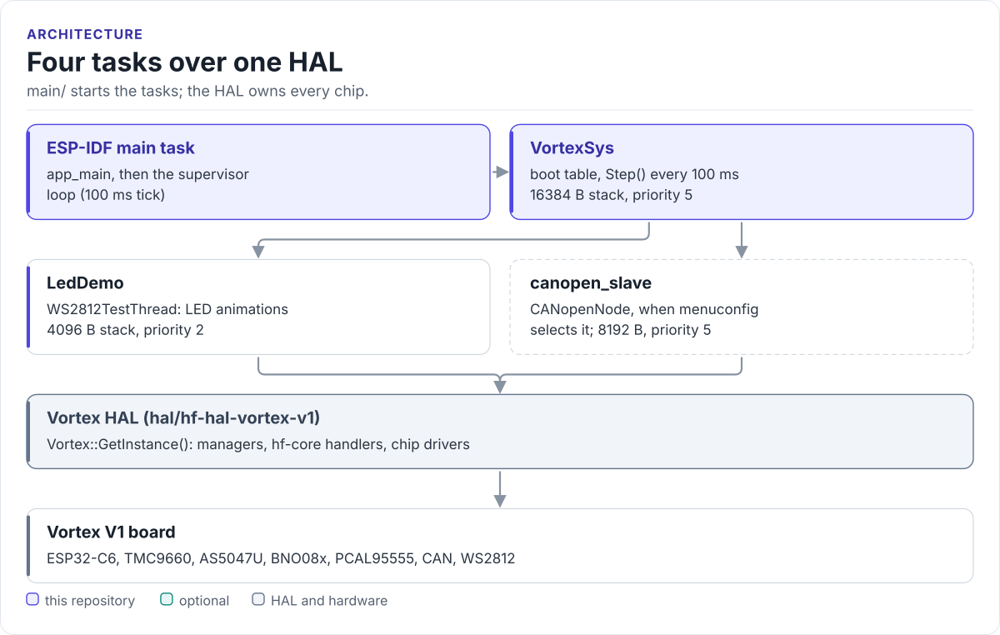

# Figures

<!-- Generated by hardfoc-docs figures from docs/diagrams/figures/*.py. Do not edit by hand. -->

Every figure on this site is drawn by a Python module from facts extracted from the code, so it is rebuilt,
not redrawn, when the code changes. CI runs `hardfoc-docs figures --check` and fails when a
committed figure no longer matches the code. Each figure below lists the files it is drawn from.

## Four tasks over one HAL

<!-- figure: firmware-tasks -->
<picture>
  <source media="(prefers-color-scheme: dark)" srcset="firmware-tasks.dark.svg">
  
</picture>
<!-- /figure -->

Figure module: [`docs/diagrams/figures/firmware-tasks.py`](../../docs/diagrams/figures/firmware-tasks.py)

Drawn from:

- [`main/app_main.cpp`](../../main/app_main.cpp)
- [`main/apps/system/sub_threads/VortexSystemThread.h`](../../main/apps/system/sub_threads/VortexSystemThread.h)
- [`main/apps/system/sub_threads/VortexSystemThread.cpp`](../../main/apps/system/sub_threads/VortexSystemThread.cpp)
- [`main/apps/node/sub_threads/ws2812/WS2812TestThread.h`](../../main/apps/node/sub_threads/ws2812/WS2812TestThread.h)
- [`main/apps/node/canopen/CanopenDevice.cpp`](../../main/apps/node/canopen/CanopenDevice.cpp)
- [`main/apps/node/canopen/CoSvcFreeRtos.cpp`](../../main/apps/node/canopen/CoSvcFreeRtos.cpp)
- [`main/apps/supervisor/VortexSupervisor.cpp`](../../main/apps/supervisor/VortexSupervisor.cpp)
