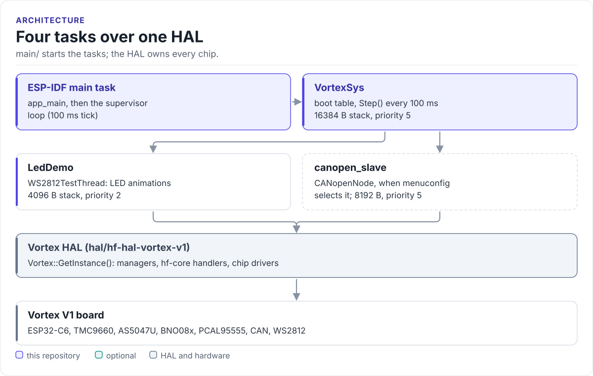

---
hide:
  - navigation
  - toc
---

HardFOC product firmware

# Vortex V1 firmware

The ESP-IDF application for the HardFOC Vortex V1 motor controller: it boots the board through the Vortex HAL,
supervises its health and is becoming a CiA 402 CANopen drive node with one object dictionary as its source.

[Get started](getting-started.md){ .md-button .md-button--primary }
[See the architecture](architecture.md){ .md-button }

## What the device is

Vortex V1 drives one motor. An ESP32-C6 runs this firmware and commands a TMC9660, which closes the current,
velocity and position loops itself. The firmware brings the board up, watches it and exposes it on CAN. Board
wiring, pin maps and the managers live in the [Vortex V1 HAL documentation](https://hardfoc.github.io/hf-hal-vortex-v1/latest/).

Single-axis motor controller
Vortex V1
HardFOC

MCU
:   ESP32-C6 (RISC-V, single-core FreeRTOS); flash configured as 2 MB in `sdkconfig`

Motor controller
:   TMC9660, UART by default or SPI, on-chip FOC loops

Sensors
:   AS5047U angle encoder slot, BNO08x IMU, NTC on TMC9660 AIN3

I/O
:   PCAL95555 expander, CAN (TWAI) port, WS2812 status LED

Firmware
:   ESP-IDF v5.5, C++17, project version `2.0.0` (`CMakeLists.txt`)

Status
:   Bring-up: boot, supervisor and HAL demos run; the CANopen device is being rebuilt to the [design](design/canopen-node.md)

## What you get

- A thin `app_main` and one orchestrator task with an ordered, table-driven boot ([architecture](architecture.md)).
- A fixed set of tasks with known stacks and priorities ([threads](threads.md)).
- A supervisor that checks HAL health every 5 s and never moves the motor on a timer ([safety](safety.md)).
- An optional CANopenNode CiA 301 slave on the CAN port ([CANopen](canopen.md)).
- One YAML object dictionary that generates the CANopenNode tables, the EDS, C++ and Python constants and the
  [object dictionary reference](od-reference.md).
- Host-tested contracts for the CiA 402 state machine, fault policy, frame routing and parameter store
  ([testing](testing.md)).

<!-- figure: firmware-tasks -->
<picture>
  <source media="(prefers-color-scheme: dark)" srcset="diagrams/firmware-tasks.dark.svg">
  
</picture>
<!-- /figure -->

## Where to go next

- :material-rocket-launch-outline: **[Getting started](getting-started.md)**

    Install ESP-IDF v5.5, clone with submodules, build, flash and read the boot log.

- :material-layers-outline: **[Architecture](architecture.md)**

    The layers, the boot table, the system state machine and the supervisor.

- :material-shield-check-outline: **[Safety](safety.md)**

    What protects the drive today and what the CANopen design adds.

- :material-lan: **[CANopen](canopen.md)**

    The slave runtime, the object dictionary and the tools that read it.

- :material-tune-variant: **[Configuration](configuration.md)**

    menuconfig options, `sdkconfig` values and compile definitions.

- :material-file-document-outline: **[Design notes](design/index.md)**

    The CANopen node and drive observability designs.

